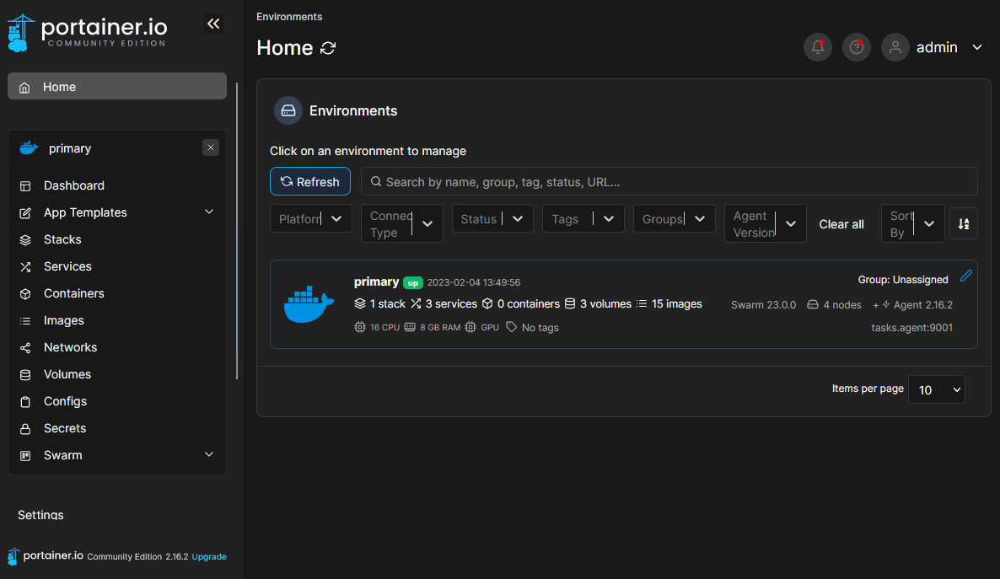
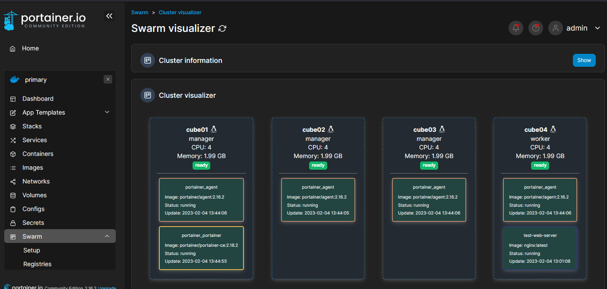

Portainer is an open-source management UI for Docker that allows you to manage containers, images, networks, and volumes from a web interface. It is a lightweight and simple solution for managing Docker resources.

In a Docker Swarm environment, Portainer can be used to manage multiple nodes and monitor the status of containers, services, and tasks in real-time. It provides a centralized interface to manage the swarm, making it easier to monitor, deploy, and manage Docker containers and services.

Additionally, Portainer provides detailed information about resources, such as memory usage and network statistics, which can be useful for troubleshooting and performance optimization.

## Install

**It is important to note** that during the installation process, we encountered a **failure due to the missing folder /var/lib/docker/volumes.** To prevent this issue from occurring in the future, it is recommended to run the following command on every node in your system:

```
mkdir -p /var/lib/docker/volumes
```

**On your main node**:

```
# look for up-to-date manifest link here: https://docs.portainer.io/start/install/server/swarm/linux  
curl -L https://downloads.portainer.io/ce2-16/portainer-agent-stack.yml -o portainer-agent-stack.yml
```

To ensure that the data stored by Portainer remains persistent, we can leverage the GlusterFS that has been deployed and mounted on all of our nodes at the location /mnt/docker-storage. This will allow us to store the data in a centralized and highly available manner, ensuring that it is not lost even in the event of a node failure.

Create folder **on primary node:**

```
mkdir -p /mnt/docker-storage/portainer
```

**Edit** the **portainer-agent-stack.yml**

Down at the bottom, remove:

```
volumes:  
  portainer_data:
```

And in Section services -> portainer -> volumes, change it to:

```
    volumes:  
      - type: bind  
        source: /mnt/docker-storage/portainer  
        target: /data
```

Safe and apply the stack.

```
docker stack deploy -c portainer-agent-stack.yml portainer
```

Wait for the service to be deployed, you can check it with:

```
root@cube01:~# docker service ls  
ID           NAME                  MODE       REPLICAS IMAGE PORTS  
c0mqercgib50 portainer_agent       global     4/4      portainer/agent:2.16.2   
dak8d8jlkbnp portainer_portainer   replicated 1/1      portainer/portainer-ce:2.16.2 *:8000->8000/tcp, *:9000->9000/tcp, *:9443->9443/tcp
```

## Check

You can access Portainersa web-based graphical user interface for managing Docker Swarm, by navigating to the virtual IP address 10.0.0.70 on port 9000. Once you have reached the setup page, you can set your username and password to securely log in. With these credentials, you can manage your Swarm from a convenient and user-friendly web interface. You can also use any IP address of a node in your Swarm instead of the virtual IP address.





## Cleanup

To remove the Portainer stack, you can use command:

```
docker stack rm portainer
```
