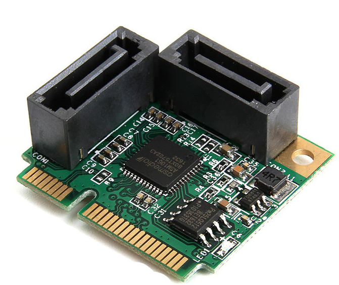

## The Game Plan

Setting up a Kubernetes cluster is a task that requires careful planning and specific goals. Some requirements can be effortlessly met by using the Turing Pi 2 board, while others might need a bit more thought and strategizing.

### The Essentials

A basic Kubernetes cluster requires a handful of elements:

* Processing Power (CPU)
* Memory (RAM)
* Data Storage
  * Persistent storage for applications
* Networking

#### CPU and Memory

It's crucial to ensure that our applications' demands won't exceed a single cluster node's capacity. This means, for instance, if a node in the cluster has 2 GB of RAM, like the Raspberry Pi with 2 GB RAM modules, your applications should not consume more than 2 GB of RAM. Despite Kubernetes' robust features, it can't merge two 2 GB RAM nodes into a single 4 GB RAM cluster. In terms of hardware and application needs, remember that more RAM is generally better than more CPU.

#### Data Storage

Storage is a critical, yet sometimes overlooked, aspect of setting up a Kubernetes cluster. It's particularly vital for applications that need data persistence. If you're running applications requiring data persistence, configuring the right storage is essential. If your applications are stateless and don't need data retention between restarts, then the storage aspect can be neglected.

For our purposes, we have two dependable storage options:

* [Longhorn](https://longhorn.io/docs)
* [NFS plugin](https://github.com/kubernetes-csi/csi-driver-nfs)

While there are other storage solutions, these two have proven to be effective. Longhorn needs at least three nodes with hard drives to set up a storage pool. Using the Raspberry Pi's SD card isn't recommended (though possible). Instead, we can use the onboard SATA connectors and two mini PCIe slots to establish three nodes with SATA SSDs for adequate storage. Mini PCIe to SATA converters can be found on sites like AliExpress.

Alternatively, the simpler solution with less complexity is the NFS plugin. For this, you only need a single disk connected to the onboard SATA connector, and we will assign Node3 as the NFS server. However, keep in mind that this setup has a single point of failure.

#### Networking

Networking within a Kubernetes cluster can be complex, especially when dealing with network plugins (CNI) and other components. However, the foundation network resources can be straightforward, especially with the Turing Pi 2 board, which offers a 1Gbps network connection between each node. Remember, network speed can be a bottleneck when using persistent storage, as applications may need to access a disk on a different node. To ensure effective communication between the nodes, make sure the built-in switch connects to a router, and each node can receive an IP address. This can be done by either directly connecting the Turing Pi 2 to your existing network or using one of the nodes as a router.

### The Desired Outcome

Our goal is to build a 4-node Kubernetes cluster using 4 Raspberry Pi CM modules. The network setup, persistent storage, and a sample application using persistent storage will be established, providing a basic Kubernetes platform for further exploration and development.

Here's the setup schema:

* Node1 - 10.0.0.60 - **Kubernetes controller** and worker node
* Node2 - 10.0.0.61 - Kubernetes worker node
* Node3 - 10.0.0.62 - Kubernetes worker node and **NFS server**
* Node4 - 10.0.0.63 - Kubernetes worker node

Before setting up Kubernetes, ensure to adjust the network settings to match your network's configuration. In the storage section, we will
