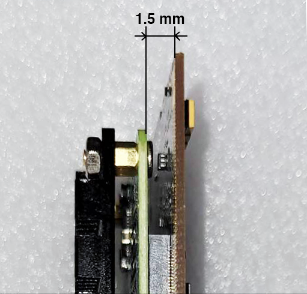
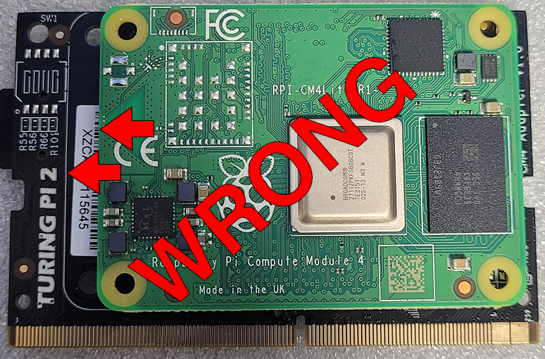
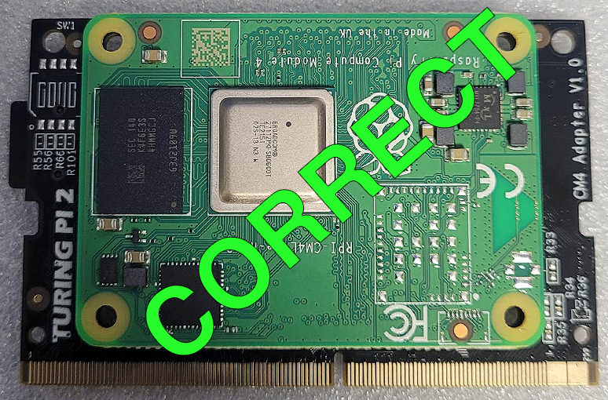
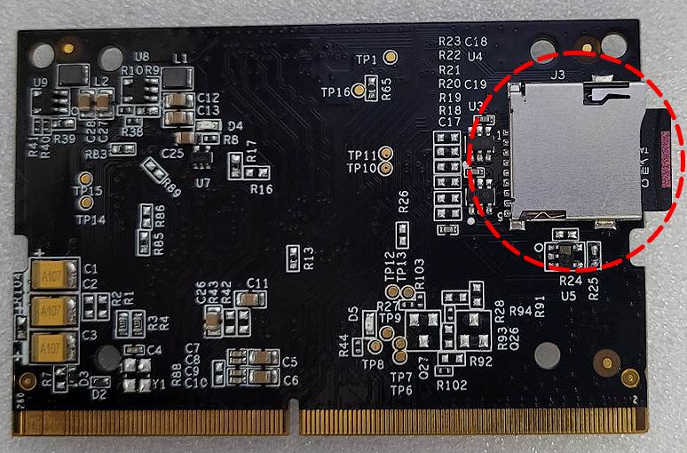

Raspberry Pi Compute Module 4 requires a [CM4 Adapter](https://turingpi.com/product/cm4-adapter/) board to fit into the 260-pin DDR4 slot. These modules securely attach to the 100-pin, high-density connectors on our CM4 adapter board and typically do not require any additional securing. However, if the unit will be used in edge computing or any application subject to high levels of vibration, please ensure the modules are firmly secured to the adapter board. Notably, there is a 1.5 mm gap between the Raspberry Pi module and the Adapter board.

:::caution
Be careful not to mount the Raspberry Pi Compute Module in the wrong direction. There's an outline on the Adapter board, and the module should fit into it properly.
:::

## SD Card

Before you insert Compute Modules, you can also install SD card, although the card is easily accessible from the side even when the modules are inserted. You can install OS on the SD card at this point, however we are going to use BMC to flash the SD cards later on.

