The heatsink kit for the RK1 module consists of a heatsink and 2 thermal pads - one for the RK3588 (SoM) chip and one for the RK806 (power management) chip.

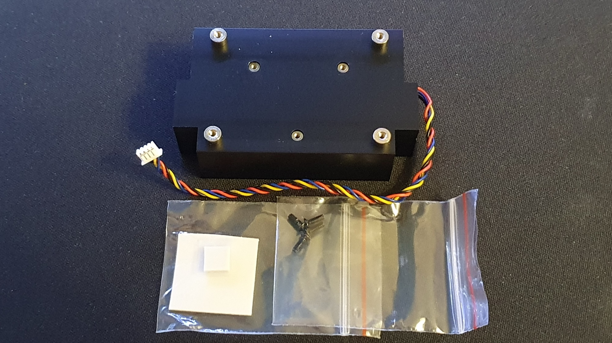

Both thermal pads have protective film on both sides:

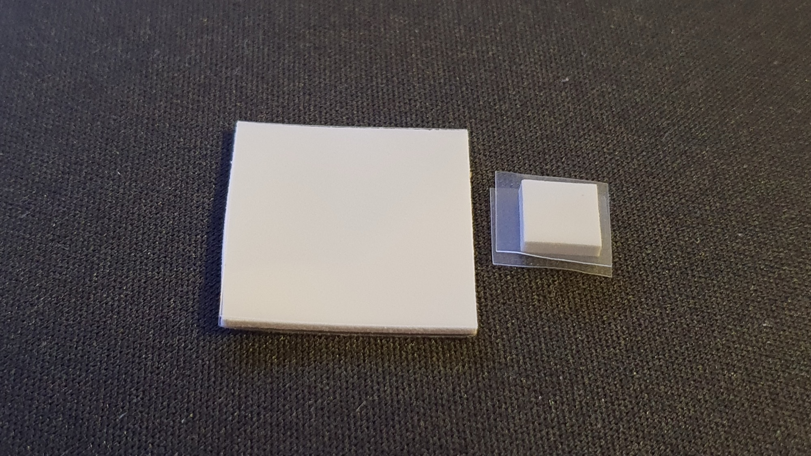

Start with the smaller thermal pad. With pliers remove the protective film from one of the sides:

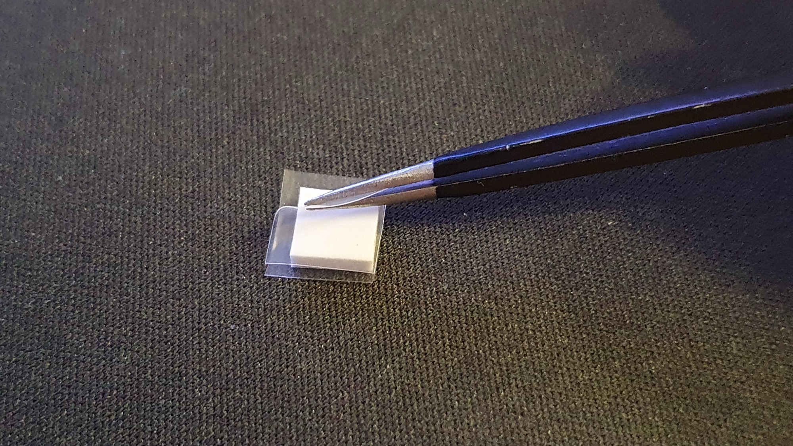

And place on the PM chip that you can locate in the right upper corner of the RK1 chip:

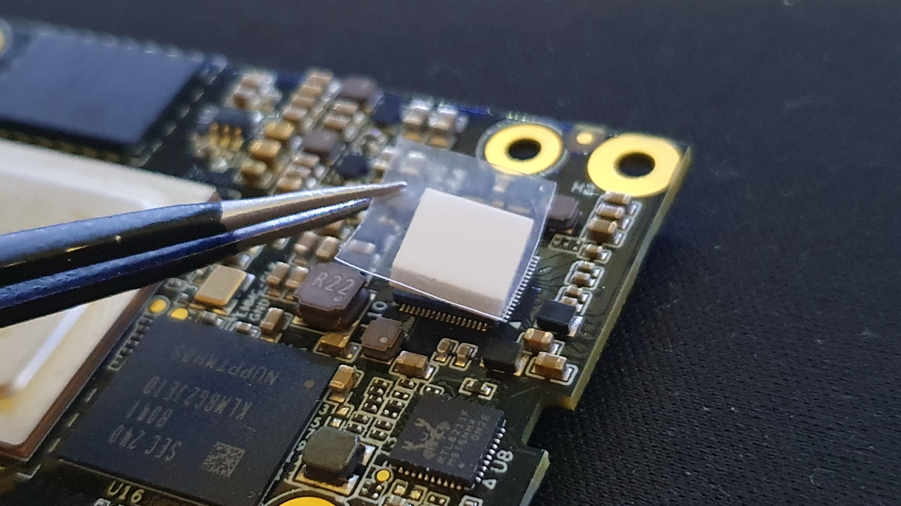

Push it down gently with your finger through the protective film - it's sticky and will "glue" itself to the PM chip letting you remove the other protective film with ease:

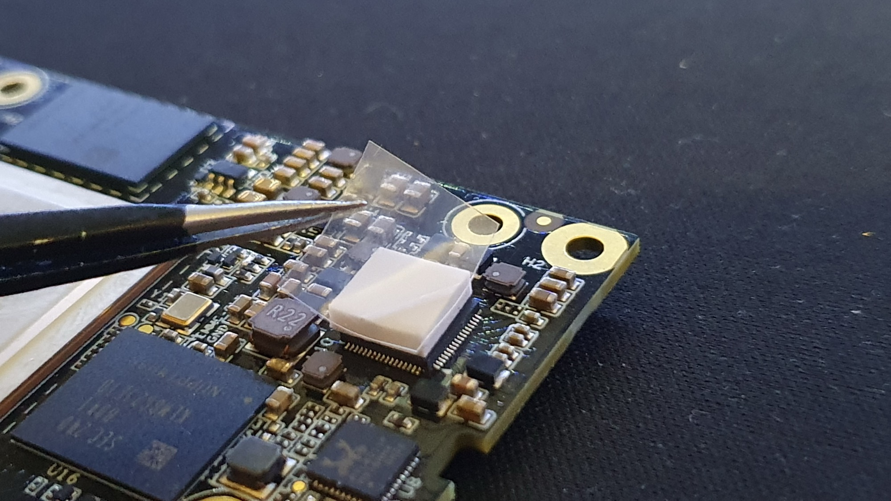

Now repeat the same with the main CPU chip - push pliers inside of the thermal pad and you'll notice the protective film (even if initially you may think it's not there):

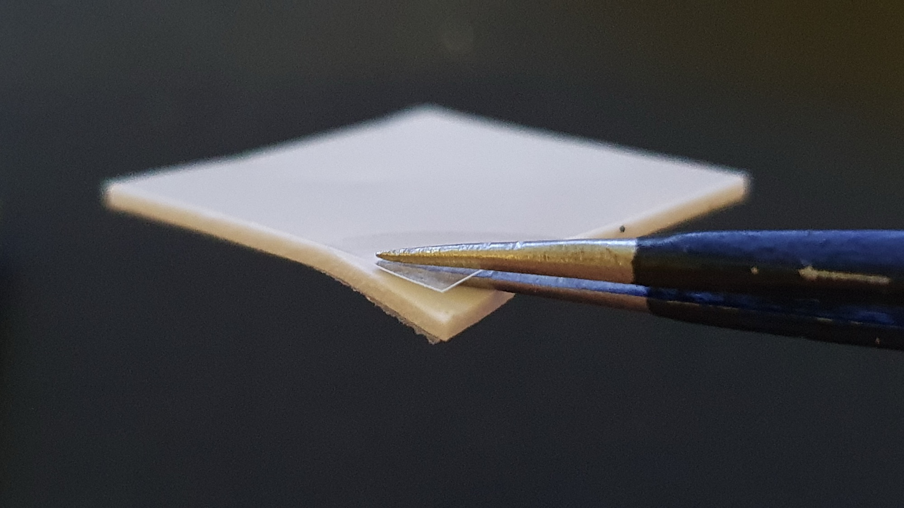

Put it on the CPU and push down with your finger through the protective film on the other side - it's sticky and will "glue" itself to the CPU, then carefully start removing the other protective film:

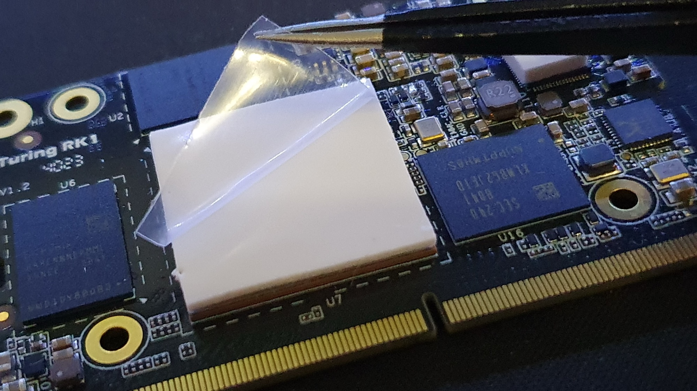

Now place the heatsink in front of you in a way the wire is on the ***left***:

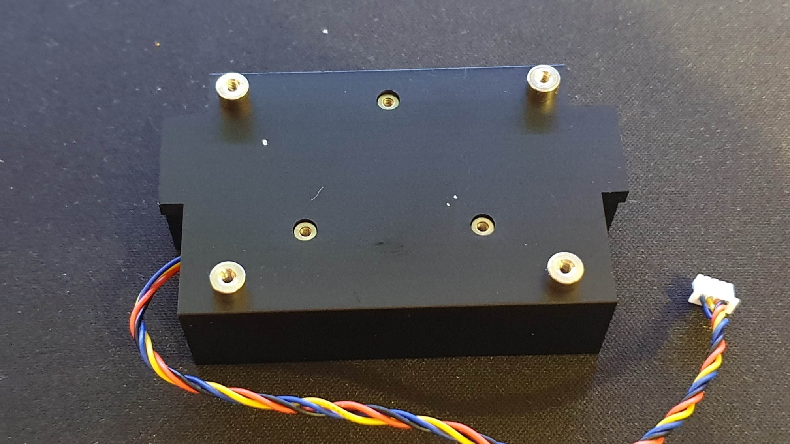

Pick up the module and face the thermal pads down. They will not fall off. Align the holes and put the module down. Try to align the holes as best as you can, the thermal pads are sticky and won't let you move the module on the heatsink:

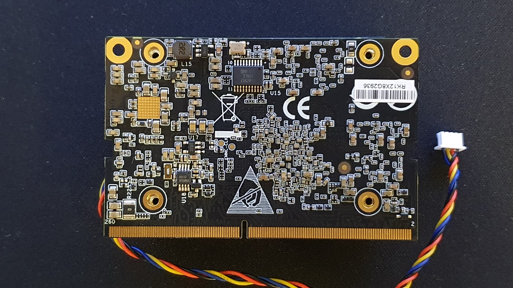

Now put the 4 screws in - the heatsink is mounted:

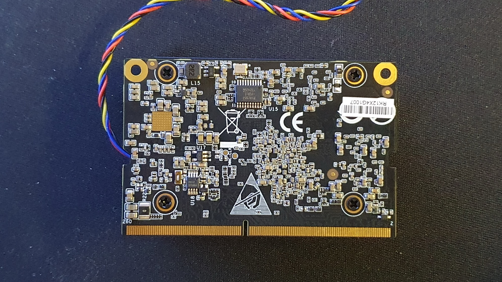

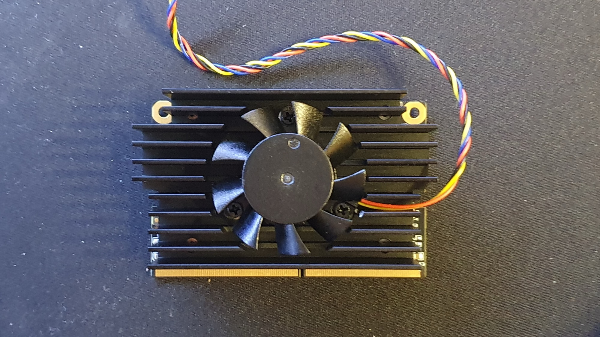
