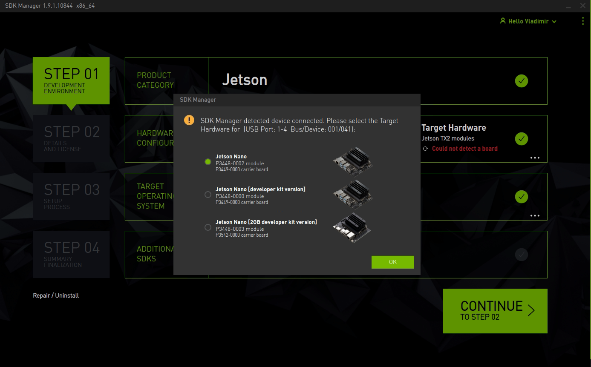
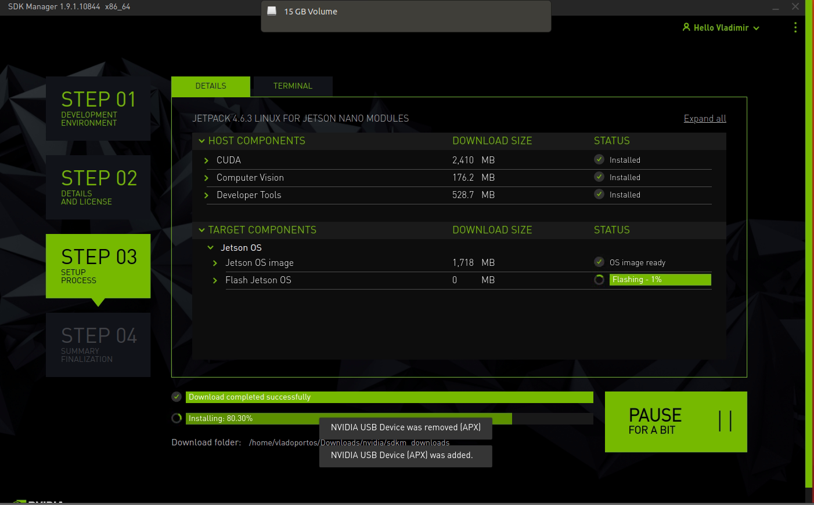

This is a bit more complicated, since Nvidia did not release its flash utility called **sdkmanager** for anything other than Linux (Ubuntu 18) and I could not get it to flash 100% on virtualbox Ubuntu which is also not supported by Nvidia as a flashing method. Therefore, we would recommend using a live USB / CD with Ubuntu 18.04.6 LTS, this should work.

Setting up a virtualized Ubuntu 18 environment in Windows can be done via \[WSL - Windows Subsystem for Linux]\([https://learn.microsoft.com/en-us/windows/wsl/](https://learn.microsoft.com/en-us/windows/wsl/))

Note: Make sure you use Ubuntu 18 or you will have compatibility issues and may not be able to flash your device.

After setting WSL up, you can follow the \[NVIDIA documentation for Flashing Devices via WSL]\([https://docs.nvidia.com/sdk-manager/wsl-systems/index.html](https://docs.nvidia.com/sdk-manager/wsl-systems/index.html))

Make sure to note you will need to \[install a tool to bind the USB to your WSL distribution]\([https://learn.microsoft.com/en-us/windows/wsl/connect-usb#install-the-usbipd-win-project](https://learn.microsoft.com/en-us/windows/wsl/connect-usb#install-the-usbipd-win-project))

You can set up your Turing PI 2 to flash the = Jetson Nano with the following commands from BMC:

```shell
tpi power off
tpi usb -n 2 flash
tpi power -n 2 on
```

This assumes that your Jetson is in slot Node2 you can then install and run sdkmanager according to [Nvidia Documentation](https://docs.nvidia.com/sdk-manager/download-run-sdkm/index.html).

Once logged in to SDK Manager, it should detect the module:

You should be able to continue with flashing the OS according to the documentation.






