## ISO Image

To install Ubuntu 20.04 LTS, first, download the [installation ISO file](https://releases.ubuntu.com/focal/ubuntu-20.04.6-desktop-amd64.iso).

## Bare-metal installation

If you are installing it on the PC/laptop directly, you can use these guides to prepare a bootable Pendrive:

* Windows: [https://ubuntu.com/tutorials/create-a-usb-stick-on-windows#1-overview](https://ubuntu.com/tutorials/create-a-usb-stick-on-windows#1-overview)
* Ubuntu: [https://ubuntu.com/tutorials/create-a-usb-stick-on-ubuntu#1-overview](https://ubuntu.com/tutorials/create-a-usb-stick-on-ubuntu#1-overview)
* MacOS: [https://ubuntu.com/tutorials/create-a-usb-stick-on-macos#1-overview](https://ubuntu.com/tutorials/create-a-usb-stick-on-macos#1-overview)

Boot your PC/laptop from the pen drive.

## Virtual Machine using VMWare Player

If you are using VMWare Player to install Ubuntu 20.04 LTS and you haven't already set the ISO image, run the VMWare Player, right-click on your Ubuntu virtual machine, and click "Settings". Click on the CD/DVD device, check it's connected, and browse for the downloaded Ubuntu ISO image:

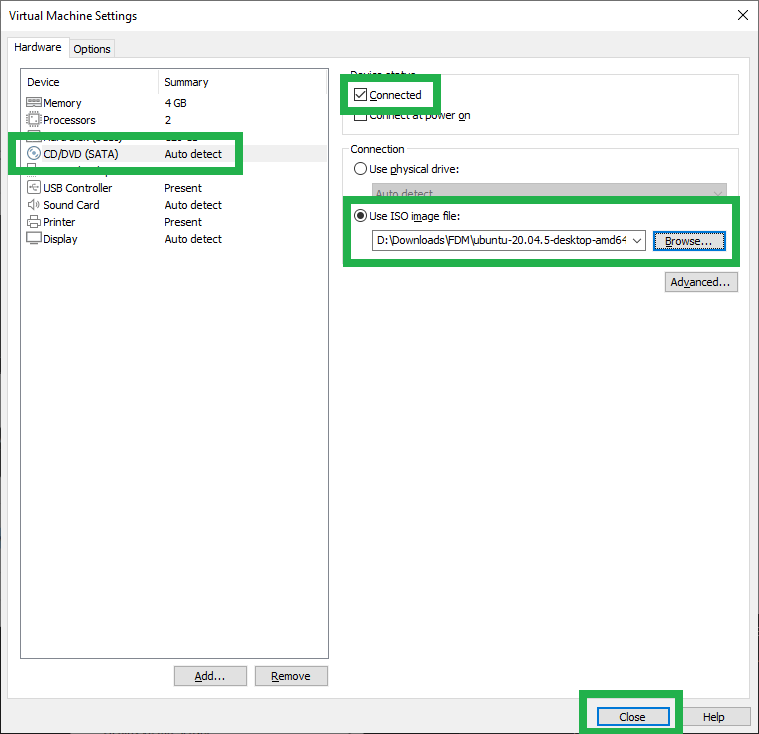

Click on "Close" and power on the virtual machine and wait for it to load the Ubuntu installation.

## Installing Ubuntu 20.04 LTS

Installing Ubuntu 20.04 is pretty straightforward. On most of the screens, the default settings would be enough. Start with clicking on "Install ubuntu":

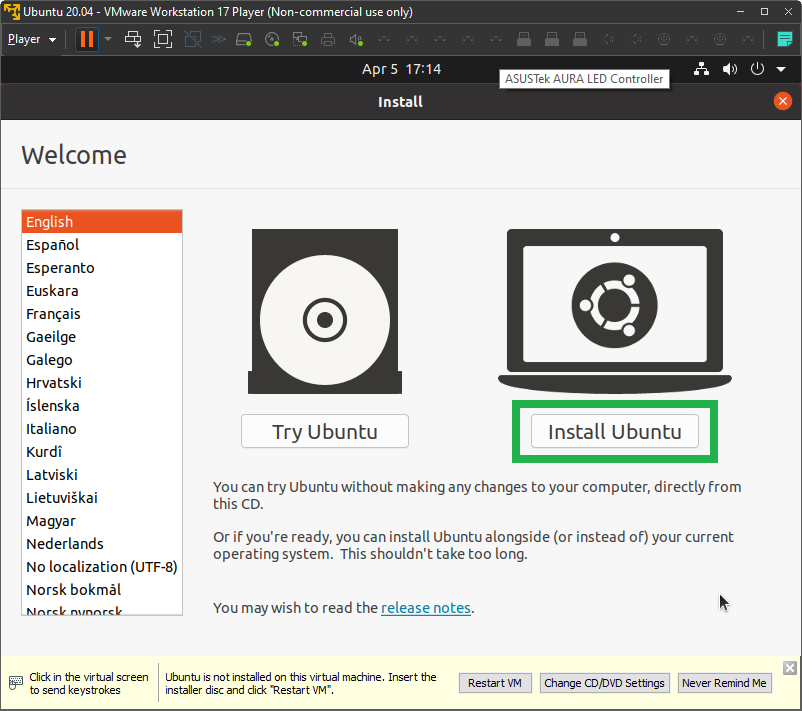

Choose your keyboard layout

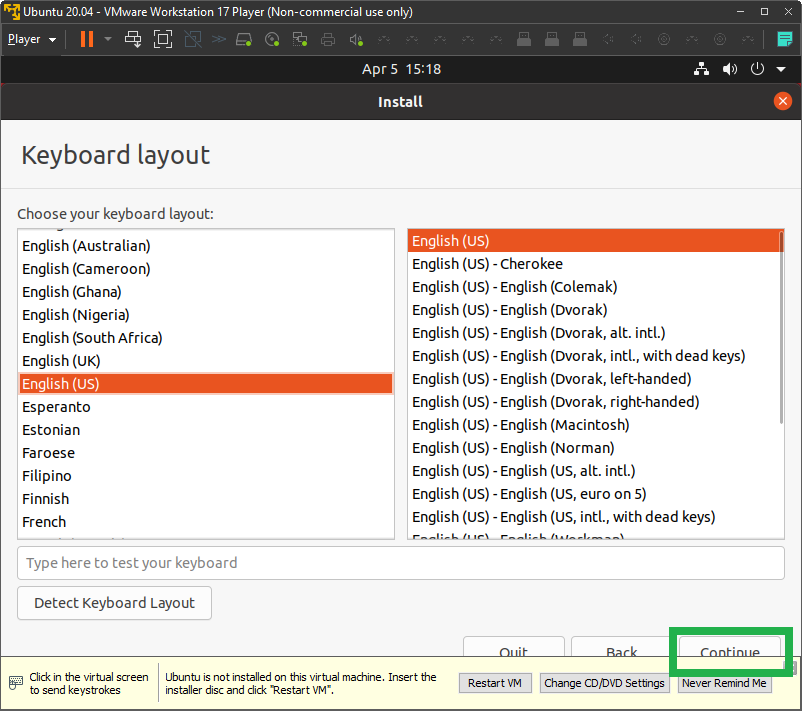

We only need the minimal installation:

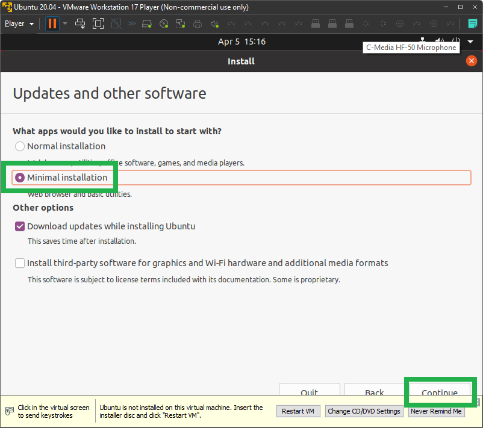

Choose to erase the disk - it won;t erase any of your disks, just a virtual disk created for this virtual machine:

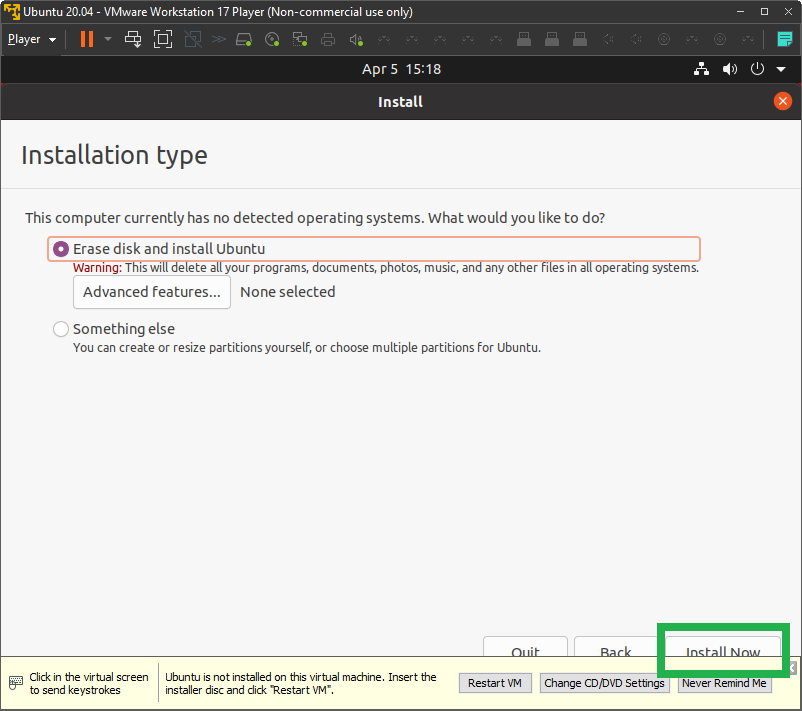

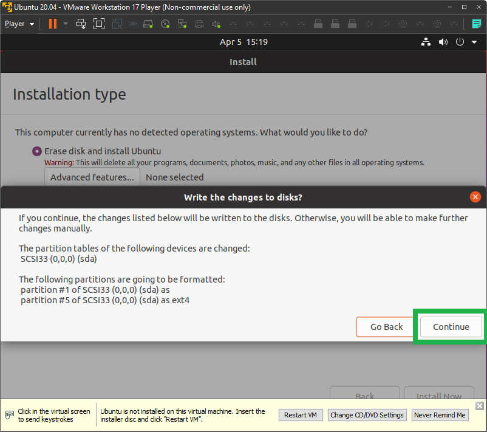

Choose your timezone:

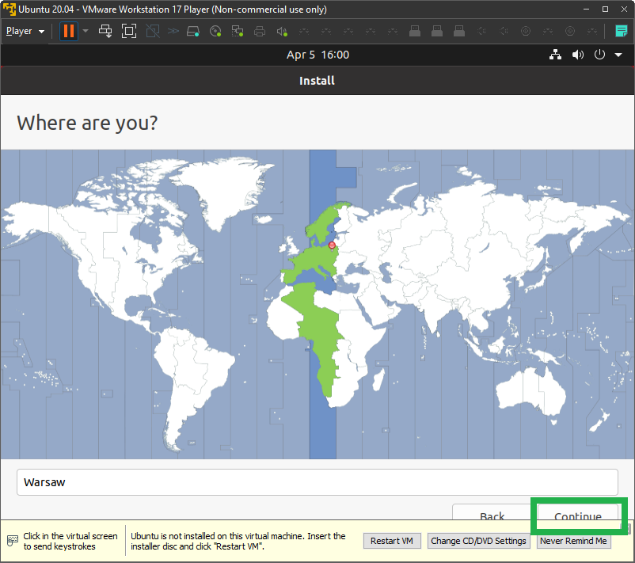

Set your name, the computer name (not important), and set the password. Setting the OS to log in automatically is handy and recommended, but not necessary:

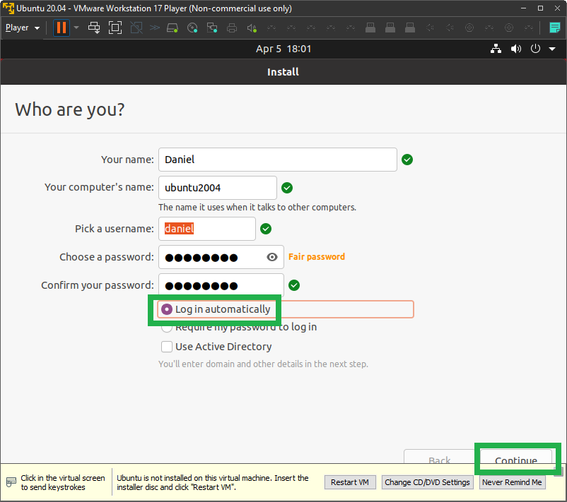

Ubuntu will now get installed what's going to take a few minutes:

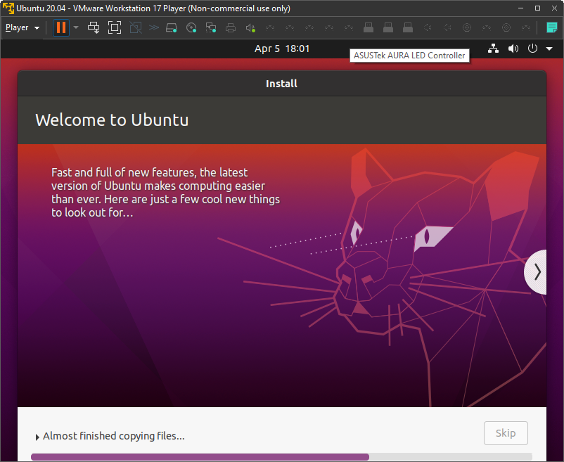

After the installation is finished - restart the virtual machine:

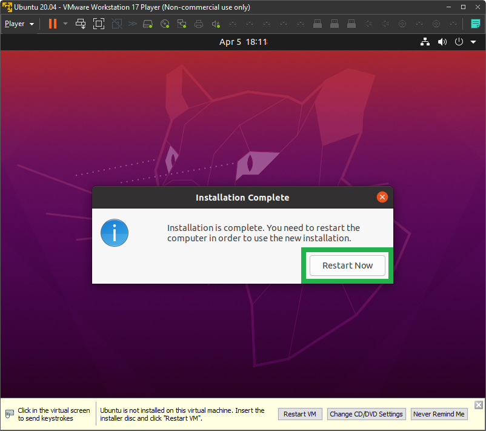

When asked to remove the installation media either disconnect the pendrive if you are using bare-metal installation or disconnect CD/DVD device in case of using a virtual machine:

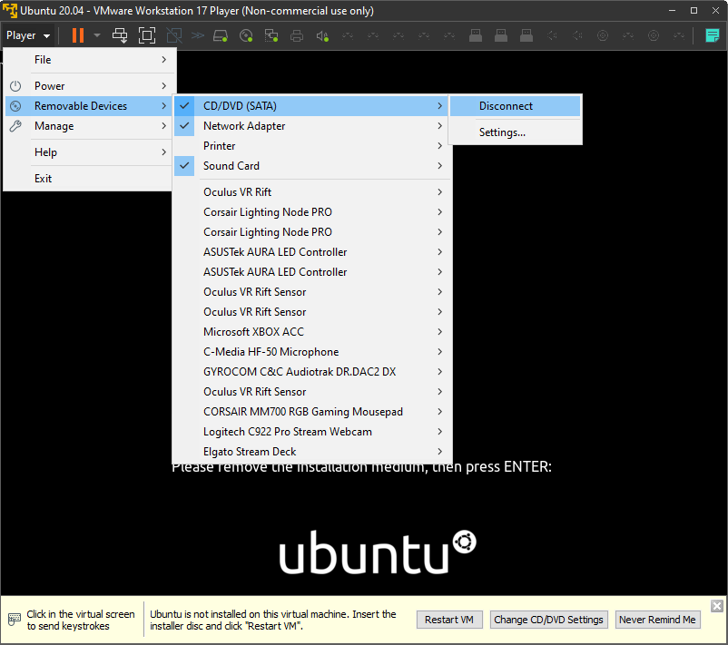

You can skip this step if you do not want to connect any of your accounts:

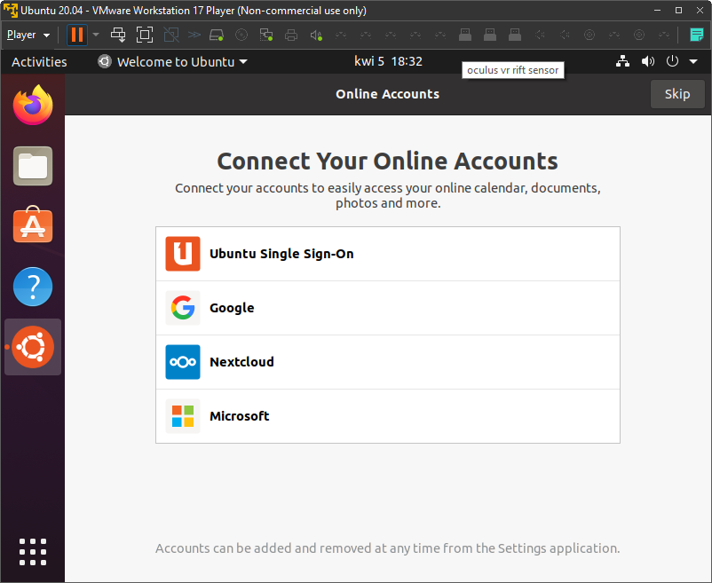

Click on "Next":

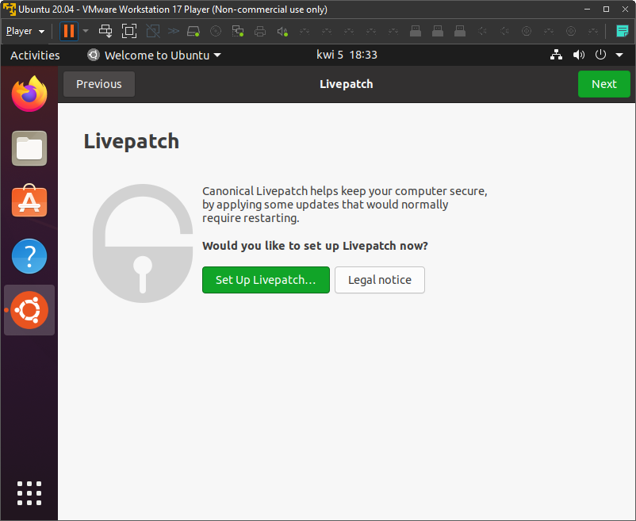

If you do not want the usage data to be sent to Canonical, check the option to not do so. Click on "Next":

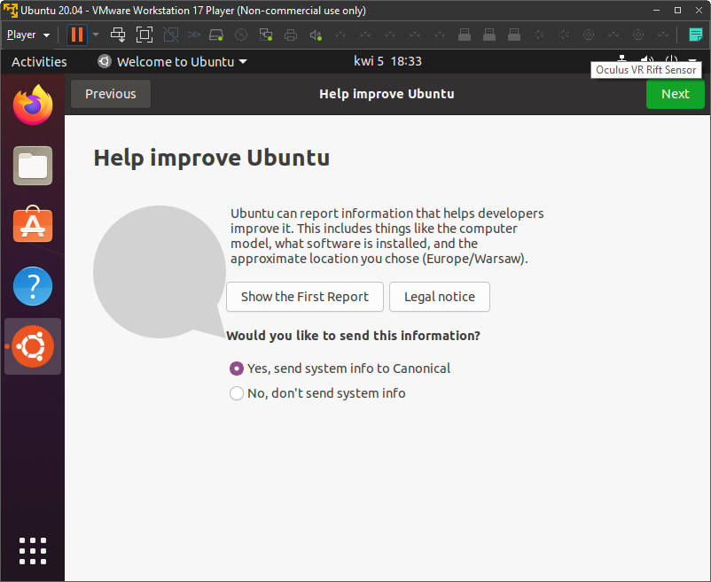

And click on "Next" again:

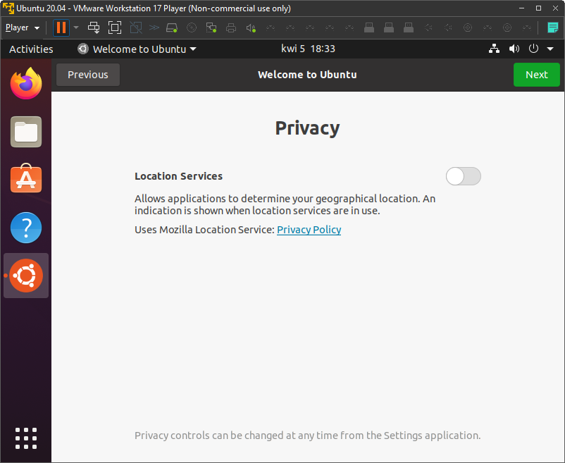

Click on "Done":

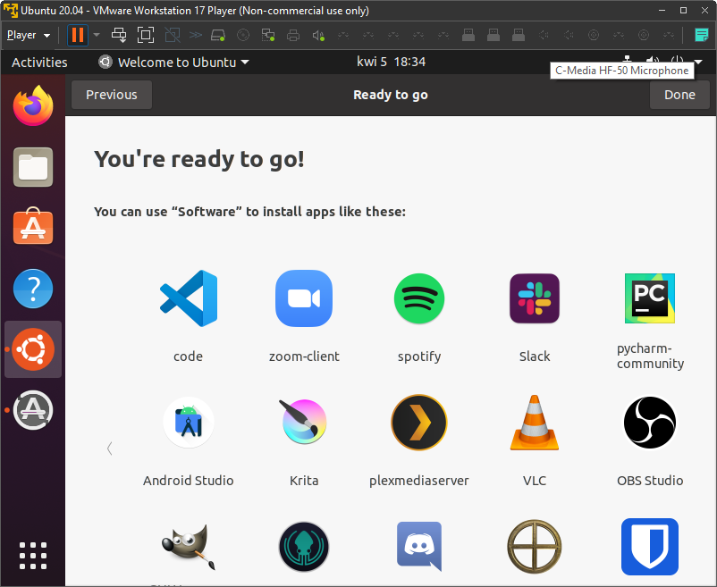

If there's an upgrade available, you can skip it for now:

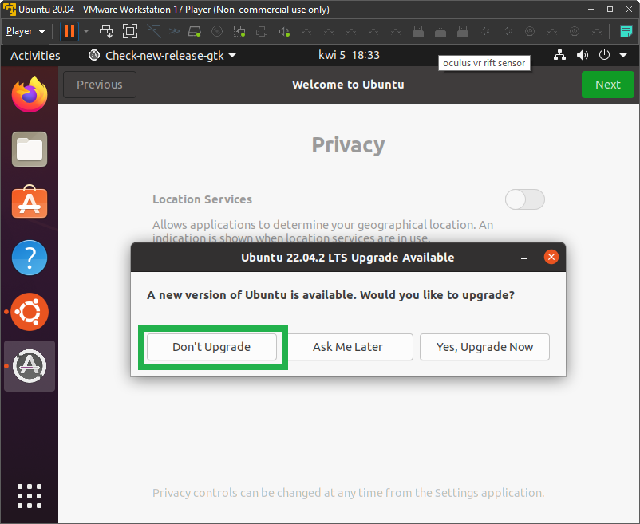
