## Installation

To be able to flash the Orin modules, you need Ubuntu 20.04 LTS operating system. If you do not have a PC or laptop running this exact version of Ubuntu, you can use a virtual machine. We tested VMWare Player that runs both on Windows and Linux, but other virtualization software that lets you pass the USB device into the VM should work too.

Download the [VMWare Player](https://www.vmware.com/go/getplayer-win) for your operating system and install it with the default options.

## USB settings

While not necessary, it is recommended to set the USB to connect to the virtual machine by default (otherwise you'll have to react to the dialog boxes popping in asking you what to do with a new USB device, and the flashing process will cause the USB device to disconnect and connect again multiple times and even change the USB device at some point):

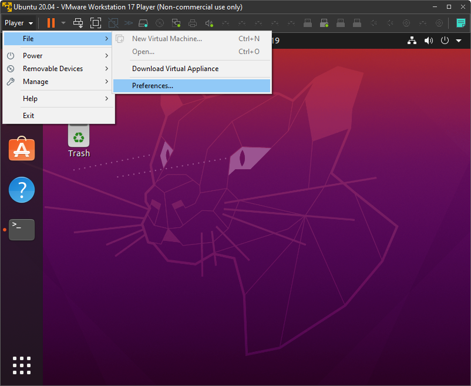

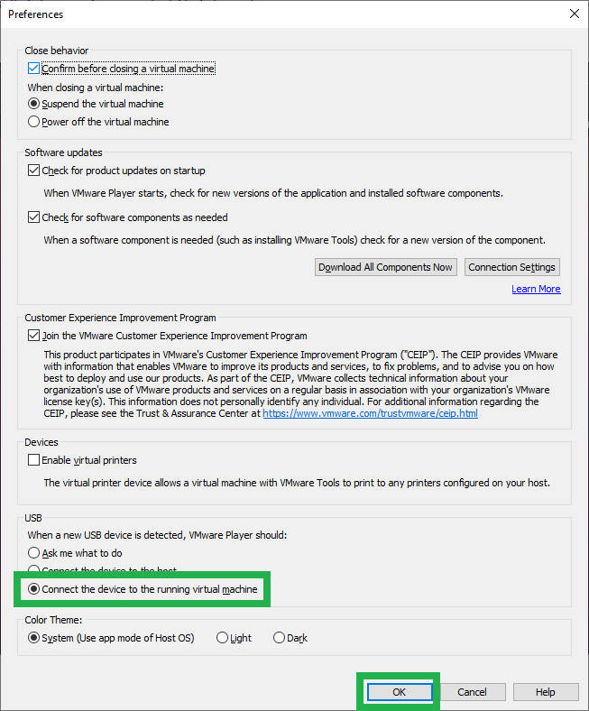

## Virtual Machine Creation

Now you can create a virtual machine that we'll use to install the required operating system. Start with creating a virtual machine:

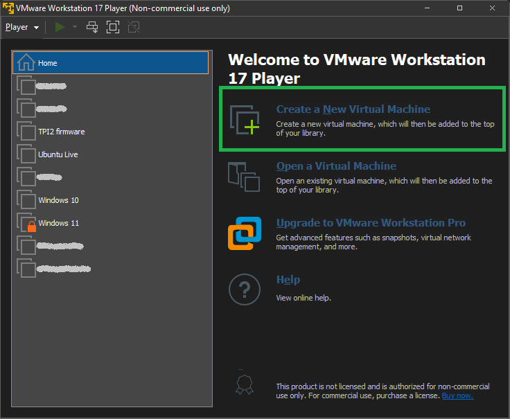

Check that you'll install the operating system later:

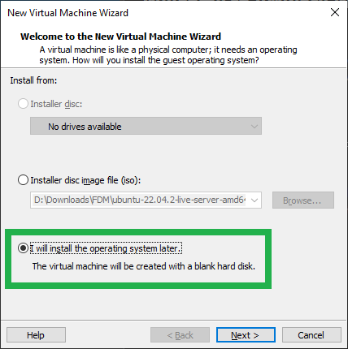

Choose Ubuntu as the operating system:

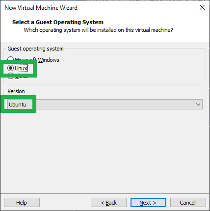

Name your virtual machine and set where you are going to store its files (up to about 60 GB):

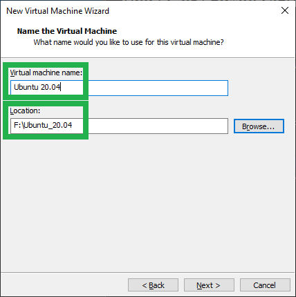

Choose the disk size. 120 GB ensures the will be enough space:

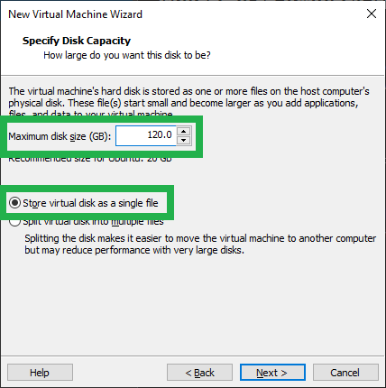

We need to set some hardware customization:

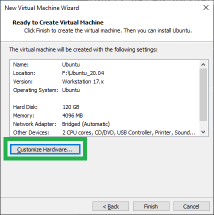

Set the network type from NAT to Bridged and click on the "Configure Adapters":

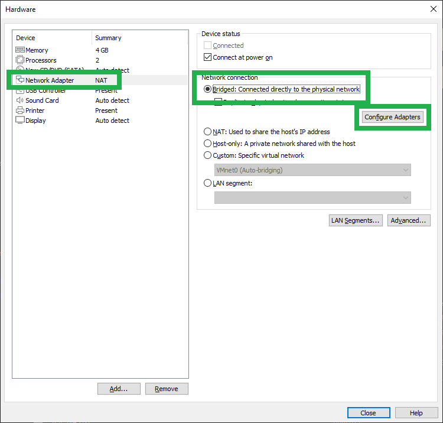

Make sure only your main network card (either LAN or WiFi) is checked here and click "OK":

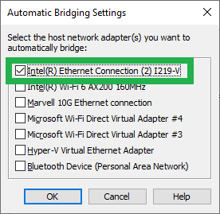

This step can be performed later, but if you have an operating system ISO image already downloaded, you can set it here already:

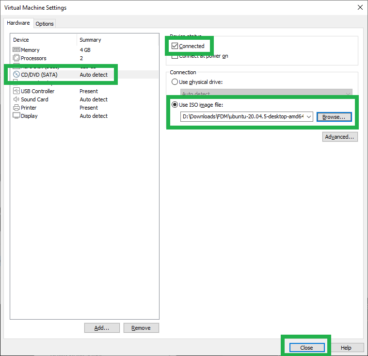

And that's all:

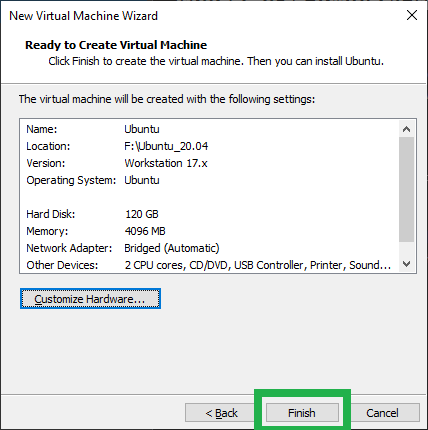

Now you should see your new virtual machine created. You can run it by double-clicking on its name or by clicking the name and clicking on the "Play virtual machine" on the right:

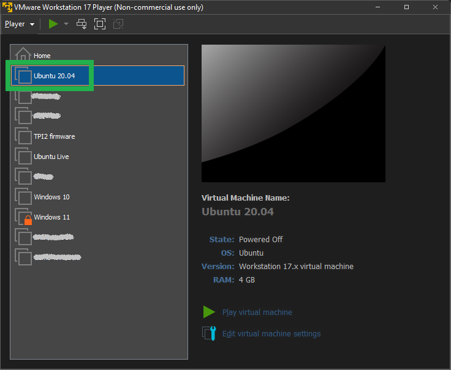
