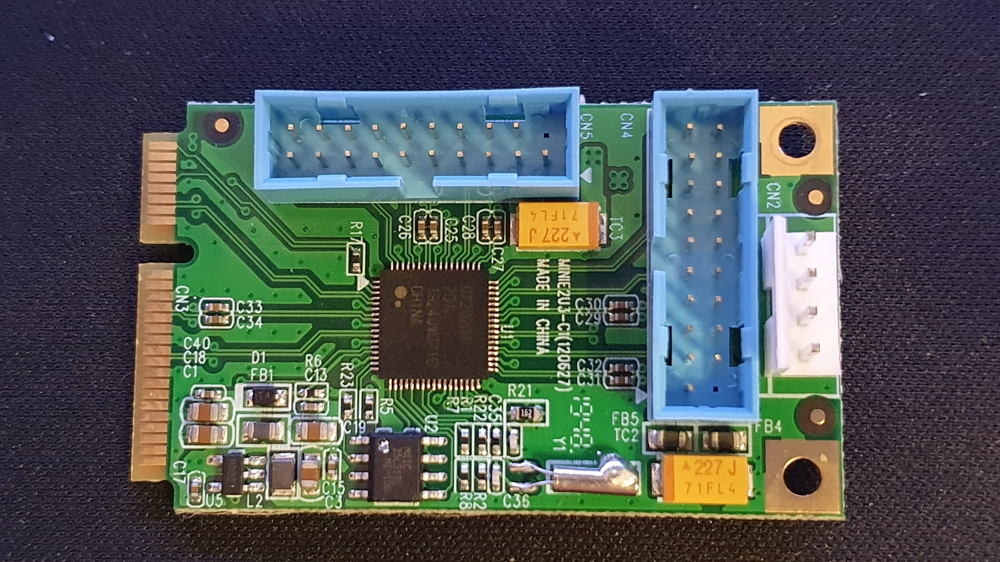
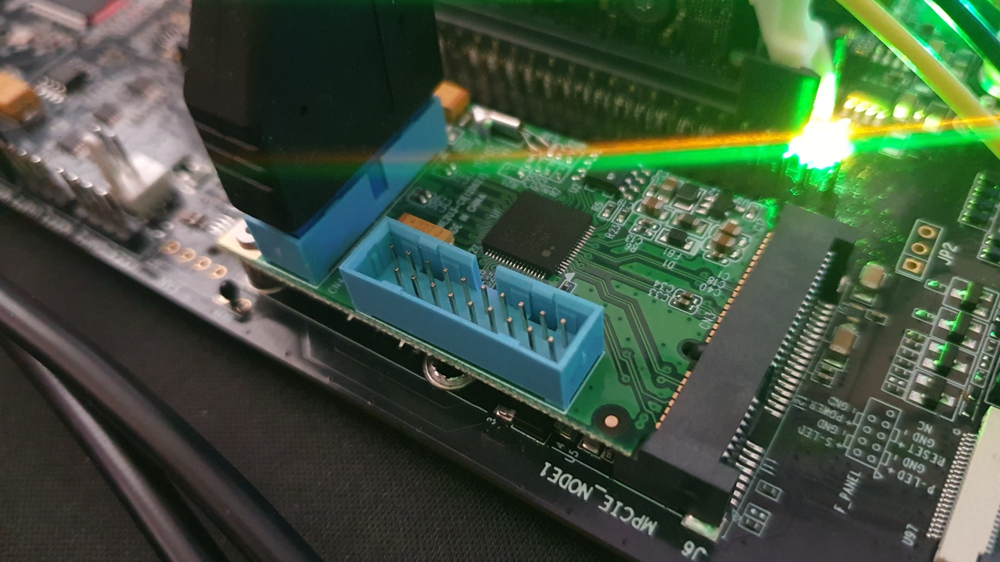
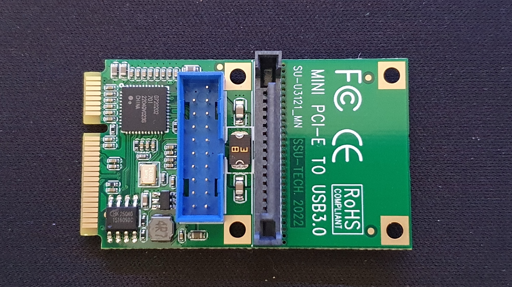

## Orin NX/Nano

### USB Keyboard and Mouse

During the flashing process, if you prefer to use non-headless mode, you'll need to attach the screen as well as the keyboard and mouse. The Jetson modules cannot put their USB controller (the same also used for flashing purposes) into the host mode, this function only works on the Raspberry Pi Compute Module 4s. This means we cannot use the USB 2.0 port mounted on the back for the keyboard and mouse and an additional USB controller is necessary.

For the USB ports, I personally used an [Inline 66905 Mini-PCIe USB3 controller](https://www.amazon.com/Inline-66905-Mini-PCIe-Card-USB/dp/B00N2ACIG4?&_encoding=UTF8\&tag=turingpi-20\&linkCode=ur2\&linkId=b8c8c5d0b76df2de141f4c1c1d25c8ac\&camp=1789\&creative=9325) based on the `Renesas D720201` chip - it works out of the box:

You do not have to buy this exact model. Any controller based on `Renesas D720201` or `Renesas D720202` should work out of the box. One thing to keep in mind is that the Turing Pi 2 board has the Mini PCIe standoffs soldered-in and the above card requires desoldering of the middle (half-size card) standoff to put it in safely. Additionally, the card pictured above uses a Molex power connector, and additional SATA power to the Molex power adapter is necessary.

Another option can be a half-sized USB controller card like [this one](https://www.amazon.com/-/he/WEYI45ampw278f/dp/B0B5YMSLNG?&_encoding=UTF8\&tag=turingpi-20\&linkCode=ur2\&linkId=467d9cec6c4e2e085f5d3b212295c4f1\&camp=1789\&creative=9325):

It comes with a mounting hole layout that contains half-sized card standoffs and has a SATA power connector, but does contain only a single USB connector (which expands up to 2 ports) and does not contain the USB cable (you need to buy a USB 3.0 header to USB-A cable additionally).
