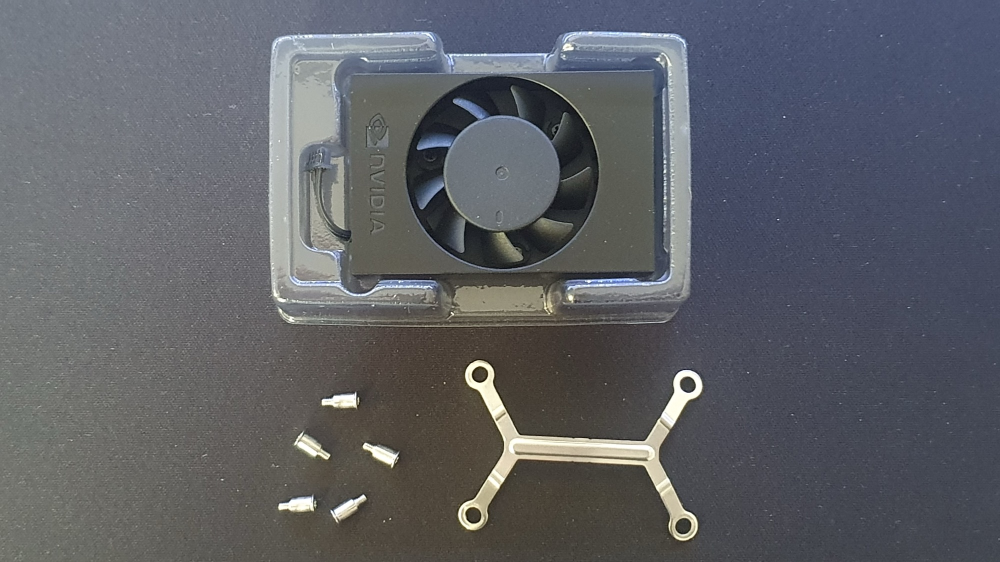
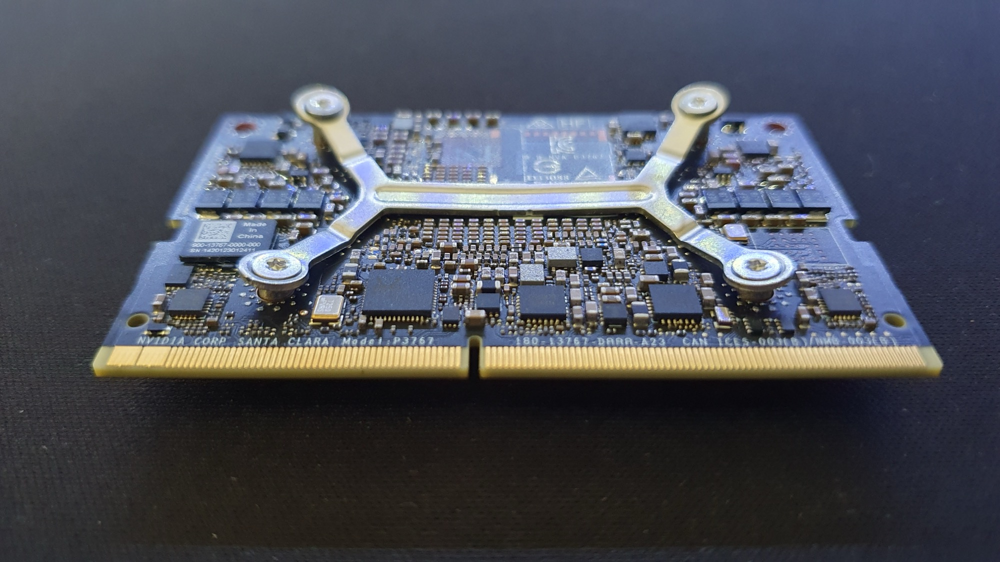
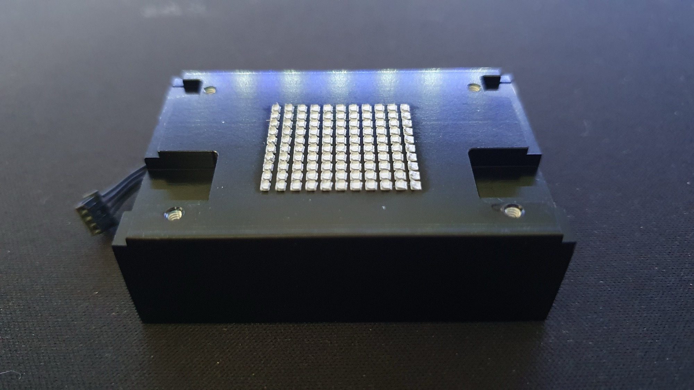
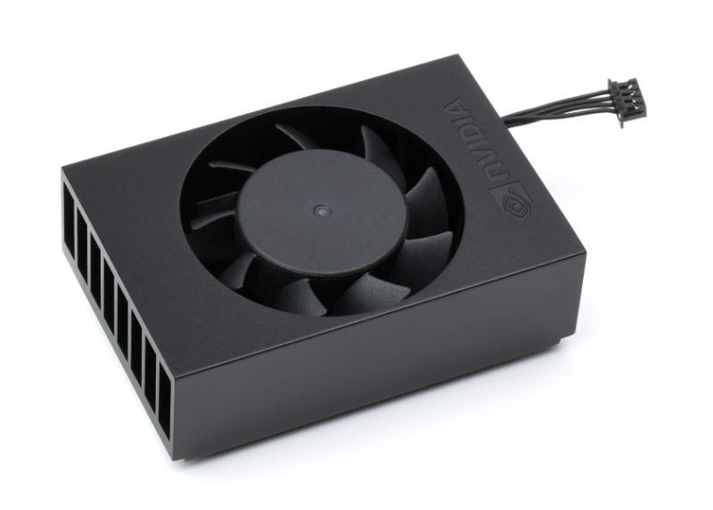
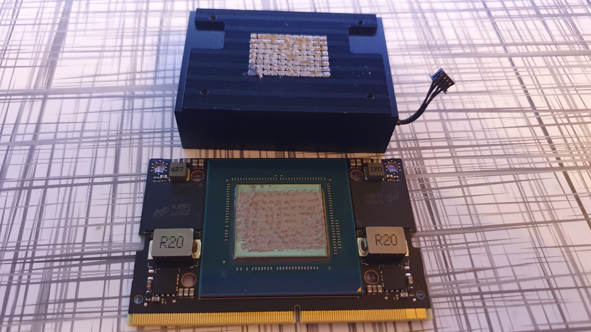
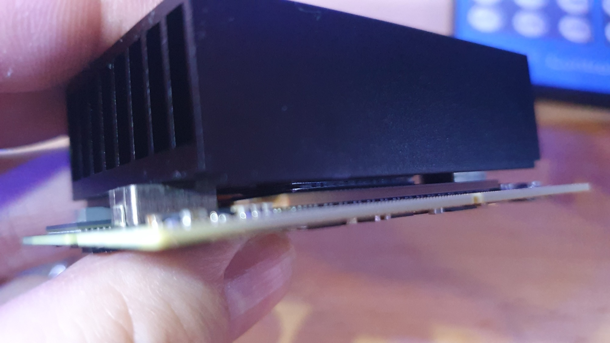
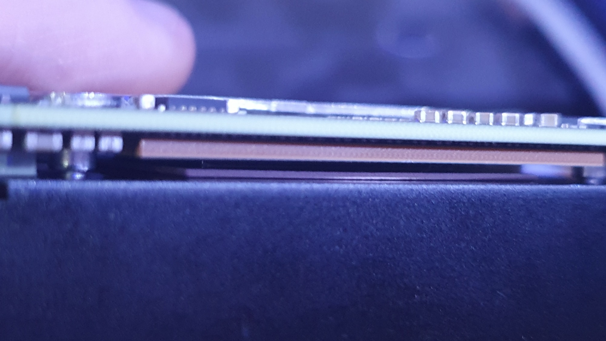

## Orin NX/Nano

### Official heatsink

`Orin NX` and `Orin Nano` modules do not contain any heatsink. The exception is the `Orin Nano Developer Kit` which contains both the heatsink and the reference carrier board. With the amount of heat generated by these modules, a heatsink is required to keep the module cool and not thermal-throttle.

The official heatsink can be bought in multiple places (please comment below if you found it in any other places):

* `Siliconhighway`: [https://www.siliconhighwaydirect.com/product-p/095-0181-000.htm](https://www.siliconhighwaydirect.com/product-p/095-0181-000.htm)
* `Waveshare`: [https://www.waveshare.com/orin-fan-pwm.htm](https://www.waveshare.com/orin-fan-pwm.htm)
* `Waveshare via Amazon`: [https://www.amazon.com/dp/B0C1TYVDTF](https://www.amazon.com/waveshare-Official-Cooling-Speed-Adjustable-Compatible/dp/B0C1TYVDTF/ref=sr_1_3?crid=R9WM1AWGM8QF\&keywords=waveshare+orin+heatsink\&qid=1689274257\&refresh=1\&sprefix=waveshare+orin+heatsink%252Caps%252C162\&sr=8-3&_encoding=UTF8\&tag=turingpi-20\&linkCode=ur2\&linkId=9938b8814cf2b20a7ead8027a2e33d2c\&camp=1789\&creative=9325)

To mount the heatsink on the module, put the bracket on the back side in a way the bracket arms bend away from the board and put the screws in:

Now put the heatsink on the table with the fan facing down:

Avoid touching the thermal paste. Now move the module above the heatsink and try to match the screws with the holes. Screw each corner for a few rotations to start and start tightening the screws up by a few rotations at the time each up until the screws stop rotating.

### Xavier NX heatsink

Before the official Orin heatsink was available, I bought a [Waveshare NX-FAN-PWM heatsink](https://www.amazon.com/waveshare-Official-Cooling-Speed-Adjustable-Compatible/dp/B0C1TYVDTF/ref=sr_1_3?crid=R9WM1AWGM8QF\&keywords=waveshare+orin+heatsink\&qid=1689274257\&refresh=1\&sprefix=waveshare+orin+heatsink%252Caps%252C162\&sr=8-3&_encoding=UTF8\&tag=turingpi-20\&linkCode=ur2\&linkId=9938b8814cf2b20a7ead8027a2e33d2c\&camp=1789\&creative=9325) which requires a bit of creativity to put it in. If you cannot buy the official heatsink or you have a spare from the Xavier NX, this is also a viable option.

While the mounting hole layout and the bracket are the same, the height of the elements on the boards are slightly different between Xavier NX and Orin NX, causing the Orin NX CPU/GPU core not to touch the heatsink - you can see how the core is being reflected on the heatsink surface and the gap is clearly visible:

I used the solution to remove the thermal paste and use a 0.5mm thick thermal pad. To make the heat conductivity decent, I used `Thermopad Thermal Grizzly Minus Pad 8 (30 × 30 × 0,5 mm)`:

The thing to remember is the screws are not going to screw all the way in. Put the pad between the CPU/GPU core and the heatsink and screw in all of the screws so the 4 square coils touch the heatsink.

I tested this solution under heavy CPU and GPU loads and the results were very good.
