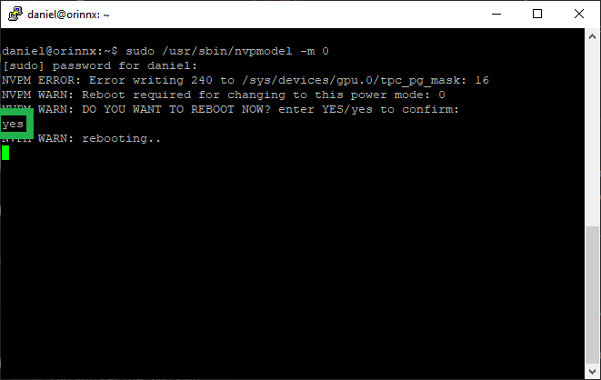
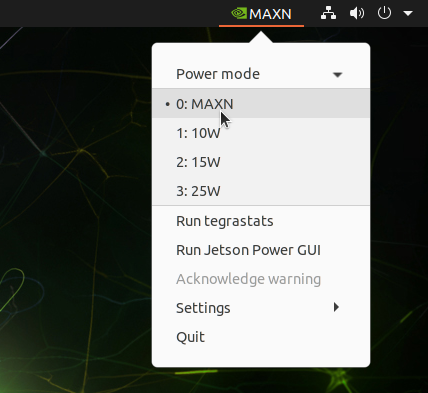
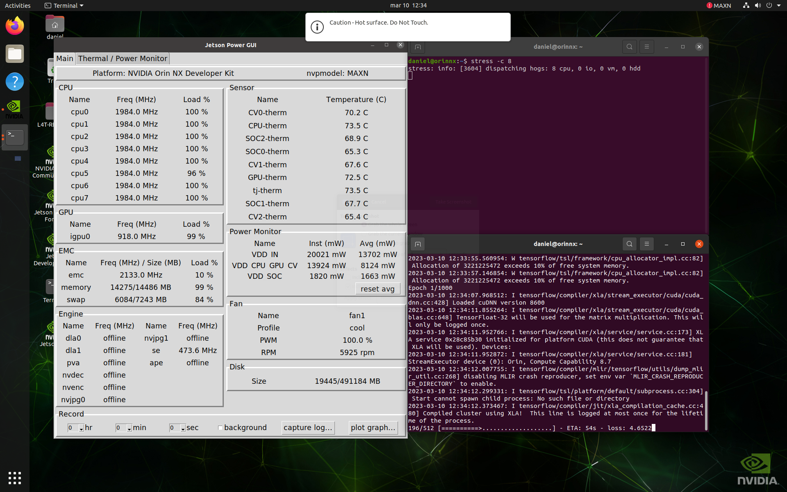

## Orin NX/Nano

### Configuration

#### FAN Profile

While the default fan profile is "quiet", for more demanding machine learning and other computation tasks it might be better to change the fan profile to "cool", which is also pretty quiet,

To change the profile to "cool":

```shell
sudo sed -i 's/FAN_DEFAULT_PROFILE .*/FAN_DEFAULT_PROFILE cool/g' /etc/nvfancontrol.conf
```

To change the profile to "quiet":

```shell
sudo sed -i 's/FAN_DEFAULT_PROFILE .*/FAN_DEFAULT_PROFILE quiet/g' /etc/nvfancontrol.conf
```

After any of the above, invoke:

```shell
sudo rm /var/lib/nvfancontrol/status  
sudo systemctl restart nvfancontrol
```

#### Power Mode

Depending on the module model, your module might not be configured to use it's whole potential. We list all the power modes for all of the Orin modules and the default mode. Make sure to check (with the commands below) if you module is running at the power mode of your choice.

**Defaults:**

`Jetson Orin Nano 4GB`:

0: 10W\
1: 7W\_AI\
2: 7W\_CPU

default mode: `0`

`Jetson Orin Nano 8GB`:

0: 15W\
1: 7W

default mode: `0`

`Jetson Orin NX 8 GB`:

0: MAXN (best)\
1: 10W\
2: 15W\
3: 20W

default mode: `2`

`Jetson Orin NX 16 GB`:

0: MAXN (best)\
1: 10W\
2: 15W\
3: 25W

default mode: `2`

To check the current power mode:

```shell
sudo /usr/sbin/nvpmodel -q
```

To set a new mode:

```shell
sudo /usr/sbin/nvpmodel -m <x>
```

Where `<x>` is the power mode ID (i.e. 0, 1, 2 or 3).

Example command execution:

```
sudo /usr/sbin/nvpmodel -m 0
```



The same setting can be changed using GUI:



#### Jetpack

As mentioned before, this flashing method does not provide Jetpack. It's time to install it.

To install Jetpack, let's first update the Orin module operating system:

```shell
sudo apt update  
sudo apt -y upgrade  
sudo apt -y dist-upgrade  
sudo apt install --fix-broken -o Dpkg::Options::="--force-overwrite"  
sudo reboot
```

Then install the Jetpack:

```shell
sudo apt -y install nvidia-jetpack  
sudo reboot
```

#### Machine Learning

Tensorflow and PyTorch instalaltion for the Orin modules

**Prerequisites:**

```shell
sudo apt -y install autoconf bc build-essential g++-8 gcc-8 clang-8 lld-8 gettext-base gfortran-8 iputils-ping libbz2-dev libc++-dev libcgal-dev libffi-dev libfreetype6-dev libhdf5-dev libjpeg-dev liblzma-dev libncurses5-dev libncursesw5-dev libpng-dev libreadline-dev libssl-dev libsqlite3-dev libxml2-dev libxslt-dev locales moreutils openssl python-openssl rsync scons python3-pip libopenblas-dev curl wget
```

**Tensorflow:**

```shell
export REPO_URL=https://developer.download.nvidia.cn/compute/redist/jp/  
export JETPACK_VERSION=$(curl -s $REPO_URL | grep -oP 'v\K[0-9]+(?=/)' | sed 's/./&\./g' | rev | cut -c2- | rev | sort -V | sed 's/\.//g' | tail -n 1)  
export JETPACK_VERSION=$(sudo apt-cache show nvidia-jetpack | grep "Version" | grep -oP '(?<=: ).*?(?=-)' | tr -d '.')  
export TENSORFLOW_REPO_URL=https://developer.download.nvidia.cn/compute/redist/jp/v$JETPACK_VERSION/tensorflow/  
export TENSORFLOW_INSTALL=$TENSORFLOW_REPO_URL$(curl -s $TENSORFLOW_REPO_URL | grep -oP 'tensorflow-.*?\.whl' | sort -V | tail -n 1)  
sudo pip3 install --upgrade --no-cache $TENSORFLOW_INSTALL
```

**PyTorch:**

```shell
export REPO_URL=https://developer.download.nvidia.cn/compute/redist/jp/  
export JETPACK_VERSION=$(curl -s $REPO_URL | grep -oP 'v\K[0-9]+(?=/)' | sed 's/./&\./g' | rev | cut -c2- | rev | sort -V | sed 's/\.//g' | tail -n 1)  
export JETPACK_VERSION=$(sudo apt-cache show nvidia-jetpack | grep "Version" | grep -oP '(?<=: ).*?(?=-)' | tr -d '.')  
export TORCH_REPO_URL=https://developer.download.nvidia.cn/compute/redist/jp/v$JETPACK_VERSION/pytorch/  
export TORCH_INSTALL=$TORCH_REPO_URL$(curl -s $TORCH_REPO_URL | grep -oP 'torch-.*?\.whl' | sort -V | tail -n 1)  
sudo pip3 install --upgrade --no-cache $TORCH_INSTALL
```

### Testing

To put some load on the CPU we'll use `stress`:

```shell
sudo apt -y install stress
```

Reboot:

```shell
sudo reboot
```

Now you can open Jetson Power GUI - it can be found in the upper-right corner when you click on the power profile, below the power mode settings

Additionally, open 2 terminal windows.

Save this Python code into the `test.py` file - this is a neural network that does really nothing useful (computes some noise), but puts a load on the GPU (assumes you installed TensorFlow):

```python
import os  
import time  
import subprocess  
from threading import Thread  
import tensorflow as tf  
from tensorflow.keras import optimizers, layers, models  
import numpy as np  
  
  
BATCH_SIZE = 4  
HIDDEN_LAYERS = 2  
HIDDEN_LAYER_KERNELS = 4  
DATASET_SIZE = 2048  
DATA_SHAPE = (256, 256, 3)  
  
model = models.Sequential()  
model.add(layers.Conv2D(HIDDEN_LAYER_KERNELS, (3, 3), activation='relu', input_shape=DATA_SHAPE, strides=(1, 1), padding="same"))  
model.add(layers.MaxPooling2D((2, 2), strides=(1, 1), padding="same"))  
for _ in range(HIDDEN_LAYERS):  
    model.add(layers.Conv2D(HIDDEN_LAYER_KERNELS, (5, 5), activation='relu', strides=(1, 1), padding="same"))  
    model.add(layers.MaxPooling2D((5, 5), strides=(1, 1), padding="same"))  
  
model.add(layers.Conv2D(2, (DATA_SHAPE[0] // 8, DATA_SHAPE[1] // 8), activation='relu'))  
model.add(layers.Flatten())  
model.add(layers.Dense(64, activation='relu'))  
model.add(layers.Dense(10))  
  
model.summary()  
  
X = np.ones((DATASET_SIZE, *DATA_SHAPE))  
y = np.ones((DATASET_SIZE, 10))  
data = tf.data.Dataset.from_tensor_slices((X, y))  
data = data.batch(BATCH_SIZE)  
  
model.compile(optimizer=tf.keras.optimizers.Adam(learning_rate=1e-3),  
loss=tf.keras.losses.BinaryCrossentropy())  
  
model.fit(data, epochs=1000)
```

In one terminal window run:

```shell
stress -c 8
```

to stress the CPU, and in another run:

```shell
python3.8 test.py
```

to stress the GPU at the same time. At this stage, the Orin NX might start showing over-current messages which means we are an amount of load beyond what it can handle.


