## Terminal

To run the following commands, open a `Terminal` application:

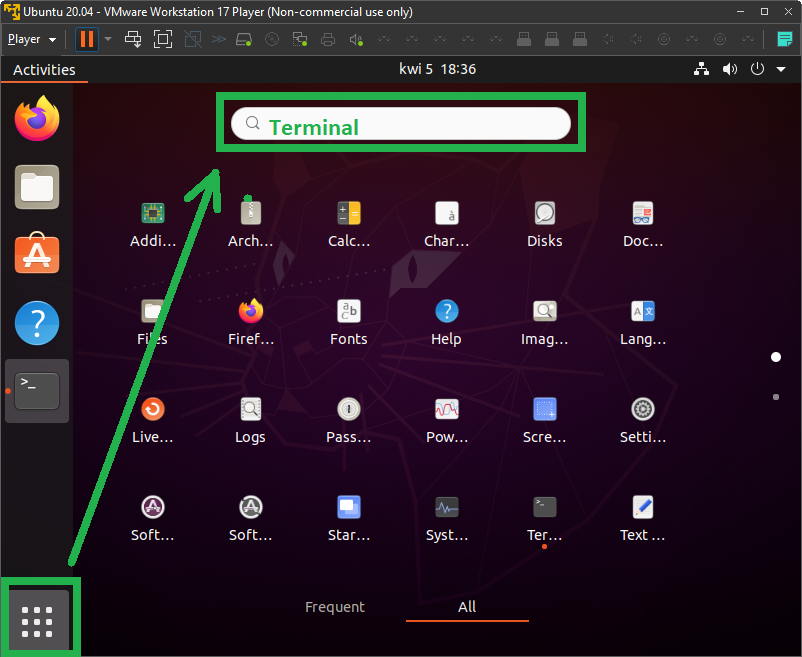

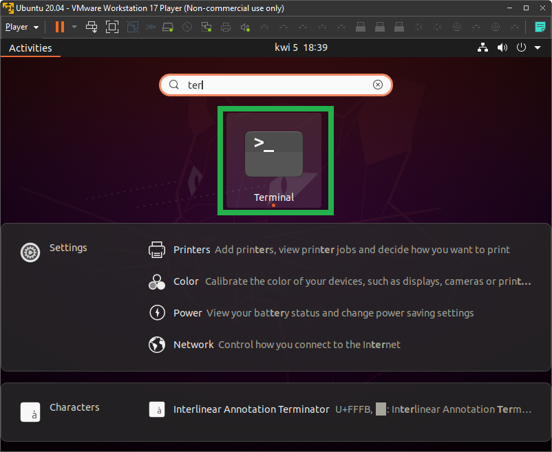

## Prepare Ubuntu

First, let's update the operating system. Run these commands, one at a time:

```shell
sudo apt update  
sudo apt -y upgrade  
sudo apt -y dist-upgrade  
sudo reboot
```

The SDK Manager does not support flashing of the Orin modules in the third-party boards (like Turing Pi 2), and most likely will never do, so we have to flash them "by hand".

Install the required libraries:

```shell
sudo apt install -y qemu-user-static nano ssh
```

This last command installed the SSH server which means from now on, you can continue either using Ubuntu's desktop and the Terminal application (or any other of your choice if you install one) or connect to a virtual machine using ssh. For the rest of this tutorial, we'll continue with `Putty`, an ssh client and terminal emulator for Windows, but the flashing process is the same in both cases.

One last thing we have to do in the desktop environment is to download Jetson Linux. Starting with version 35.3.1 (which is related to JetPack 5.1.1) Nvidia added a requirement to log in before downloading required files. We can no longer just simply use `wget` to download the files.

Start a web browser (Firefox is the default one) and navigate to the [Jetson Linux page](https://developer.nvidia.com/linux-tegra), then click on the green button of the latest Jetson Linux version:

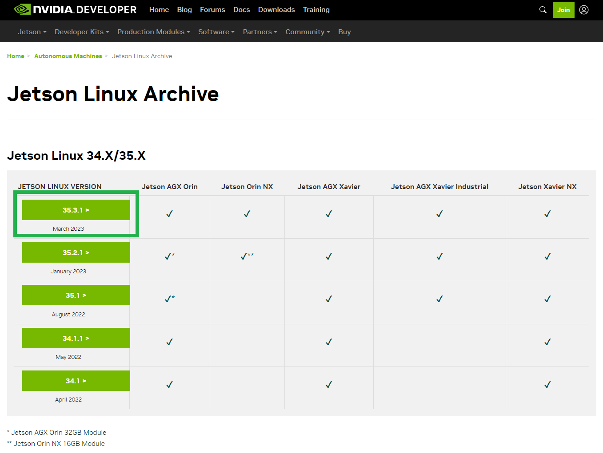

Scroll down to the download table. From the Drivers section copy links for both the `Driver Package (BSP)` and the `Sample Root Filesystem`:

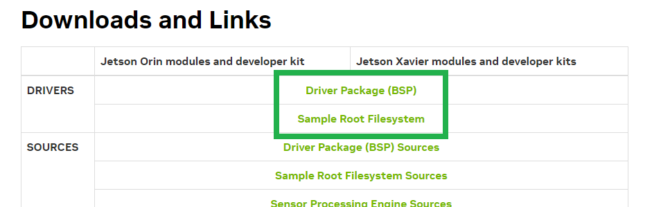

For example, for `Jetson Linux 35.3.1` the links are:  

* `Driver Package (BSP)`: [https://developer.nvidia.com/downloads/embedded/l4t/r35\_release\_v3.1/release/jetson\_linux\_r35.3.1\_aarch64.tbz2/](https://developer.nvidia.com/downloads/jetson-linux-r3521-aarch64tbz2)  
* `Sample Root Filesystem`: [https://developer.nvidia.com/downloads/embedded/l4t/r35\_release\_v3.1/release/tegra\_linux\_sample-root-filesystem\_r35.3.1\_aarch64.tbz2/](https://developer.nvidia.com/downloads/embedded/l4t/r35_release_v3.1/release/tegra_linux_sample-root-filesystem_r35.3.1_aarch64.tbz2/)

Download both files to the home directory. You'll be prompted to either login or create an account (if you do not have one):

Unpack the Driver Package (BSP) (notice were using names from the example URLs above, the name will change with the future downloads, so update it accordingly):

```shell
cd ~  
tar xpf Downloads/Jetson_Linux_R35.3.1_aarch64.tbz2
```

Unpack the Sample Root Filesystem into the Driver Package (BSP) (sudo is important here):

```shell
sudo tar xpf Downloads/Tegra_Linux_Sample-Root-Filesystem_R35.3.1_aarch64.tbz2 \  
  -C Linux_for_Tegra/rootfs/
```

Turing Pi 2 (similar to some other custom carrier boards) does not have the onboard EEPROM that the module or the flasher can access. The flasher, however, expects the EEPROM to exist as it does on the official Orin Nano (and Xavier NX) carrier boards. We need to modify one file to set the EEPROM size to `0`:

```shell
sed -i 's/cvb_eeprom_read_size = <0x100>/cvb_eeprom_read_size = <0x0>/g' Linux_for_Tegra/bootloader/t186ref/BCT/tegra234-mb2-bct-misc-p3767-0000.dts
```

Prepare the firmware:

```shell
cd Linux_for_Tegra/  
sudo ./apply_binaries.sh  
sudo ./tools/l4t_flash_prerequisites.sh
```

At this stage, we can create a default user name and hostname for the headless installation. While this step is optional, it is also highly suggested to perform - makes the operating system ready to use right after flashing without a need to use GUI to finish the installation, important if you use an Orin module in any other node than 1:

```
sudo ./tools/l4t_create_default_user.sh -u <username> -p <password> -a -n <hostname>
```

where:

* `<username>` - replace with your user name
* `<password>` - replace with your password
* `<hostname>` - replace with the hostname to use in your network (also for the ssh connections)
* `-a` - autologin, if you are going to use desktop

For example:

```shell
sudo ./tools/l4t_create_default_user.sh -u daniel -p topsecretpasswd -a -n orinnx
```

Once invoked, accept the license:

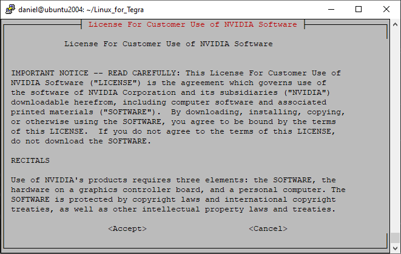

Press the `right arrow key` to highlight `<Accept>` and then `Eenter`.

## Turing Pi 2 Preparation

Because flashing in Node 1 can be problematic on some boards, it is suggested to try another node if this is the case for you. For the purpose of this article, we're going to use Node 2.

Insert your Orin module into Node 2 and install the NVMe drive for Node 2, or insert the SD card in case of the Orin Nano from the Jetson Nano Developer kit module. It might be possible to install the OS on the SATA drive while using one of the SATA ports connected to Node 3, or to use some Mini PCIe SATA controller, but this has not been tested here.

Now, let's put the Orin module into the `Forced Recovery Mode` using the web panel:

* turn the Node 2 power off
* set Node 2 into the device mode
* turn the Node 2 power on

You can also use this command line version if you can connect to the BMC via SSH or using UART/adb:

* `tpi -p off` (turns off all nodes)
* `tpi -u device -n 2`
* `tpi -p on` (turns on all nodes)

Connect the USB A-A cable to the PC.

If you are using a VMWare Player and you did not set the USB devices to be automatically attached to the VM, choose to connect the new device to the VM:

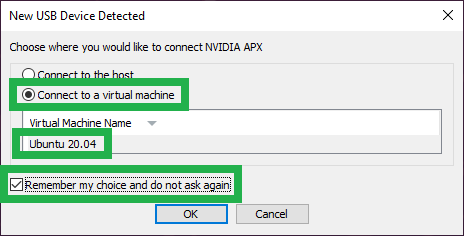

Verify that the Orin module has been detected by invoking `lsusb`. It should pop up as the `Nvidia Corp. APX` device on the list:

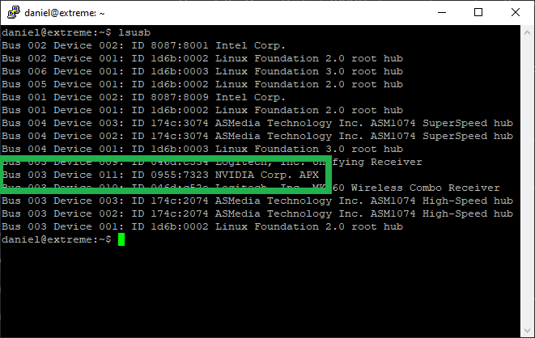

## Before flashing

There are a few pieces of information to keep in mind while flashing:

If you are using `VMWare Player` and if the `VMWare Player` has been installed earlier, it might "remember" some USB settings and, for example, not connect devices automatically, which will cause this message to appear:

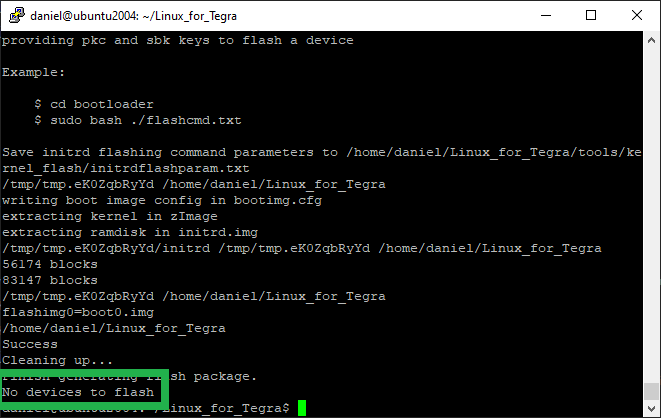

In this case, make sure that the `Nvidia APX` USB device is connected and connect it if it's not:

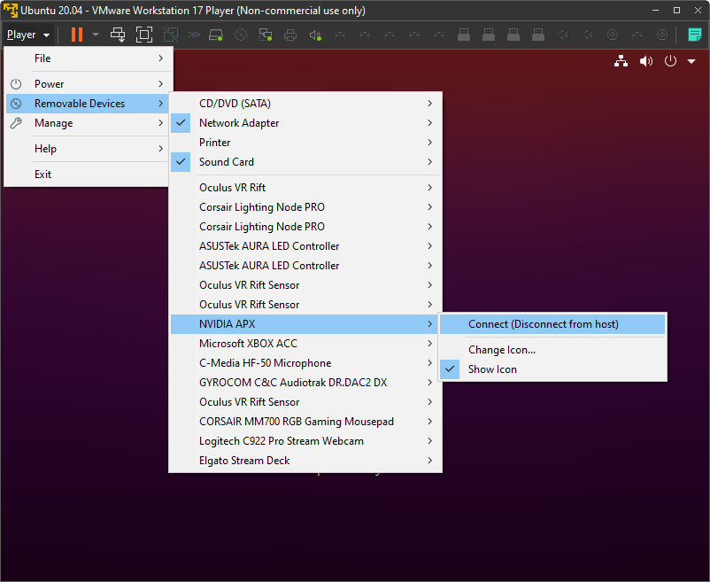

The same message can appear if you did not set the USB mode on the Turing Pi 2 to "device" for the given node mode, or if you did not power the module on after you set the USB mode (so the module won't run into the flashing mode).

Another reason for this message to appear will be if the USB A-A cable is not meant also for data transfer, but do not use so-called "smart" cables either - this must be a simple USB A-A cable without any additional electronics. Other cables like USB C-A rarely work in this combination and your mileage may vary - in general, use USB A-A cable.

If you see this message:

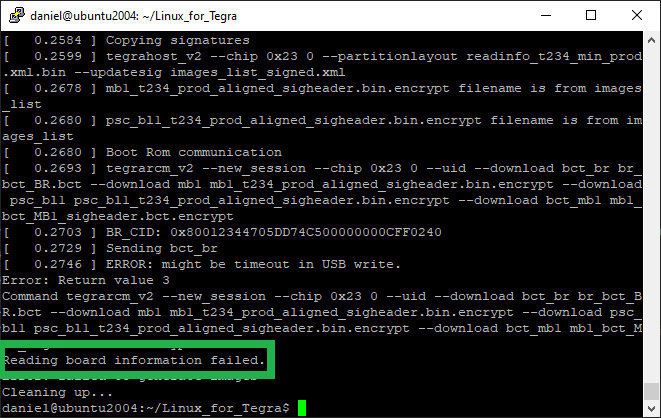

restart the module (by turning its power off and on again), or restart the whole Turing Pi 2 board.

After about 5-10 minutes of the flashing process, the Nvidia Corp AXP device will be disconnected and the NVIDIA Linux for Tegra will appear. If you are using `VMWare Player`:

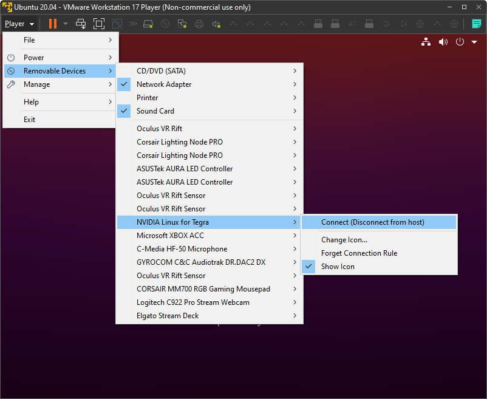

This new device will appear when you see this on the console:

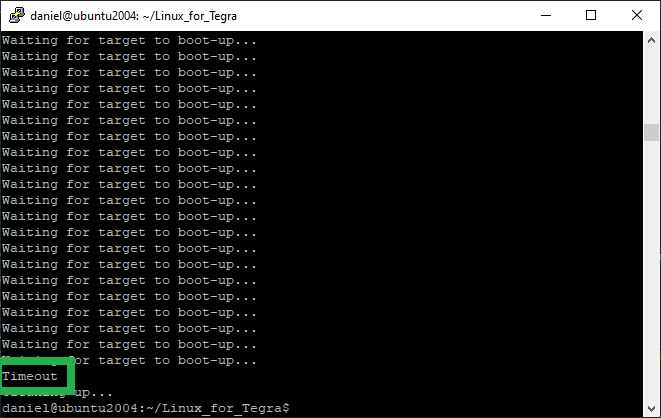

If you see a Timeout here, make sure this new USB device got connected and connect it if it was not and restart flashing. You also have about 30 seconds to react when you see the above and before the timeout. This does apply only if you are using a VM and it does not attach new USB devices to the VM. Bare-metal installation always sees all of the USB devices.

## Flashing

Assuming you're still in the `Linux_for_Tegra` directory, flash the Orin module with the NVMe drive using:

```shell
sudo ./tools/kernel_flash/l4t_initrd_flash.sh --external-device nvme0n1p1 \  
  -c tools/kernel_flash/flash_l4t_external.xml -p "-c bootloader/t186ref/cfg/flash_t234_qspi.xml" \  
  --showlogs --network usb0 jetson-orin-nano-devkit internal
```

If you want to use a USB drive (untested):

```shell
sudo ./tools/kernel_flash/l4t_initrd_flash.sh --external-device sda1 \  
  -c tools/kernel_flash/flash_l4t_external.xml -p "-c bootloader/t186ref/cfg/flash_t234_qspi.xml" \  
  --showlogs --network usb0 jetson-orin-nano-devkit internal
```

For the SD card (Orin Nano Developer Kit module):

```shell
sudo ./tools/kernel_flash/l4t_initrd_flash.sh --external-device mmcblk0p1 \  
  -c tools/kernel_flash/flash_l4t_external.xml -p "-c bootloader/t186ref/cfg/flash_t234_qspi.xml" \  
  --showlogs --network usb0 jetson-orin-nano-devkit internal
```

The whole flashing process should take 15-30 minutes and the flasher will exit once it has finished. The Orin module FAN would not be spinning for the first part of the flashing process, but this is not a problem - the Orin module will work just fine cooled passively by the heatsink for this part of the flashing process.

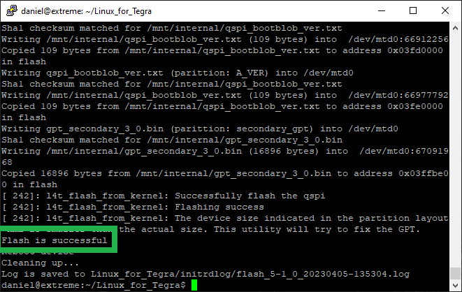

After flashing is done, you can move the module into Node 1 if this is where you are going to use it. If you invoked the command for the headless installation, you can SSH into your Orin module and run "sudo poweroff":

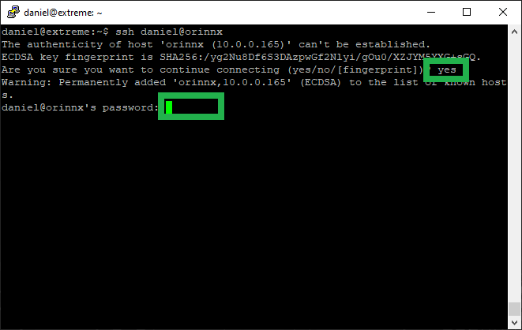

If you did not, there's no other way to turn it off gracefully since we have no input device to shut the operating system down, but this should not be a problem - turn off the power using either the web panel or the command (`tpi -p off`) as before when putting the module into device mode.

## Finishing the OS Installation

:::note
Note: If you invoked the command for the headless installation, skip this step.
:::

To finish up the configuration:

* Disconnect the USB A-A cable used for flashing
* move the module to Node 1
* move the NVMe drive
* insert the USB controller into the Mini PCIe slot
* connect the keyboard and mouse to the USB controller
* connect a monitor to the HDMI port (remember to [set up the SW1 switch for Jetson devices](/docs/turing-pi2-specs-and-io-ports#hdmi-circuit-switch) otherwise you will not see the output on the monitor)
* turn on the module power using either the web panel or the command (`tpi -p on`)

Using a keyboard and mouse, go through the configuration steps visible on the monitor and wait for the setup to finish - until you get a desktop environment. These are the standard Ubuntu initial configuration steps.

## Done flashing

At this stage we have a bare operating system that does not even contain Jetpack - there are a few more required and suggested steps that we need to perform

These steps can be done using SSH - one of the steps asked for a hostname - if your PC/Mac has the mDNS running, you can use this name directly to connect to it via SSH, otherwise, you need to find and use the IP address.
