## Raspberry Pi + CM4 Adapter

Raspberry Pi Compute Modules come in various flavors, and some do not have eMMC storage at all, relying on SD cards. Some have up to 32GB eMMC directly on board.

For both types of storage, we are going to use a fantastic tool called: [**Raspberry Pi Imager.**](https://www.raspberrypi.com/software/) This software works on Windows/macOS/Linux. Download it and install it on your PC.

:::note
If you have issues with flashing through a Raspberry Pi Imager, then you may consult the following section, [Flashing from a command line](/docs/raspberry-pi-cm4-flashing-os#flashing-from-a-command-line).
:::

Raspberry Pi Imager allows you to download, customize and copy most OS versions you might like to your RPi Compute Module.

**Note: Do not use either SD card and eMMC during installation, remove the SD card temporarily when installing to eMMC.**

With the SD card, you have two options, either use the SD card reader and flash the OS on your PC. Or you can use the same method to access the SD card as we are going to describe for installing it on eMMC.

If you have chosen the second method, you will need a USB cable. You need to connect USB 2.0 on Turing Pi V2 (it's the vertical one, next to HDMI) to your PC.

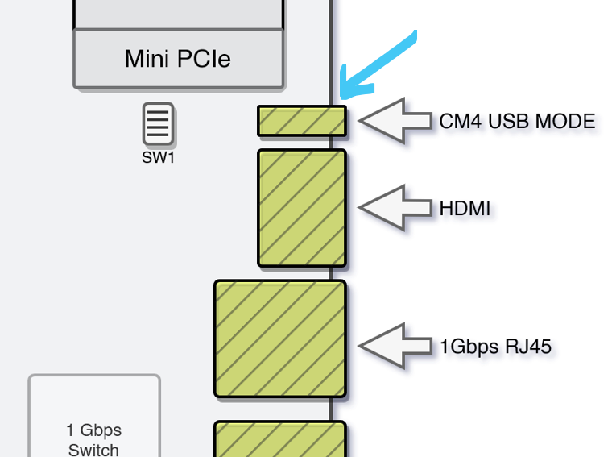

**Ideally**, you will need USB A-A (or also called USB M/M) that looks like this on both sides:

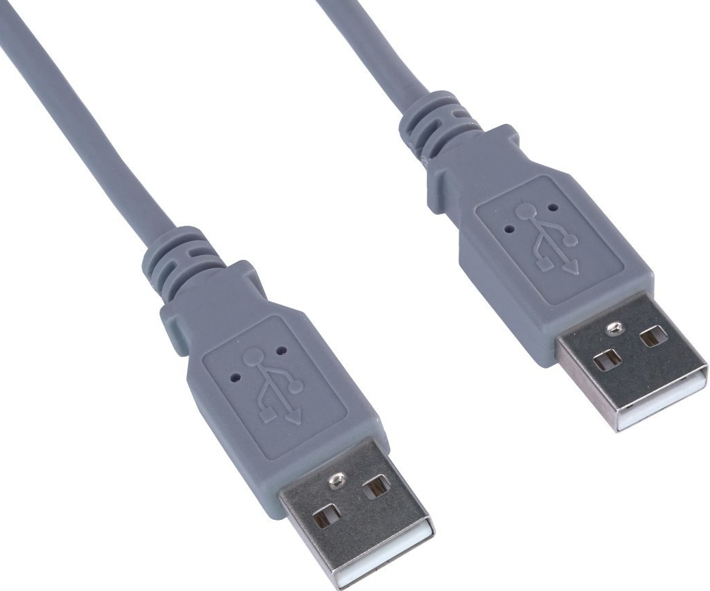

However, you can also use USB-A to USB-C, it depends on if your computer have USB-C input.

:::note
We have seen some reports from users where USB-A to USB-C was not working correctly. If you face issues, please use preferred method USB-A to USB-A.
:::

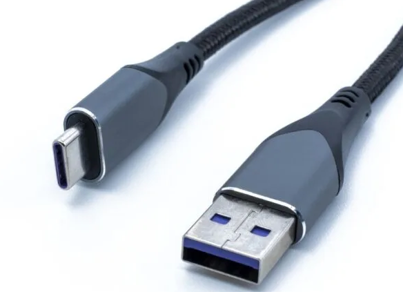

### Driver

For our PC to recognize the Raspberry Pi storage when switched to "storage" mode, you need to install the **rpiboot** tool.

* For Windows users, install the [rpiboot installer](https://github.com/raspberrypi/usbboot/raw/master/win32/rpiboot_setup.exe).
* For Mac & Linux users, [follow the build instructions](https://github.com/raspberrypi/usbboot#building).

Then run the tool in OS of your choice, usually its:

```
sudo ./rpiboot
```

But for windows you need to run **CMD.** The easiest way to launch the Command Prompt (CMD) in Windows is by using the start menu. Press the Windows key on your keyboard or click on the Windows icon in the bottom left corner of your screen, then type "cmd" into the search bar. Click on the "Command Prompt" result that appears. Another way to launch CMD is by using the Run dialog box. Press the Windows key + R on your keyboard, type "cmd" into the box, and press Enter.

```
cd "C:\Program Files (x86)\Raspberry Pi"  
rpiboot -d .\msd
```

It should look like this:

```
C:\Program Files (x86)\Raspberry Pi>rpiboot -d .\msd  
RPIBOOT: build-date Dec 16 2022 version 20221215~105525 1afa26c5  
Loading: .\msd/bootcode.bin  
Loading: .\msd/bootcode4.bin  
Waiting for BCM2835/6/7/2711...
```

### Switching to USB mode

Assuming you have **connected the USB CM4 from Turing Pi 2 to your PC,** where **rpiboot is now waiting** for connection, and you turned on power to your Compute Modules. You need to execute the following command inside BMC:

```
tpi -u device -n 1
```

**-n 1 to 4** represents your Node1-4 slots.

On your PC side, you should see rpiboot detecting the Compute Module storage and presenting it to you as a new disk.

Here is an example with a brand new SD card:

```
C:\Program Files (x86)\Raspberry Pi>rpiboot -d .\msd  
RPIBOOT: build-date Dec 16 2022 version 20221215~105525 1afa26c5  
Loading: .\msd/bootcode.bin  
Loading: .\msd/bootcode4.bin  
Waiting for BCM2835/6/7/2711...  
Loading: .\msd/bootcode4.bin  
Loading: .\msd/bootcode4.bin  
Sending bootcode.bin  
Successful read 4 bytes  
Waiting for BCM2835/6/7/2711...  
Loading: .\msd/bootcode4.bin  
Second stage boot server  
Cannot open file config.txt  
Cannot open file pieeprom.sig  
Loading: .\msd/start4.elf  
File read: start4.elf  
Cannot open file fixup4.dat  
Second stage boot server done
```

And in disk manager I can see the new disk (this one is already partitioned as the new SD card tents to be)

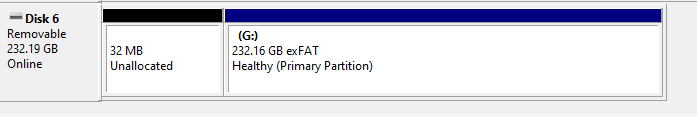

### Raspberry Pi Imager

You can now freely use [**the Raspberry Pi Imager**](https://www.raspberrypi.com/software/) to flash the OS you want to your Compute Module.

We will quickly go over flashing Raspbian 64bit, but you can choose Ubuntu or others.

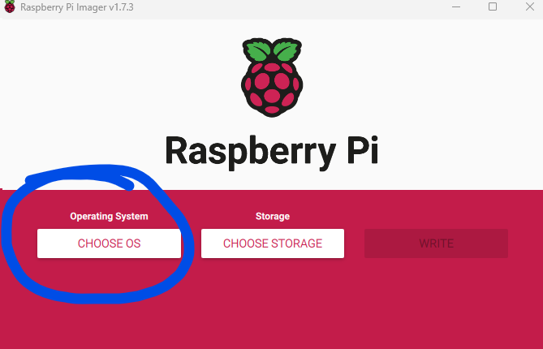

I have chosen: **Raspberry Pi OS (other) > Raspberry Pi OS Lite (64-bit).** 

**Next,** you can choose **Storage.** Raspberry Pi Imager already offers the correct disk, but make sure you are really choosing the correct one.

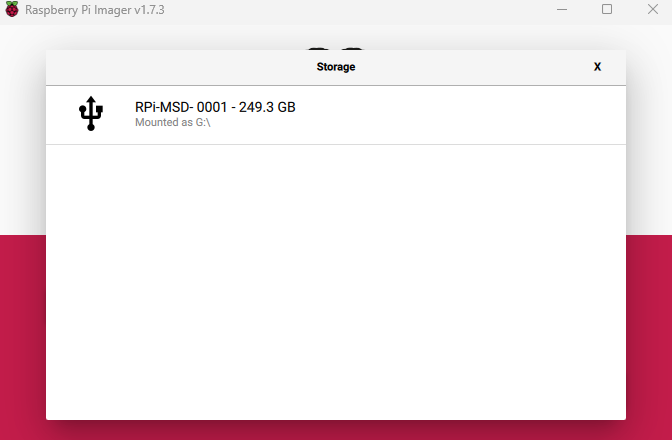

**Before Write**, click on cog icon and configure your OS, enable SSH, give it a hostname, set passwords etc..

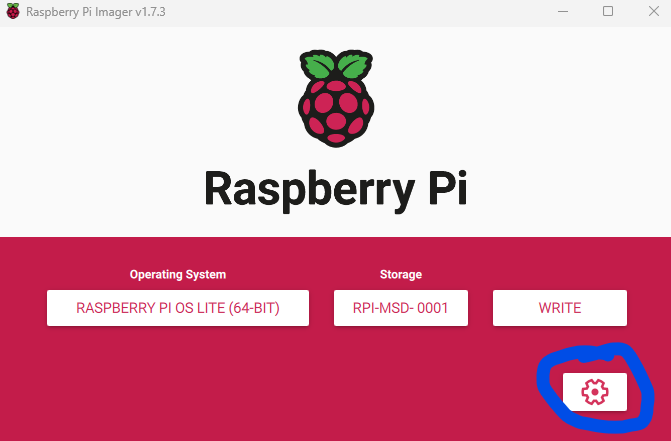

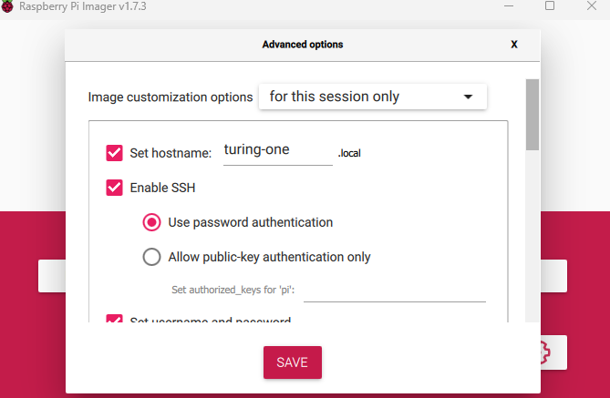

**Write**, click write and confirm "yes" in next pop up window.

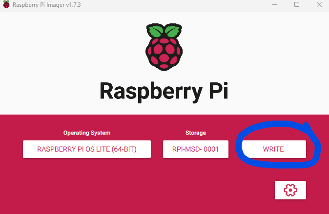

Please wait until the OS is flashed and verified, do not cancel the verification.

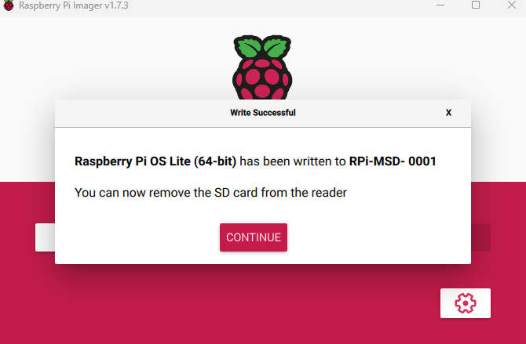

Now that the flashing is done, you can reboot the node by issuing the following command in BMC:

**Stop Power to Node1:**

```
tpi power --node 1 off
```

**Start Power to Node1:**

```
tpi power --node 1 on
```

We just did a reboot, but if you want to get IP quickly we can modify our script for BMC a little, and after we turn our node off, we can run the following on your PC (change the range to your network) :

```
range="10.0.0.*"; echo "Please wait, starting scan..."; \  
nmap -PN -p 22 --open -oG - "$range" | grep -E '22/open' | \  
awk '{print $2}' | sort -V > initial_scan.txt; \  
echo "Start RPi, waiting 60sec..."; sleep 60; \  
nmap -PN -p 22 --open -oG - "$range" | \  
grep -E '22/open' | awk '{print $2}' | \  
sort -V | diff initial_scan.txt -
```

And turn it back on when asked. You should get something like this:

```
  
vladoportos@DESKTOP-7BCS3LE:~$ range="10.0.0.*"; echo "Please wait, starting scan..."; \  
nmap -PN -p 22 --open -oG - "$range" | grep -E '22/open' | \  
awk '{print $2}' | sort -V > initial_scan.txt; \  
echo "Start RPi, waiting 60sec..."; sleep 60; \  
nmap -PN -p 22 --open -oG - "$range" | \  
grep -E '22/open' | awk '{print $2}' | \  
sort -V | diff initial_scan.txt -  
Please wait, starting scan...  
Start RPi, waiting 60sec...  
10a11  
> 10.0.0.167
```

Since we enabled SSH server during the installation modification, we should be able to ssh now to that IP.

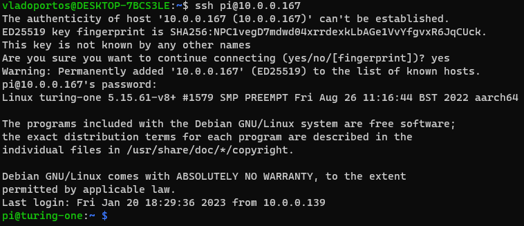

## Flashing from a command line

In case you have issues flashing through a USB-A ↔ USB-C cable, do not have a USB-A ↔ USB-A cable or a USB 2.0 socket, or have other difficulties, then you can perform flashing with the `tpi` tool.

:::note
The [$tpi CLI](/docs/tpi-usage)tool can be run from your desktop. This version has an option to stream an given image from your computer to one of the nodes using the argument  `--flash `. The latest BMC release is not able to receive big files (>50mb), rendering this command rather unuseful. 

we are working on making the changes nessisary to resolve this limitation. We will provide a timely update once the issue has been resolved.
:::

1. Insert an SD card in the back of the Turing-Pi board. Make sure it's formatted with one of the supported filesystems. [see](/docs/turing-pi2-bmc-sd-card)
2. Log in to the turing-pi board (`ssh root@turingpi.local`) to mount the sd card: 

On the first connection, you get the following:

```text
The authenticity of host 'turingpi.local (10.x.y.z)' can't be established.
ECDSA key fingerprint is SHA256:ABCD1234EFGH5678IJKL90MNOPQRstuvWXYZabcd.
Are you sure you want to continue connecting (yes/no/[fingerprint])?
```

Type yes. You will be asked for the password, the default password is `turing`

```
root@turingpi.local's password:
```

The command to mount the SD card depends on your partitioning. Copy and paste the following command into your ssh session:

```
    if [ -b /dev/mmcblk0p1 ]; then
        mount /dev/mmcblk0p1 /mnt/sdcard
    elif [ -b /dev/mmcblk0 ]; then
        mount /dev/mmcblk0 /mnt/sdcard
    fi
```

Alternatively, rebooting the turing pi will mount the SD card as well.

3. Acquire the desired OS image.\
   This guide uses Raspberry Pi OS, which you can download from the [official website](https://www.raspberrypi.com/software/operating-systems/). After downloading, extract the image to your filesystem.
4. Upload the file to your microSD card using a new shell:\
   `scp 2023-05-03-raspios-bullseye-arm64-lite.img root@turingpi.local:/mnt/sdcard/images`\
   Note: if the folder `images` doesn't exist you need to create it. If you don't do this then your image will be written to a file named `images` without an `img` extension.
5. Perform flashing on desired node.\
   Issue the following command which from the local filesystem flashes the image (if the node was powered off this will power on the node (at least as of v1.1.0)):\
   `# tpi flash -n 1 -l -i /mnt/sdcard/images/2023-05-03-raspios-bullseye-armhf-lite.img`\
   You must use an absolute path or flashing will fail after 10-15 seconds.\
   When the LEDs next to the node (from the back panel side) is constantly red the power is on.\
   While the command is running:
   1. on the back of the carrier board both LEDs will be constantly green (the upper for power, the lower for activity)
   2. you will get the following output (the 00:00:53 will be counting up, typically between 5 and 11 minutes):
   3. ```
           % Total    % Received % Xferd  Average Speed   Time    Time     Time  Current
                                          Dload  Upload   Total   Spent    Left  Speed
           0     0    0     0    0     0      0      0 --:--:--  0:00:53 --:--:--     0
      ```
      Only the column "Time Spent" is changing, other columns remain 0. This is standard behavior.\
      When the command is finished:
   4. on the back of the carrier board, the lower LED typically occasionally blinks green and,
   5. the output looks like this:
   6. ```
        % Total    % Received % Xferd  Average Speed   Time    Time     Time  Current
                                       Dload  Upload   Total   Spent    Left  Speed
      100    56    0    56    0     0      0      0 --:--:--  0:10:16 --:--:--    12
      ```
6. (Optional) Access the node's filesystem:

Use `tpi` to load the node as a mass storage device:

```
# tpi advanced msd --node 1
```

The command has finished when the output looks like this:

```
ok
```

You can now mount the partitions as device, the boot partition is typically `/dev/sda1`. If not, then `dmesg` should return the device name in its output's last line(s).

```
# mount /dev/sda1 /mnt/bootfs
```

You can now configure e.g. in Raspbian's boot partition the file config.txt. To enable uart messages on the node's Raspbian (to fetch with `tpi --uart=get -n 1`) add or enable the line `enable_uart=1`:

```
# vi /mnt/bootfs/config.txt
```

Depending on your OS, you might want to make other changes. If you are flashing Raspbian you might want to `touch /mnt/bootfs/ssh` to enable sshd, and set the well-known username and password with `echo 'pi:$6$c70VpvPsVNCG0YR5$l5vWWLsLko9Kj65gcQ8qvMkuOoRkEagI90qi3F/Y7rm8eNYZHW8CY6BOIKwMH7a3YYzZYL90zf304cAHLFaZE0' > /mnt/bootfs/userconf` (and do not power off too early as you might interrupt the generation of the ssh host keys). If you are flashing DietPi you will want to edit dietpi.txt.

Once finished, leave vi with `:wq<enter> `;) and unmount the filesystem:

```
umount /mnt/bootfs
```

7. Reboot the node:

```
# tpi power -n 1 off
# tpi power -n 1 on
```

While this command is running. (on the back of the carrier board, the lower LED will show node activity).

Check if the node did begin to boot by querying the uart output (no matter the above setting in config.txt a few lines of output should be returned once):

```
# tpi uart get -n 1

OTP boardrev c03141 bootrom 48b0 48b0

RPi: RPIBOOT release VERSION:8ba17717 DATE: 2023/01/11 TIME: 17:40:52
BOOTMODE: 0x07 partition 0 build-ts BUILD_TIMESTAMP=1673458852 serial 3de9630e boardrev c03141 stc 93888096
PM_RSTS: 0x00001000
part 00000000 reset_info 00000000
uSD voltage 3.3V
Initialising SDRAM 'Samsung' 16Gb x2 total-size: 32 Gbit 3200
DDR 3200 1 0 32 152
Boot mode: RPIBOOT (03) order f1
Read config.txt bytes        0 hnd 0x0
SIG pieeprom.sig 0000000000000000000000000000000000000000000000000000000000000000 0
Bad signature pieeprom.sig
Read start4.elf bytes   301628 hnd 0x0
Read fixup4.dat bytes        0 hnd 0x0
0x00c03141 0x00000000 0x00000fff
MEM GPU: 76 ARM: 948 TOTAL: 1024
Starting start4.elf @ 0xc1000200 partition -1
```

If the node does not boot, try to remedy this by setting the node back to USB host mode (in case `tpi advanced msd --node 1` did set the node in device mode, seems to be the case for the last inserted, powered module):

```
# tpi -u host -n 11
```

The output will be:

```
# tpi -u host -n 1
{"response":[{"result":"ok"}]}#
```

If the node still does not boot, toggle power off and on:

```
# tpi power -n 1 off
# tpi power -n 1 on
```

With the node booted, you should be able to find its IP. In the case of a home network, your router's DHCP might show the IP for the host `raspberrypi` .

### example: Raspbian installation

[https://asciinema.org/a/602865?t=10:33](https://asciinema.org/a/602865?t=10:33)
