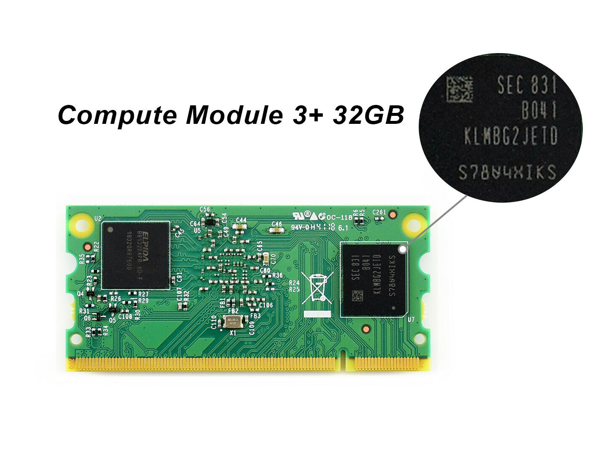

The Turing Pi V1 board works with Raspberry Pi compute modules 1, 3, 3+.

You can use Compute Modules with or without onboard eMMC memory. If you have compute modules without eMMC storage, you can use a microSD card. For a better experience, we recommend using compute modules with eMMC storage.

:::note
Please note, you can use either eMMC or SD card storage. You can't use both options
:::

Raspberry Pi Compute Module 3+ with eMMC storage

