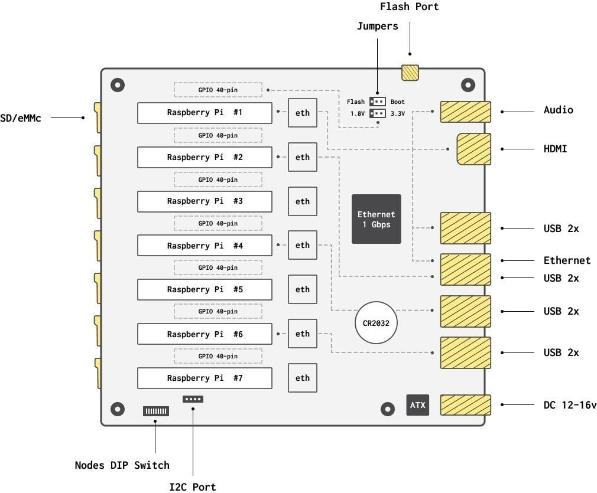

Hello and welcome to the Turing Pi V1 documentation.

Turing Pi V1 is a 7 nodes cluster on a mini ITX board. It’s a scale model of bare metal clusters like you see in data centers. The Turing Pi board can be used as a local mini server to host apps, containers, Kubernetes. The Turing Pi also is a great tool for learning cloud-native technologies, Serverless, Microservices on a bare-metal cluster. The Turing Pi top/main node can act as a NAT/Router for the rest of the nodes. If you move the cluster from one location to another, all the node's IPs stay the same. 

### Some of the Turing Pi V1 features:

* Flash mode - flash RPi compute modules using the Turing Pi board
* Boot mode - boot OS through eMMC or SD card or netboot 

:::note
Please note, you can use either eMMC or SD card storage. You can't use both options.
:::

* Power management for each node \(on/off/reboot\)
* Real-time clock \(RTC\)
* I2C cluster management bus
* Compute modules hot-swap

## Specs

| Name                               | Value                                                                                           |
| :--------------------------------- | :---------------------------------------------------------------------------------------------- |
| Supported Compute Modules          | Raspberry Pi Compute Module 1, 3, 3+                                                            |
| CPU cores, Max.                    | 28                                                                                              |
| RAM, Max.                          | 7GB                                                                                             |
| Internal eMMC, Max.                | 224GB                                                                                           |
| Boot from the network \(netboot\)  | Yes, tested with CM3, CM3+, and Hypriot OS v1.11.3                                              |
| Boot from eMMC                     | Yes                                                                                             |
| Boot from SD                       | Yes                                                                                             |
| Compute Modules, Max. QTY          | 7x, DDR2 SO-DIMM 200 pin                                                                        |
| Micro SD slots, QTY                | 7x, 1 per node                                                                                  |
| Ethernet Port                      | 1x, 1Gbps                                                                                       |
| Int. Network Speed, Max.           | 1Gbps                                                                                           |
| Node Network Speed                 | 100Mbps per node                                                                                |
| Power supply                       | 12V, 5A, 60 W, 2.1-5.5mm \(center positive\)                                                    |
| Power consumption, Max.            | 40 W                                                                                            |
| Board form factor                  | Mini ITX, 6.7 x 6.7 inches \(170 x 170 mm\)                                                     |
| Mini ITX Power socket 2x2 pin      | 12 V                                                                                            |
| Flash port                         | Only for Master Node via micro USB                                                              |
| GPIO 40-pin, RPI compatible pinout | 7x \([Standard Raspberry Pi 3 pinouts](https://www.raspberrypi.org/documentation/usage/gpio/)\) |
| HDMI                               | 1x, Node \#1 \(Master Node\)                                                                    |
| Audio 3.5 mm                       | 1x, Node \#1 \(Master Node\)                                                                    |
| USB 2.0                            | 8x                                                                                              |
| RTC battery                        | CR2032                                                                                          |

## Cluster Management Bus

| Name                  | Value                                                  |
| :-------------------- | :----------------------------------------------------- |
| CMB protocol          | I2C                                                    |
| CMB access            | From each node                                         |
| Node Power Management | Yes, via CMB for each node                             |
| Userspace EEPROM      | 128bytes                                               |
| Int. CMB devices      | Ethernet Switch, I2C expander, and RTCC                |
| External I2C ports    | 1x, for additional devices like LCD displays or EEPROM |

## Block Scheme

