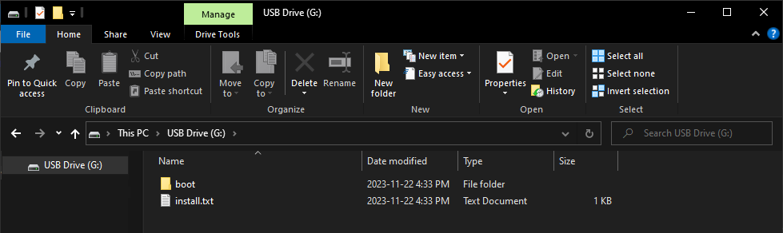
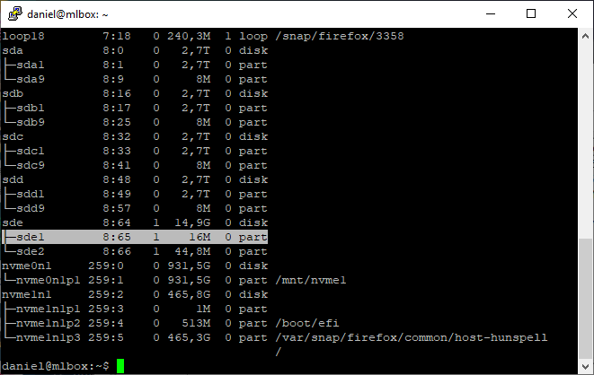
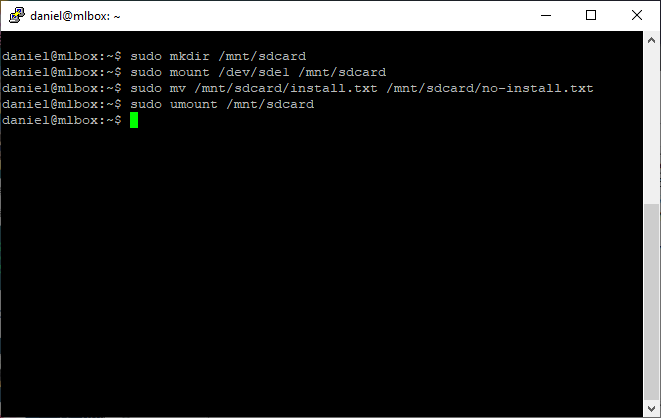

You can run the BMC from an SD card without flashing it.

In order to run the BMC from the SD card prepare the SD card for the [firmware upgrade process](/docs/turing-pi2-bmc-v1x-to-v2x), but do not put it into the Turing Pi 2 yet. Once the card is created, it'll contain 2 partitions. You need to access one of them.

There is no official OTA support for this method of running the BMC firmware, but you can find below a temporary way.

 

## On Windows

On Windows, right after flashing the card, a new partition will appear:



Rename the `install.txt` file to something else, for example, `no-install.txt`.

 

## On Linux/MacOS

First, find out the device name of your SC card - for example run `lsblk` then insert the card and run it again to see which drive appeared. In this example the device is `sde` and the first partition is `sde1`:



Remember this partition name.

Create a mount point:

```shell
sudo mkdir /mnt/sdcard
```

Then mount the first card partition:

```shell
sudo mount /dev/card_partition /mnt/sdcard
```

where `card_parition` is the partition device found earlier, for example:

```shell
sudo mount /dev/sde1 /mnt/sdcard
```

Now rename the file:

```shell
sudo mv /mnt/sdcard/install.txt /mnt/sdcard/no-install.txt
```

And unmount the partition:

```shell
sudo umount /mnt/sdcard
```



 

## Boot the board

Remove the card from the computer, insert it into Turing Pi 2 board, and power it on. The board will boot from the SD card.

At any point, you can rename the file back and the firmware will flash onto the BMC with all the changes made to the SD card image (like configuration)

 

## OTA update

While OTA updates are not supported while running from SD card, you may use SSH and the `.tpu` file to update the firmware. Refer [OTA upgrade](/docs/turing-pi2-bmc-v2x-to-v2x) to download the upgrade file.

To perform the upgrade you are going to use `ssh` command. Use PowerShell on Windows and any console emulator on Linux and MacOS (refer to [BMC UI](/docs/turing-pi2-bmc-ui) to find out the hostname or IP and for the default password).

To upgrade the firmware run:

```shell
ssh root@turingpi dd of=/dev/mmcblk0p2 < /path/to/tp2-ota-v2.x.x.tpu
```

And reboot immediately.

Note that the BMC might crash during this process because the filesystem is still mounted when you perform low-level disk operations.
