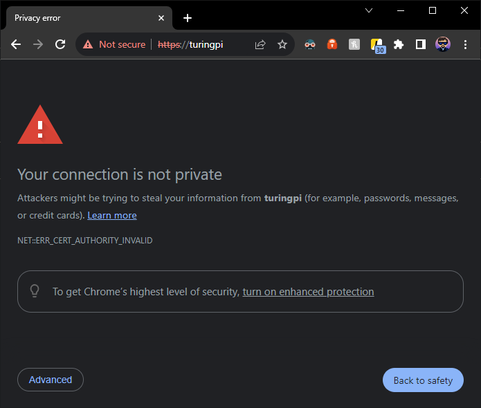
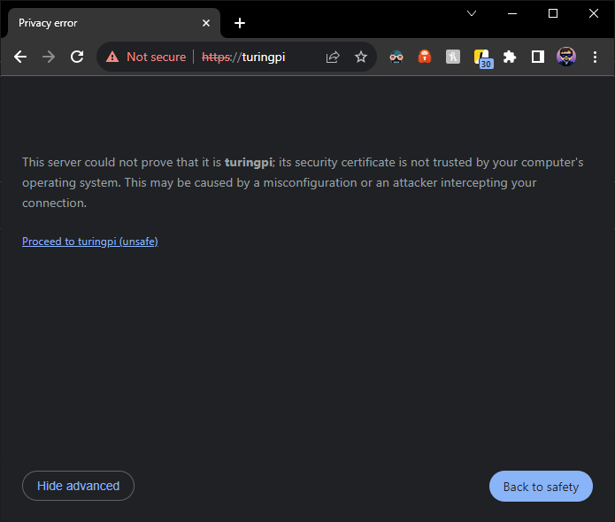
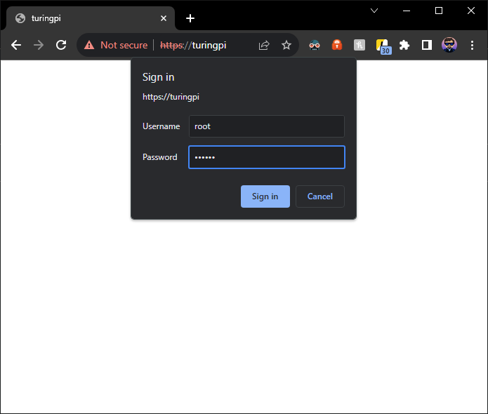
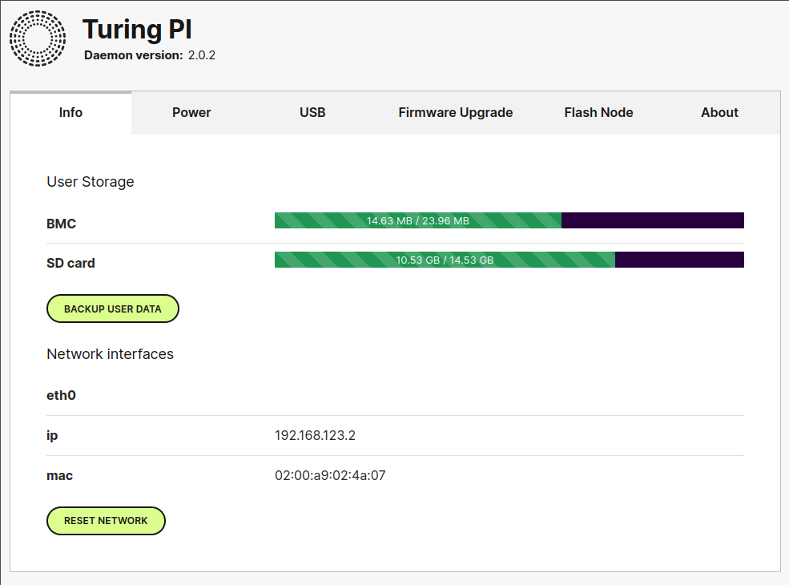
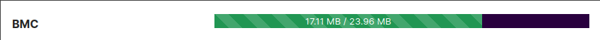
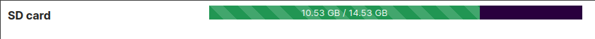

The BMC User Interface (UI), also called Graphical User Interface (GUI) or Web Interface is located at [https://turingpi/](https://turingpi/) or (depending on your local network configuration) at [https://turingpi.local/](https://turingpi.local/).  In the UI you can find information about your board, control power, USB behavior, and execute firmware upgrades.\
It can be that your local network blocks mDNS broadcasts. In this case, check your router’s DHCP lease table to find an IP of the BMC network interface - you should find an entry with `turingpi` name and the IP next to it. Use this IP in the browser: [https://a.b.c.d/](https://a.b.c.d/) (where `a.b.c.d` is the IP address).

:::note[Multiple boards]
Before the Turing-Pi board broadcasts its hostname over the network, it will determine if such a hostname already exists. If so, a postfix number will be added. e.g. `turingpi-2`
:::

In the firmware version 2.0 or newer, when you access the UI, you might see a message about an invalid certificate - in this example in the Google Chrome version:

This is normal - the BMC does not use a unique domain name to which the certificate could be issued; instead, a self-signed certificate is generated after the firmware upgrade. You can safely proceed:

You get asked to authenticate yourself when you visit the website. The default login and passwords are:

* user: `root`
* password: `turing`

Don't forget to update the default credentials if you haven't already. After successful authentication, you will see the homepage, similar to: 

It has several tabs, which will be explained in more detail below:

## Info

The info tab displays three things:

### User Storage

Item **BMC** displays the amount of flash space the user can use freely. Even though the flash chip has a capacity of 128 MiB, we reserved 24 MiB for additional storage on the BMC. This storage is not a separate partition, but the amount of the overlay can grow. The other \~100 MiB are used for root filesystem partitions. 

storage capacity indicator of the BMC

:::note[EROFS]
The BMC doesn't have a separate user partition but uses an overlay filesystem (EROFS). This means any changes made to the filesystem are stored on a 'overlay' rather then on the root filesystem. This way we can deploy updates to the filesystem without you loosing your custom files!
:::

Secondly, if you have an SD card inserted into your board, it will also be shown here:

#### Backup user data

Clicking the 'backup user data' button will compress and download all the files that were changed or added on top of the 'stock' filesystem (that came with the installed firmware). Depending on how many files need to be compressed, this process can take a couple of seconds up to a minute. Once completed, you should be presented with a 'success toast.' The downloaded file can be found in the default download folder of your browser.

:::note[about firmware upgrade]
Firmware upgrades do not erase user data on the BMC. Downloading your files is an extra safety net in the event you need to restore you board, or if you want to migrate your data to another board.
:::

:::caution[Sensitive information inside the backup!]
Be aware that everything is archived in the backup. Any secret present on the board is now in the backup archive as well. This includes ssh and bmc keys. Be causious about where you store your backup.

Its benificial to renew you passwords and keys even now and then. How to regenerate the certificates of the UI is explained in [How To's](/docs/turing-pi2-bmc-how-tos#regenerate-self-signed-certificates-ui)
:::

### Network interfaces

Displays a list of connected network interfaces that are not loop-back devices. IP and MAC are shown.

#### Reset Network

The reset network button can be used to restart the onboard Ethernet switch. A reset typically can take around 5 seconds. When executed successfully, a `success`toast will briefly appear at the top of the page.

## Power

On the power tab, individual nodes can be powered on and off. Clicking on one of the nodes should immediately send a request to the BMC.

Please note that the UI serves static content. Any changes outside the UI are not updated until the webpage is refreshed.

## USB

Switches the USB bus between the different nodes. Only one route can be active at any given time and is going to the USB-A port. 

## Firmware Upgrade

Via this tab, upgrade packages (`.tpu` files) can be uploaded to upgrade the firmware of the BMC to the given version. The latest upgrade images can be downloaded from [http://firmware.turingpi.com](https://firmware.turingpi.com/turing-pi2/) . This operation can take up to a couple of minutes. All user files are preserved during upgrades.

Once the upgrade is completed, you get asked to reboot. After booting, the upgrade will be finalized. you can verify that the upgrade was successful by checking the `daemon version` string in the header of the UI.

:::caution[Only available for >= v2.0.0]
Upgrading via the UI is only available for firmware versions of v2 and higher. If you have a board that runs an older version. We recommend you to upgrade in one go to the latest version using the SD card method. After that firmware upgrade is available as usual. read more [here](/docs/turing-pi2-bmc-firmware-upgrade)
:::

## Flash Node

Select a node and an image file you want to write. Once you click 'Install OS,' the selected node will be power cycled and prepared for the transfer. In parallel, the file upload is started as well. As a last step of the flashing process, a checksum is calculated over the written data to ensure no data corruption happens during the transfer. This can take several minutes as well, depending on the image size.

:::note[Preparing module]
You might experience the progress stalling in the first MB's of transfer. In this case the receive buffer is filled up and waiting for the preparation process to finish. Once the BMC actually started writing to the module the transfer continues as normal.
:::

Be aware that images are written one-to-one to the storage medium of the given module. Only raw `.img` files can be written. Be sure to decompress archived images first before transferring them to the module.

Any errors will be shown on the label under the progress bar.
