## Preparation

To upgrade firmware from version 1.x to 2.x, or to recover from the state when the BMC does not boot, prepare the SD card and the SD card reader (if your computer does not contain it). The image size is small, well under 100MB, so the card size does not matter. Be aware that if you have any data on this SD card, it will be lost.

:::note
You always find the newest firmware version on [https://firmware.turingpi.com/turing-pi2/](https://firmware.turingpi.com/turing-pi2/)
:::

To perform the upgrade, download the `.img` file of the newest firmware version. You can use software of your choice to burn the image onto the SD card, but we also show examples below.

:::note
This process is also applicable if the BMC chip does not boot anymore or there is a need to completely re-flash the firmware
:::

:::caution
This process of upgrading from firmware v1 to v2 will remove any custom files and settings and perform a clean install
:::

This section contains:

* [Short version](#short-version)
* [Detailed version](#detailed-version)
  * [Flashing the SD card using Windows](#flashing-the-sd-card-under-windows)
  * [Flashing the SD card using Linux/MacOS](#flashing-the-sd-card-using-linuxmacos)
  * [Flashing the SD card if you cannot remove it from the board](#upgrading-the-firmware-without-sd-card-access)
  * [Upgrading the firmware using the flashed card](#upgrading-the-firmware-using-the-flashed-card)
  * [Alternative ways of "removing" SD card after flashing](#alternative-ways-of-removing-the-sd-card)

 

## Short version

* Burn the SD card with the upgrade image
* Insert the SD card into Turing Pi 2 and power it on
* Wait for the 4 LAN port LEDs to start blinking slowly
* Press `KEY1` on the board or `Power` button in the case (if you have a front panel connected) rapidly **3 times** (or type in `CONFIRM` in the console if you have UART connected)
* During flashing, the LEDs will animate by turning a single LED on from left to right
* The LEDs will start blinking twice when the flashing succeeds
* Remove the SD card and reboot

 

## Detailed version

### Flashing the SD card under Windows

Download and install [Win32 Disk Imager](https://win32diskimager.org/)r. Open it and in the `Image File` section choose the downloaded `.img` file. On the right, in the `Device` section, choose the SD card letter. Note that only removable devices will be shown on the drive list - disconnect any other removable drives if you’re unsure which one to use. If the SD card contains more than a single partition, it may appear with multiple drive letters on this list - choose the first one. Click on `Write`:

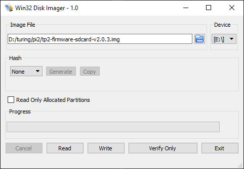

Confirm to start writing the image onto the SD card:

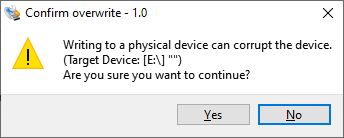

The flashing process will begin and should be fast - should take between a few and a dozen seconds:

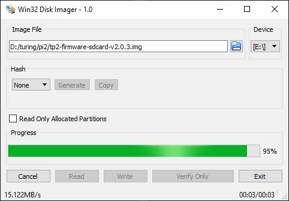

Once the flashing is done, a message indicating this will pop in:

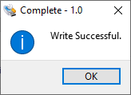

You can remove the SD card from your computer.

 

### Flashing the SD card using Linux/MacOS

On Linux and Mac an easy way is to use the `dd` command to flash the SD card and `lsblk` to find the device to flash. Because there are multiple ways to connect the SD card to a computer, the card might appear as `/dev/sdX` or `/dev/mmcblkX`. One of the easy ways to find the device name is to run the `lsblk` command before inserting the card, then insert the SD card, run this command again, and find which device has appeared. In this example, it’s `sde`:

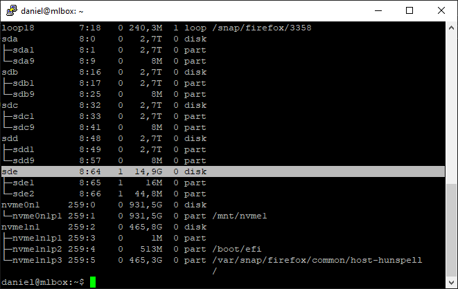

When determining the device to use, look at the second to last column to contain `disk` and not `part` - we need to image the disk, not it's partitions. Also, make sure that the disk size matches your SD card size. Double-check that you found the right device name to prevent accidental writing on a disk you did not intend to write to. Remember SD card's device's name.

On macOS you can list available devices using:

```
sudo diskutil list
```

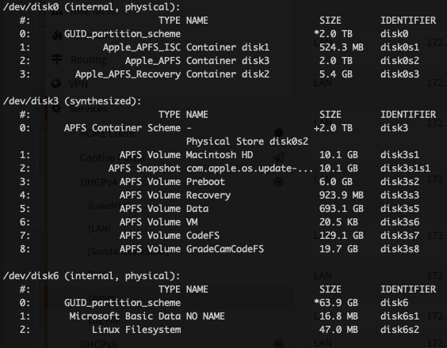

You will need to unmount the disk before writing to it; in the case above the SD card is `/dev/disk6`:

```
sudo diskutil unmountDisk /dev/disk6
```

To flash the SD card use `dd` command as follows:

```
sudo dd if=path/to/tp2-firmware-sdcard-v2.x.x.img of=/dev/the_device bs=1M
```

where:

* `path/to/tp2-firmware-sdcard-v2.x.x.img` is the path to where you saved your image file, for example `~/Downloads/tp2-firmware-sdcard-v2.0.4.img`
* `/dev/the_device` is the SD card device with `the_device` being the previously remembered drive (`sde` in the shown example)

For example:

```
sudo dd if=~/Downloads/tp2-firmware-sdcard-v2.0.4.img of=/dev/sde bs=1M
```

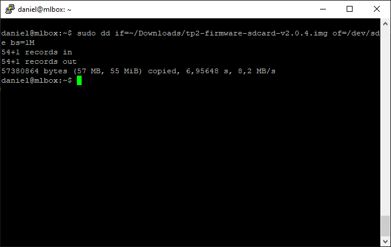

You can remove the SD card from your computer.

 

### Upgrading the firmware using the flashed card

Power down Turing Pi 2, insert the card, and connect power to the Turing Pi 2 board again. Alternatively, you can insert the SD card and press the BMC reset button.

After a few seconds, the board will indicate that the firmware upgrade is ready by slowly flashing all 4 LAN port LEDs on the back of the board:

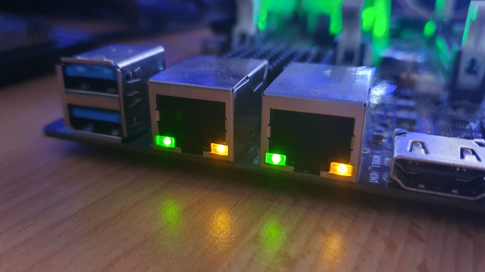

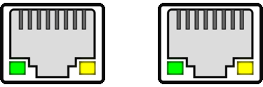

If you have a UART interface connected, you’ll also see a message:

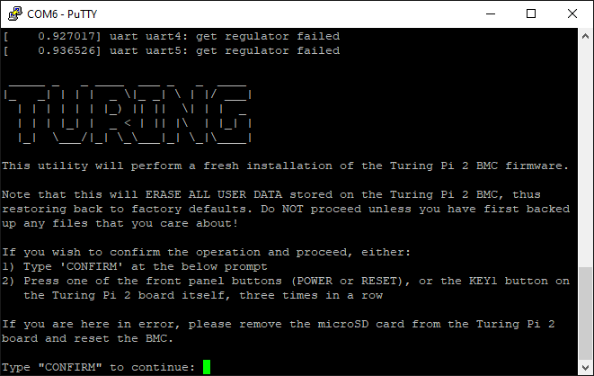

:::note
The console is not necessary to perform the upgrade but it will let you see more details about the upgrade process
:::

To continue the firmware upgrade process choose one of the below:

* press `KEY1` on the board rapidly **3 times**
* press `Power` button on the case (if you have a front panel connected) rapidly **3 times**
* type in `CONFIRM` in the console and press `Enter` if you have UART connected

The flashing process will start and will be indicated by the LED animation (LEDs will turn on one at a time from left to right):

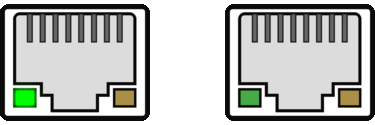

and in the console (if you have it connected), you’ll see, for example:

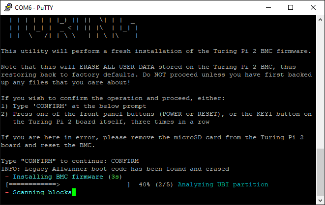

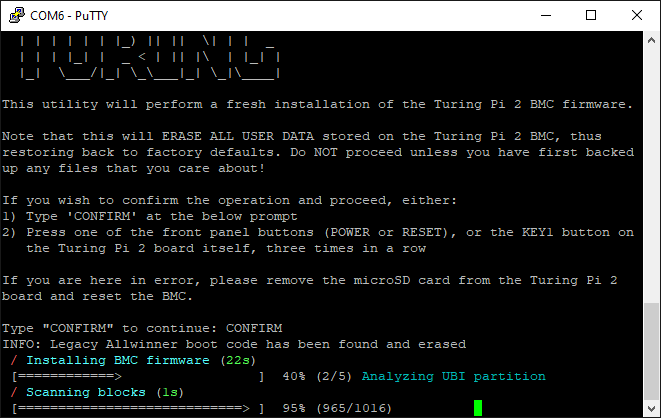

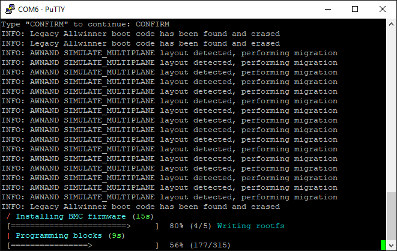

:::note[If the flashing fails for any reason, the LEDs will start blinking the "SOS code":]

:::

:::note
Interrupting the upgrade process (e.g. due to a power failure or error during flashing) is not “dangerous” but will result in a non-bootable BMC until installation is reattempted and completes successfully
:::

Once the flashing process is finished, the LEDs will start blinking twice:


and the console will print this message:

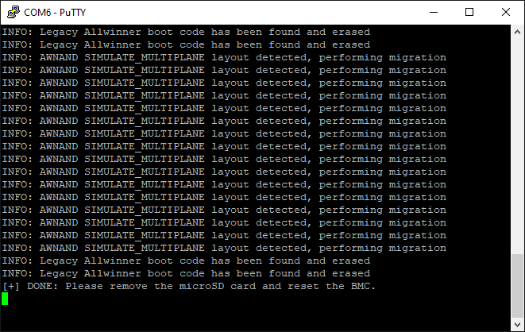

Disconnect power from the Turing Pi 2 board, remove the SD card, and connect the power back. Alternatively, you can remove the card and restart the BMC.

The first boot can take over a minute to finish because of post-upgrade processes like certificate generation. Once the boot is complete you can navigate to [BMC UI](/docs/turing-pi2-bmc-ui) to verify the new firmware has been installed (the interface will change and will show the version in the top section next to the logo and below “Turing Pi”:

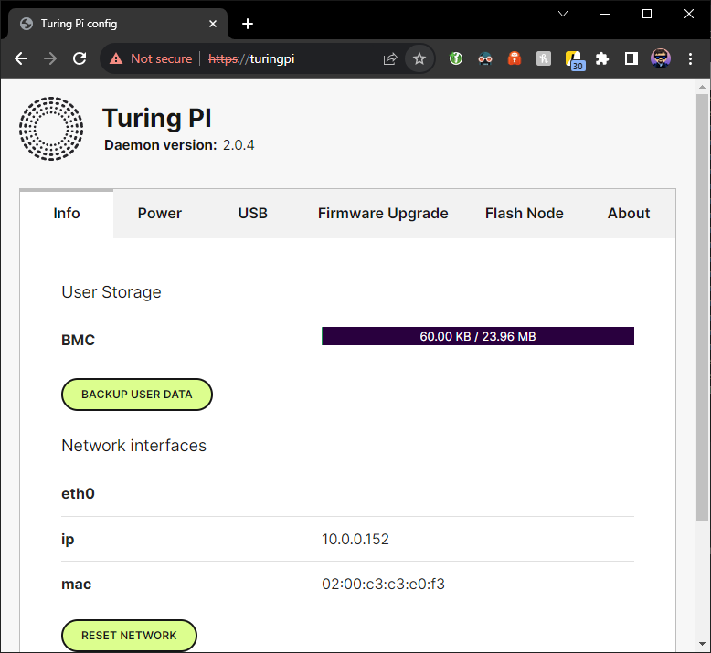

 You can see the version in the UART console as well:

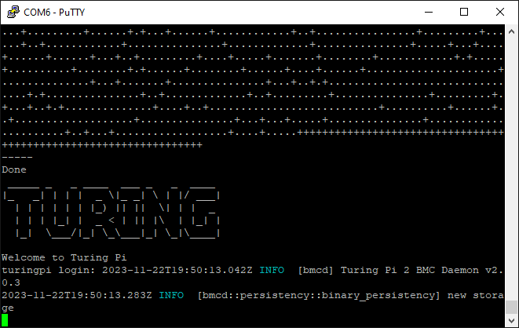

 

### Alternative ways of "removing" the SD card

If you want to leave the SD card in the Turing Pi 2 board and not remove it after you upgraded firmware from v1.x to v2.x, that'll prevent the BMC from booting because it will detect firmware on the card and try to upgrade again.\\

**Using UART:**

Interrupt the boot process (during the U-boot phase) when asked and use the command:

```
mmc erase 0 1000
```

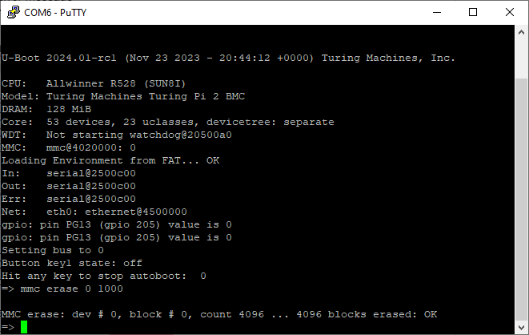

And reboot.

This will make the partitions disappear and you'll need to recreate the partitions once you boot the BMC

**Using SSH:**

Press and hold `KEY1` for 5s when powering on or resetting the board. The board will boot into a `safemode boot`. The boot will take over a minute to perform. SSH into the BMC (refer to [BMC UI](/docs/turing-pi2-bmc-ui) to find out the hostname or IP and for default login and password). While logged in perform:

```
dd if=/dev/zero of=/dev/mmcblk0 count=4096
```

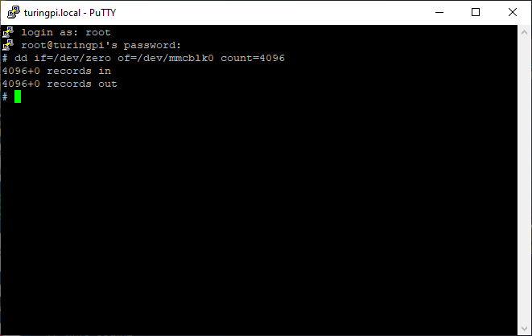

And reboot.

This will make the partitions disappear and you'll need to recreate the partitions once you boot the BMC. Since this is the BMC firmware running (even if in `safemode` mode) you can also re-format the card using `fdisk`

 

### Upgrading the firmware without SD card access

To perform the upgrade you are going to use `ssh` command. Use PowerShell on Windows and any console emulator on Linux and MacOS.

If you have data on the SD card that you want to retain, first unmount the SD card and make a local copy (refer to [BMC UI](/docs/turing-pi2-bmc-ui) to find out the hostname or IP and for default password). This example assumes default `turingpi` hostname and Linux/MacOS:

```shell
ssh root@turingpi umount /mnt/sdcard
ssh root@turingpi dd if=/dev/mmcblk0 > /local/path/to/sdcard-dump.img
```

On Windows use the Windows path style, for example:

```shell
ssh root@turingpi umount /mnt/sdcard
ssh root@turingpi dd if=/dev/mmcblk0 > D:\sdcard-dump.img
```

Now refer to [Preparation](#preparation) and download the `.img` image file. Flash the image using:

```shell
ssh root@turingpi dd of=/dev/mmcblk0 < /path/to/tp2-firmware-scdard-v2.x.x.img
```

Reboot the board and continue with [firmware upgarde](#upgrading-the-firmware-using-the-flashed-card).

Once the firmware is flashed, use one of the [alternative ways of "removing" the SD](#alternative-ways-of-removing-the-sd-card) card.

Once you boot into the new firmware and you made a backup of your card, you can flash your SD card data back to the card:

```shell
ssh root@turingpi dd of=/dev/mmcblk0 < /local/path/to/sdcard-dump.img
```
