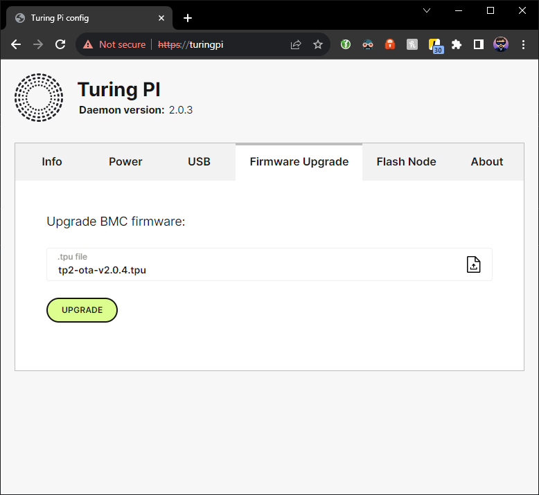
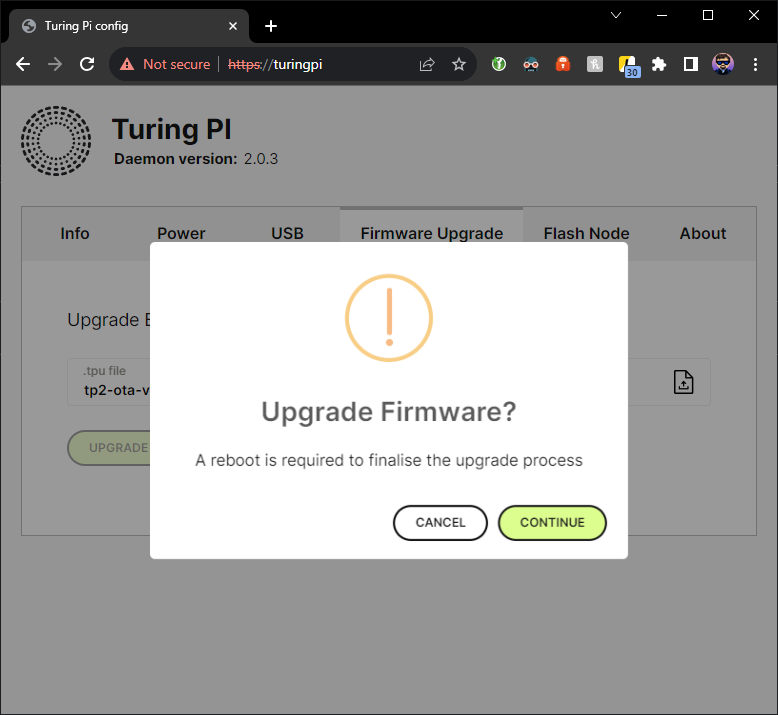
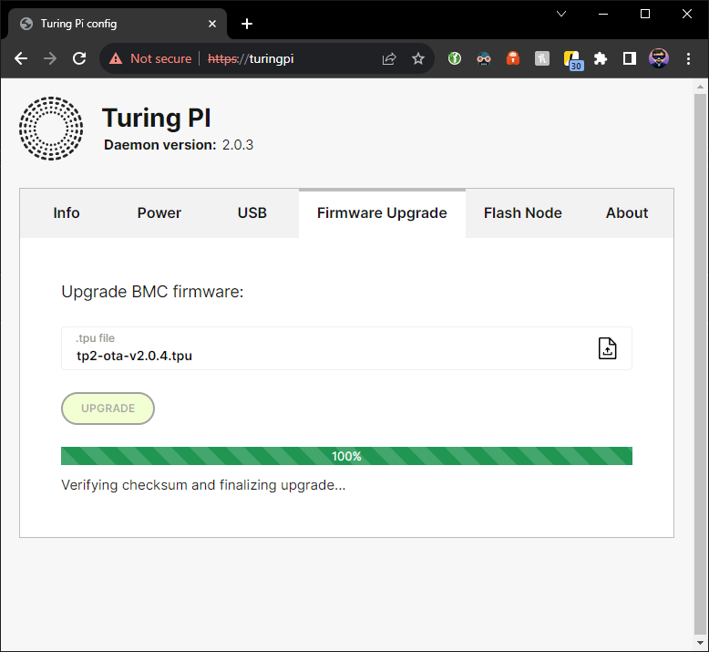
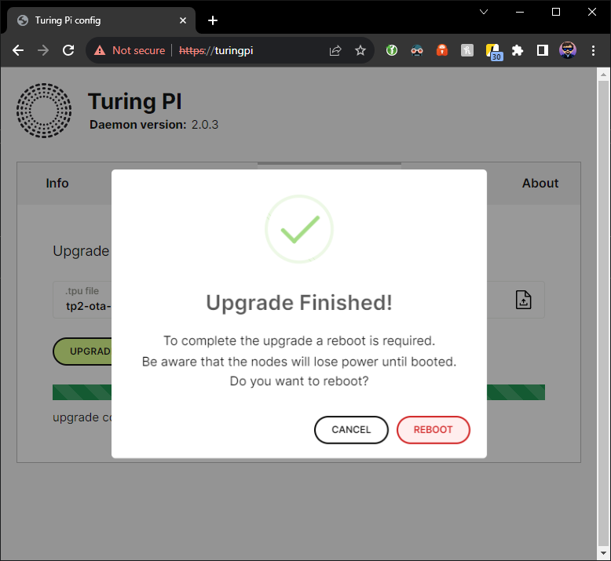
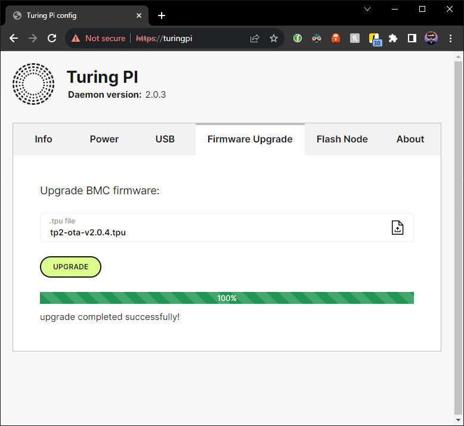
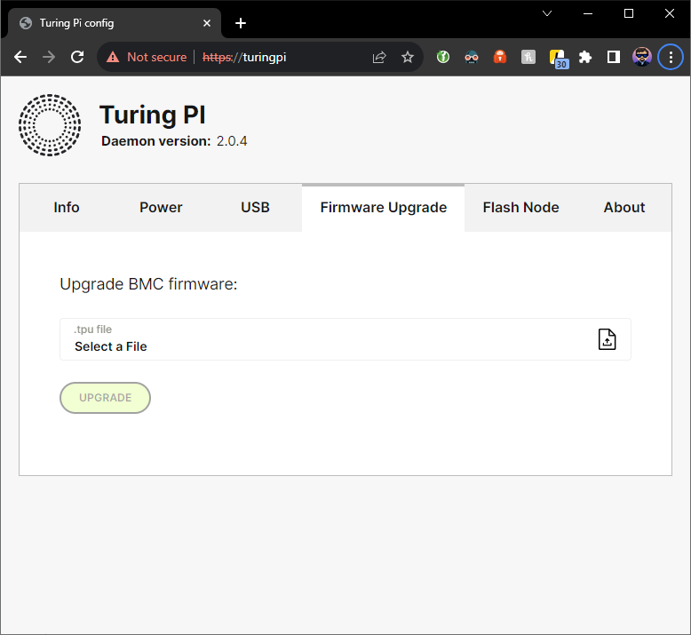

## Preparation

:::note
Info: You always find the newest firmware version on [https://firmware.turingpi.com/turing-pi2/](https://firmware.turingpi.com/turing-pi2/)
:::

To perform the OTA upgrade, download the `.tpu` file of the newest firmware version.

## Short version

* Open the [BMC UI](/docs/turing-pi2-bmc-ui)
* Navigate to the “Upgrade Firmware” card
* Choose the upgrade file
* Confirm/Proceed
* Reboot when prompted 

## Detailed version

With the [BMC UI](/docs/turing-pi2-bmc-ui) opened, head to the “Firmware Upgrade” card, click on the `.tpu file` field and choose the downloaded file:

Click `Upgrade` and confirm that you want to upgrade the firmware:

Click on `Continue` - the firmware will start to transfer from your computer to the BMC:

Once the transfer is done, the verification step will begin:

The verification process is important to ensure that the firmware upgrade was completed successfully. In case an issue is detected during the upgrade process, the process will be reverted leaving the current firmware version operational.

Once the verification is done, a message will be shown to indicate this:

Click “Reboot” - the last message indicating that the upgrade has been completed successfully will appear:

Wait for about a minute and press F5 in the browser - the interface should reload showing a new version on top of the page next to the logo and below “Turing Pi”:

The firmware has been upgraded successfully.
