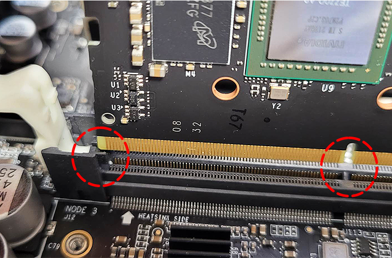
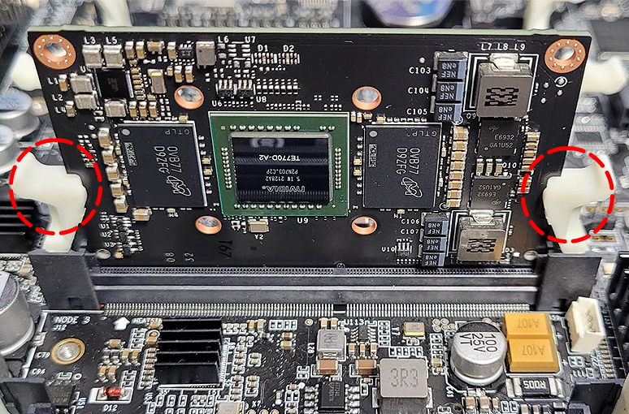
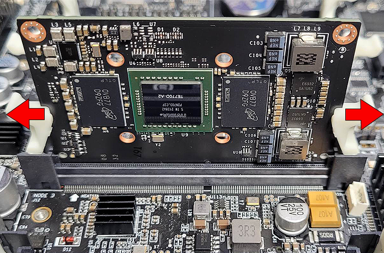

:::note
You can insert and remove (hot-swap) the modules without turning off (disconnecting power from) the whole Turing Pi2 board. Make sure that the node power is off (the red LED next to the node is off) for the node you want to insert or remove the module.
:::

## Installing Modules

Inserting modules into the Turing Pi 2 slot is straightforward. Simply align the sides and notch of the module with the slot, then press it vertically until you hear a click and the side arms fall into place. 

## Removing Compute Module

Removing the Compute Module is straightforward. Simply release the white arms located on both sides of the module simultaneously. Doing so will lift the module from the socket, allowing for easy removal.

## Installing Raspberry Pi CM4

Please follow [Module installation](/docs/installing-raspberry-pi-cm4-onto-a-turing-pi-2-cluster-board) guide to learn how to install Raspberry Pi CM4 onto the Turing Pi 2 board.

## Network

The Turing Pi 2 board is equipped with two RJ45 1Gbps network connectors configured in bridge mode by default. Connect one port to your router or network switch to integrate the board with your existing network. The BMC and Compute Modules should automatically receive IP addresses if your network has DHCP enabled. You should be able to reach your board via the hostname `turingpi.local`. This hostname is broadcasted over your network. For more information on networking, such as obtaining the BMC IP, please refer to the dedicated [Connect to the BMC](/docs/turing-pi2-bmc-ui) page, where we discuss all available options.
