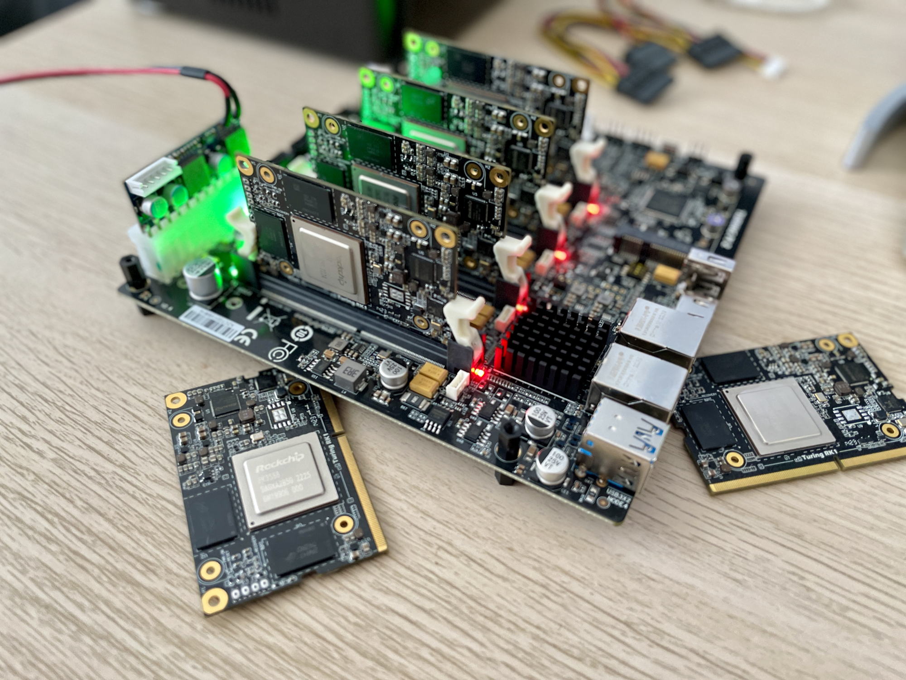

This page will help you get started with Turing Pi. You'll be up and running in a jiffy!

This innovative board is designed to provide a powerful platform for building not only multi-node computing clusters, but also as an excellent tool for learning Kubernetes, automation, edge AI computing, home labs and many more. With its ability to mount up to four Turing RK1, Raspberry Pi and Nvidia Jetson modules, the Turing Pi 2 board offers an unprecedented level of flexibility and scalability.

Turing Pi 2 board is solving many annoying issues when creating small clusters with its integrated power management and networking. The onboard 1 Gbps Ethernet network and integrated managed switch provide a high-speed connection to easily connect multiple nodes together and create a powerful computing cluster without additional wires and external devices. The board also includes an extension for USB and storage, which allows you to easily add additional storage and peripherals to your cluster. 

Another important feature of the Turing Pi 2 board is its built-in BMC (Baseboard Management Controller). This useful tool allows you to easily manage and automate your nodes, including monitoring system health, controlling power, flash OS to compute modules and even automate whole installation tasks using Terraform or Ansible. This makes it easy to keep your cluster running smoothly and troubleshoot any issues that may arise. 

Overall, the Turing Pi 2 board is a powerful and versatile platform. Whether you are a developer, researcher, or hobbyist, the Turing Pi 2 board offers everything you need to build a scalable computing cluster in a very small format. So why wait? Get started building your own cluster today with the Turing Pi 2 board!
