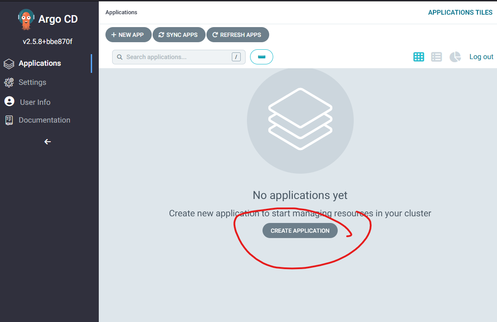
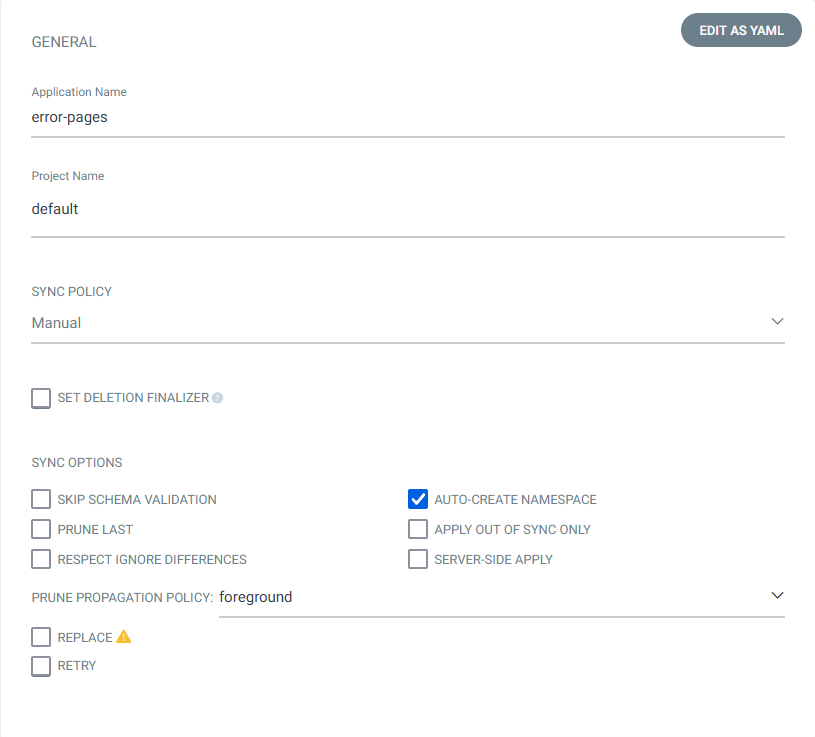
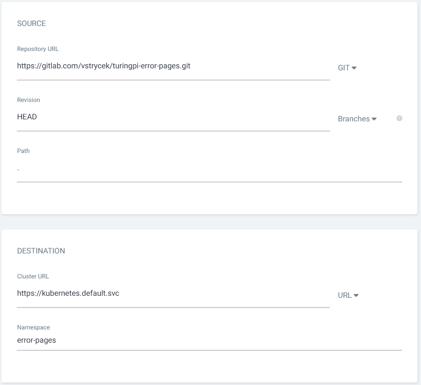
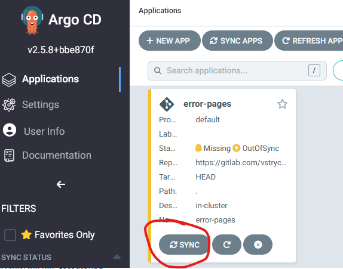
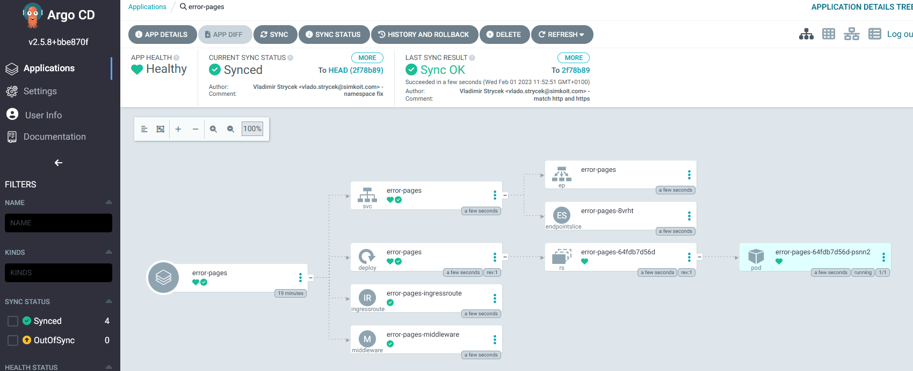
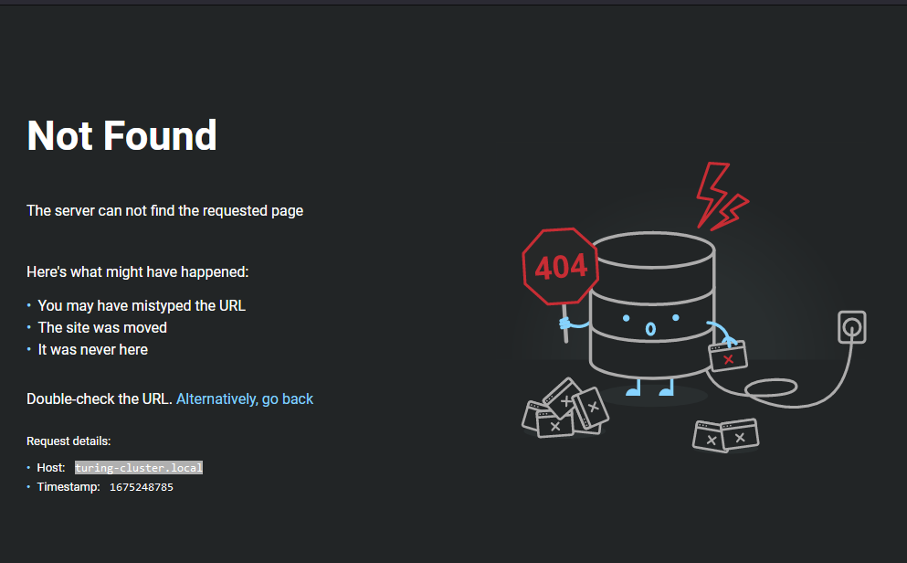
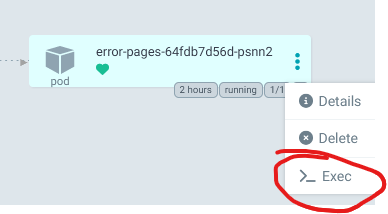

**[ArgoCD](https://argoproj.github.io/cd/)** is a GitOps tool for Kubernetes. It provides a way to manage applications in a Git repository and continuously deploy them to a cluster. Argo CD helps to ensure that the desired state of applications in the cluster matches the state specified in the Git repository.

The benefits of using Argo CD in a Kubernetes environment are:

* **Version control**: ArgoCD integrates with Git, allowing for version control of your application configurations.
* **Automated deployment**: ArgoCD continuously monitors the Git repository and automatically deploys changes to the cluster.
* **Consistency:** ArgoCD ensures that the state of the cluster and the Git repository are in sync, preventing drift and ensuring consistency.
* **Easy rollback**: ArgoCD makes it easy to roll back to previous versions of an application in the Git repository.
* **Auditability:** ArgoCD provides an audit trail of changes to applications, making it easier to understand and track changes over time.

Overall, Argo CD can help simplify and automate application deployment and management in a Kubernetes environment.

## Install

Installation is very straight forward, ArgoCD do not require persistent storage and does support Arm64 architecture out of the box.

On your primary control node, do:

```
#create namespace  
root@cube01:~# kubectl create namespace argocd  
#Install as on any other cluster  
root@cube01:~# kubectl apply -n argocd -f https://raw.githubusercontent.com/argoproj/argo-cd/stable/manifests/install.yaml
```

Please wait for the ArgoCD to finish deployment, you can see it done when all pods are in "Running" State.

```
root@cube01:~# kubectl get pods -n argocd  
NAME                                             READY STATUS  RESTARTS   AGE  
argocd-notifications-controller-7c946895bb-nb2qm  1/1 Running 1 (13h ago) 15h  
argocd-redis-598f75bc69-cv25j                     1/1 Running 1 (13h ago) 15h  
argocd-applicationset-controller-7c86dd8cd7-mnw59 1/1 Running 1 (13h ago) 15h  
argocd-dex-server-786fb4b8b-pc8mz                 1/1 Running 1 (13h ago) 15h  
argocd-repo-server-648db4756c-cw6c4               1/1 Running 1 (13h ago) 15h  
argocd-application-controller-0                   1/1 Running 1 (13h ago) 15h  
argocd-server-6cfb678659-lwm7v                    1/1 Running 1 (13h ago) 15h  
  

```

ArgoCD will automatically generate an **admin password** that you can use to log in. (The default username is "**admin**") To get it, execute the following command:

```
kubectl -n argocd get secret argocd-initial-admin-secret -o jsonpath="{.data.password}" | base64 -d; echo
```

### UI

You can access the GUI of ArgoCD multiple ways.

**Option 1**: Port forwarding the service to your localhost.

```
kubectl port-forward svc/argocd-server -n argocd 8080:443
```

You should be able to access it on [https://localhost:8080](https://localhost:8080)

**Option 2**: (Preferred) Use MetalLB to assign Unique IP to ArgoCD UI

```
kubectl patch service argocd-server -n argocd --patch '{ "spec": { "type": "LoadBalancer", "loadBalancerIP": "10.0.0.72" } }'
```

Change the IP to one free from range defined for MetalLB.

**Option 3**: Use build in Traefik to route base on DNS

Follow the official guide [**HERE**](https://argo-cd.readthedocs.io/en/stable/operator-manual/ingress/#traefik-v22). This however require also to do some changes to configuration of ArgoCD, like disabling HTTPS internally and having Traefik terminate HTTPS connections instead.

### Deploying simple application

Let's make sample deployments that can be actually also useful, our "go to" test deployment is [error-pages](https://github.com/tarampampam/error-pages)

We have prepared a [**git repository**](https://gitlab.com/vstrycek/turingpi-error-pages) with Kubernetes deployment. And what it does, is deploy error-pages container and redirect all 404 and other errors in Traefik to it. Showing much more pleasing error page.

**We highly recommend cloning this repository to your own.**

**Open ArgoCD UI** and log in with admin|password and click on **"Create Application"**



**Fill in the following:**

* **Application Name**: error-pages
* **Project Name**: default
* **Sync Policy**: Manual
* **Auto-Create Namespace:** "check"
* **Repository URL(GIT):** [https://gitlab.com/vstrycek/turingpi-error-pages.git](https://gitlab.com/vstrycek/turingpi-error-pages.git)
* **Revision**: HEAD
* **Path**: .
* **Cluster URL**: [https://kubernetes.default.svc](https://kubernetes.default.svc)
* **Namespace**: error-pages





Then hit **"Create"** on top of the page. Your app should appear in ArgoCD main page, but since we have chosen "Manual" for sync, it will not automatically deploy. You should not in any case have automatic deployment from Git that is not under your control !

Now you can hit "**Sync"** and then **"Synchronize**" on the panel that appear. Watch how the app deploys by clicking on the app panel.  



If everything went ok, you should see something like this:



In our guide, we set up MetalLB and Traefik got IP 10.0.0.70, then we added `turing-cluster.local` into our host file. So when we go to http or https\://[http://turing-cluster.local](http://turing-cluster.local) we should get a nice looking error page.



### Enable CLI from GUI

ArgoCD allows CLI access directly to your containers, but this feature is not turned on by default. To turn it on, do the following:

**1. Patch role argocd-server**

```
kubectl patch role argocd-server -n argocd --type=json -p='[{"op": "add", "path": "/rules/-", "value": {"apiGroups": [""], "resources": ["pods/exec"], "verbs": ["create"]}}]'
```

**2. Patch ConfigMap argocd-cm**

```
kubectl patch configmap argocd-cm -n argocd -p '{"data": {"exec.enabled": "true"}}'
```

**3. Delete all ArgoCD pods (restarting the service)**

```
kubectl delete pods -n argocd --field-selector=status.phase=Running
```

Wait for the pods to come back into "Running" state, checking with:

```
 kubectl get pod -n argocd
```

As **admin** user, now you should have option to enter CLI for pods. (Error pages is not the best example since this deployment have some serious security restrictions)

\
For creating users and adding them possibility to interact with CLI please check the ArgoCD [**documentation**](https://argo-cd.readthedocs.io/en/stable/).
