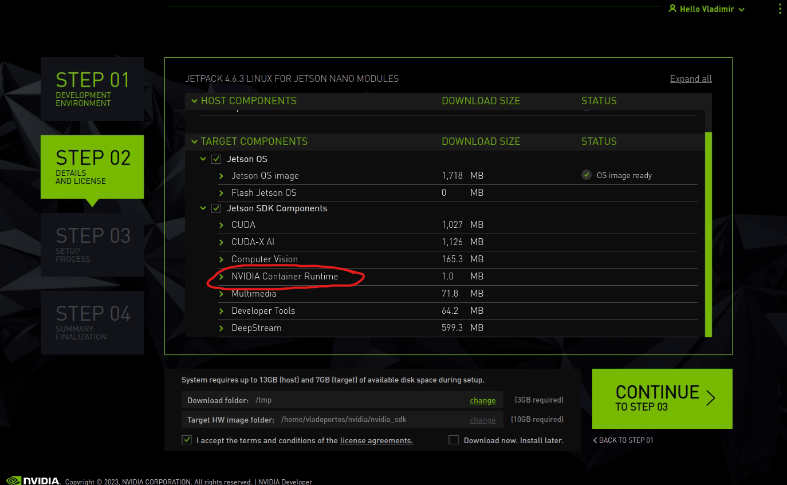
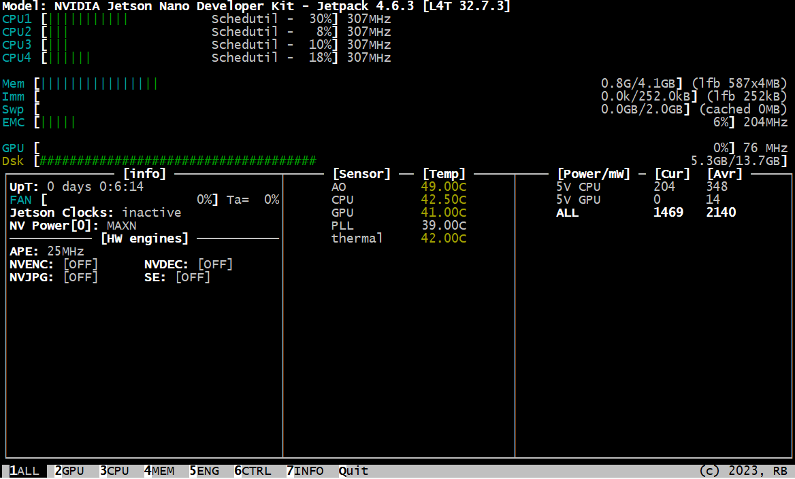
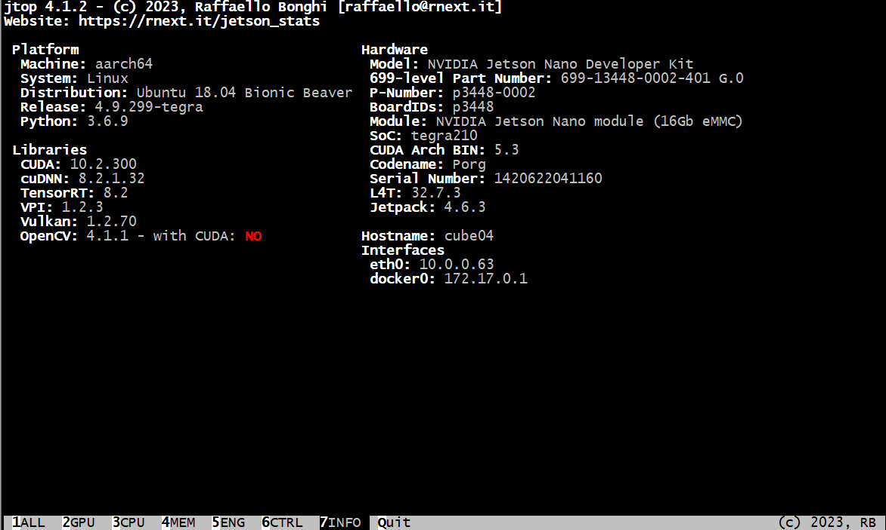

In this guide's bonus section, we'll examine the process of incorporating an Nvidia Jetson module into your K3s cluster, thereby adding a machine learning node to the cluster. We'll label the node, then deploy a test deployment to confirm that it has access to the GPU on the node.

## Setup

To configure your Nvidia Jetson as a worker node in Kubernetes, it is important to note that there are some unique requirements to be aware of. Firstly, you must use Nvidia's JetPack OS for the installation process and cannot use DietPi. For the best outcome, it is recommended to follow the official Nvidia documentation for installing JetPack OS on your specific Jetson module. Once you have the module set up within Turing Pi V2 and can access it through SSH, you can move forward with the setup process. If you need additional support, you can refer to our guide for installing the OS, which is available HERE. It is also important to make sure that you have installed the NVIDIA Container Runtime from the Jetson SDK components and any other relevant tools.



To verify, you can check it by logging in using the following command:

```
root@ubuntu:~# nvidia-container-runtime --version
runc version 1.1.0-0ubuntu1~18.04.1
spec: 1.0.2-dev
go: go1.16.2
libseccomp: 2.5.1
```

Upon logging in, you will find that JetPack is based on Ubuntu Linux. To verify the version of Ubuntu you have installed, switch to the root user and run a command to check.

Please note that this is on our Jetson Nano

```
root@ubuntu:~# lsb_release -a
No LSB modules are available.
Distributor ID: Ubuntu
Description: Ubuntu 18.04.6 LTS
Release: 18.04
Codename: bionic
```

First do the update:

```
apt-get update
apt-get upgrade
apt autoremove
```

Next, you will need to install the following packages:

```
apt-get -y install python3-pip curl
pip3 install -U jetson-stats
```

Disable IPv6 by adding these lines to the bottom of the file: `/etc/sysctl.conf`

```
# Disable IPv6
net.ipv6.conf.all.disable_ipv6 = 1
net.ipv6.conf.default.disable_ipv6 = 1
net.ipv6.conf.lo.disable_ipv6 = 1
```

To ensure that your node has a fixed IP address, you will need to set it using your network-specific values. If necessary, you can adjust these values to suit your needs.

To make this change, you will need to edit the file "/etc/default/networking" and include the following line:

```
CONFIGURE_INTERFACES=no
```

Once you have made the change to `/etc/default/networking`, you will need to **edit** the file `/etc/network/interfaces` and add your network configuration details.

```
auto eth0
iface eth0 inet static
  address 10.0.0.63
  netmask 255.255.255.0
  gateway 10.0.0.254
```

Make sure package nvidia-jetpack is installed (It should be, by default)

```
apt-cache show nvidia-jetpack
```

You will also need to **edit** the `/etc/hosts` file to make sure that it is consistent across your entire Kubernetes environment. In this case, as we are using the Kubernetes environment from our previous guide, we will name the Jetson module `cube04`. It is important to ensure that the`/etc/hosts` file is the same on all nodes in your Kubernetes environment.

```
127.0.0.1 localhost
10.0.0.60 cube01 cube01.local
10.0.0.61 cube02 cube02.local
10.0.0.62 cube03 cube03.local
10.0.0.63 cube04 cube04.local
```

Additionally, you will need to set the new hostname using a command-line interface.

```
root@ubuntu:/etc/network# hostnamectl set-hostname cube04
root@ubuntu:/etc/network# hostnamectl status
Static hostname: cube04
Icon name: computer
Machine ID: a3d9197b765643568af09eb2bd3e5ce7
Boot ID: 4c6eb1bc3b004a228e3f97d227ff5cdd
Operating System: Ubuntu 18.04.6 LTS
Kernel: Linux 4.9.299-tegra
Architecture: arm64
```

:::caution
As of the writing of this guide on February 3, 2023, there is a bug in versions of the nvidia-container-toolkit prior to 1.12 that prevent it from functioning properly on Jetson within a Kubernetes environment. To determine the version you have installed, you can run the following command:
:::

```
dpkg -l nvidia-container-toolkit
```

If the version you have installed is less than 1.12, you will need to switch to the experimental branch and update to a newer version. This will ensure that your nvidia-container-toolkit will work correctly with your Jetson in a Kubernetes environment.

```
distribution=$(. /etc/os-release;echo $ID$VERSION_ID) \
&& curl -fsSL https://nvidia.github.io/libnvidia-container/gpgkey | sudo gpg --dearmor -o /usr/share/keyrings/nvidia-container-toolkit-keyring.gpg \
&& curl -s -L https://nvidia.github.io/libnvidia-container/experimental/$distribution/libnvidia-container.list | \
sed 's#deb https://#deb [signed-by=/usr/share/keyrings/nvidia-container-toolkit-keyring.gpg] https://#g' | \
sudo tee /etc/apt/sources.list.d/nvidia-container-toolkit.list
```

```
apt update
apt upgrade
reboot
# just to be sure, try again
apt upgrade 
```

Log back in on the new fixed IP we set up.

You can now use `jtop` command to check your Jetson module:





:::note
It's important to note that installing the full SDK and JetPack can consume a significant amount of storage space. Keep this in mind as you plan your installation process.
:::

```
root@cube04:~# df -h
Filesystem Size Used Avail Use% Mounted on
/dev/mmcblk0p1 14G 13G 461M 97%  /
```

We can do some clean up.

```
apt autoremove -y
apt clean
# Remove office and thunderbird
apt remove thunderbird libreoffice-* -y
# Remove sample files
rm -rf /usr/local/cuda/samples
rm -rf /usr/src/cudnn_samples_*
rm -rf /usr/src/tensorrt/data
rm -rf /usr/src/tensorrt/samples
rm -rf /usr/share/visionworks* ~/VisionWorks-SFM*Samples
rm -rf /opt/nvidia/deepstream/deepstream*/samples
# Remove GUI
apt-get purge gnome-shell ubuntu-wallpapers-bionic light-themes chromium-browser* libvisionworks libvisionworks-sfm-dev -y
apt-get autoremove -y
apt clean -y
# Remove static libraries 
rm -rf /usr/local/cuda/targets/aarch64-linux/lib/.a
rm -rf /usr/lib/aarch64-linux-gnu/libcudnn.a
rm -rf /usr/lib/aarch64-linux-gnu/libnvcaffe_parser*.a
rm -rf /usr/lib/aarch64-linux-gnu/libnvinfer*.a
rm -rf /usr/lib/aarch64-linux-gnu/libnvonnxparser*.a
rm -rf /usr/lib/aarch64-linux-gnu/libnvparsers*.a
```

This should clean it up a little.

```
root@cube04:~# df -h
Filesystem Size Used Avail Use% Mounted on
/dev/mmcblk0p1 14G 9.2G 3.9G 71% /
```

## Joining Kubernetes

This process should work similarly to the process of joining other worker nodes in your Kubernetes environment.

```
# Install k3s and join to master
curl -sfL https://get.k3s.io | K3S_URL=https://10.0.0.60:6443 K3S_TOKEN=myrandompassword sh -
# On Master node, label the new node
kubectl label nodes cube04 kubernetes.io/role=worker
kubectl label nodes cube04 node-type=jetson
```

K3s should detect the nvidia-container-runtime on its own. You can verify this by checking the file `/var/lib/rancher/k3s/agent/etc/containerd/config.toml`. If everything is set up correctly, you should see lines similar to the following

```
[plugins."io.containerd.grpc.v1.cri".containerd.runtimes."nvidia"]
runtime_type = "io.containerd.runc.v2"
[plugins."io.containerd.grpc.v1.cri".containerd.runtimes."nvidia".options]
BinaryName = "/usr/bin/nvidia-container-runtime
```

It's crucial to make the NVIDIA runtime environment the default one to avoid potential issues. To do this, perform the following necessary steps on the Jetson node.

```
cp /var/lib/rancher/k3s/agent/etc/containerd/config.toml /var/lib/rancher/k3s/agent/etc/containerd/config.toml.tmpl
```

Edit the `/var/lib/rancher/k3s/agent/etc/containerd/config.toml.tmpl` and under plugins."io.containerd.grpc.v1.cri".containerd add default\_runtime\_name = "nvidia"

```
.
.
.
[plugins."io.containerd.grpc.v1.cri".containerd]
  snapshotter = "overlayfs"
  disable_snapshot_annotations = true
  default_runtime_name = "nvidia"
.
.
.
```

```
# Restart containerd and k3s service
systemctl restart containerd
systemctl restart k3s-agent
```

## Not enough space?

It's possible that your Jetson node may not have sufficient storage space to run containers, especially if you're using the 16 GB Jetson Nano. In this case, you may want to consider using an M.2 SSD and mounting it to "/containerd". Additionally, you should create the following folders: "/containerd/run-k3s", "/containerd/var-k3s-pods", and "/containerd/var-k3s-rancher". These folders will be linked to the original locations in containerd. Unfortunately, the "--state" location is hard-coded to "k3s", so you'll need to use the "ln -s" command to link the folders.

```
# Locate your M.2
lsblk | grep disk
# For us, it's this one: nvme0n1 259:0 0 465.8G 0 disk
# Create ext4 partition
mkfs.ext4 /dev/nvme0n1
# Create directory where we will mount the disk 
mkdir /containerd
# Add following to /etc/fstab 
/dev/nvme0n1 /containerd ext4 defaults 0 1
# Mount the disk
mount -a
# Check 
df -h /containerd
# Create two folders
mkdir -p /containerd/run-k3s
mkdir -p /containerd/var-k3s-pods
mkdir -p /containerd/var-k3s-rancher
# Stop containerd and k3s service
systemctl stop k3s-agent
systemctl stop containerd
/usr/local/bin/k3s-killall.sh
# Move files to new location
mv /run/k3s/ /containerd/run-k3s/
mv /var/lib/kubelet/pods/ /containerd/var-k3s-pods/
mv /var/lib/rancher/ /containerd/var-k3s-rancher/
# Create symbolic links
ln -s /containerd/run-k3s/ /run/k3s
ln -s /containerd/var-k3s-pods/ /var/lib/kubelet/pods
ln -s /containerd/var-k3s-rancher/ /var/lib/rancher
# Start K3s agent
systemctl start k3s-agent
```

## Test

First docker, on your Nvidia Jetson node run:

```
docker run --rm --runtime nvidia xift/jetson_devicequery:r32.5.0
```

If everything is ok, you should get detected CUDA device like this:

```
./deviceQuery Starting...

CUDA Device Query (Runtime API) version (CUDART static linking)

Detected 1 CUDA Capable device(s)

Device 0: "NVIDIA Tegra X1"
CUDA Driver Version / Runtime Version            10.2 / 10.2
CUDA Capability Major/Minor version number:      5.3
Total amount of global memory:                   3963 MBytes (4155203584 bytes)
( 1) Multiprocessors, (128) CUDA Cores/MP:       128 CUDA Cores
GPU Max Clock rate:                              922 MHz (0.92 GHz)
Memory Clock rate:                               13 Mhz
Memory Bus Width:                                64-bit
L2 Cache Size:                                   262144 bytes
Maximum Texture Dimension Size (x,y,z)           1D=(65536), 2D=(65536, 65536), 3D=(4096, 4096, 4096)
Maximum Layered 1D Texture Size, (num) layers    1D=(16384), 2048 layers
Maximum Layered 2D Texture Size, (num) layers    2D=(16384, 16384), 2048 layers
Total amount of constant memory:                 65536 bytes
Total amount of shared memory per block:         49152 bytes
Total number of registers available per block:   32768
Warp size:                                       32
Maximum number of threads per multiprocessor:    2048
Maximum number of threads per block:             1024
Max dimension size of a thread block (x,y,z):    (1024, 1024, 64)
Max dimension size of a grid size (x,y,z):       (2147483647, 65535, 65535)
Maximum memory pitch:                            2147483647 bytes
Texture alignment:                               512 bytes
Concurrent copy and kernel execution:            Yes with 1 copy engine(s)
Run time limit on kernels:                       Yes
Integrated GPU sharing Host Memory:              Yes
Support host page-locked memory mapping:         Yes
Alignment requirement for Surfaces:              Yes
Device has ECC support:                          Disabled
Device supports Unified Addressing (UVA):        Yes
Device supports Compute Preemption:              No
Supports Cooperative Kernel Launch:              No
Supports MultiDevice Co-op Kernel Launch:        No
Device PCI Domain ID / Bus ID / location ID: 0 / 0 / 0
deviceQuery, CUDA Driver = CUDART, CUDA Driver Version = 10.2, CUDA Runtime Version = 10.2, NumDevs = 1
Result = PASS
```

Next, we do the same with **containerd**:

```
ctr i pull docker.io/xift/jetson_devicequery:r32.5.0
ctr run --rm --gpus 0 --tty docker.io/xift/jetson_devicequery:r32.5.0 deviceQuery
```

You should get the same result as from Docker image.

## Nvidia Device Plugin

We can now install [Nvidia Device Plugin](https://github.com/NVIDIA/k8s-device-plugin), from their git:

The NVIDIA device plugin for Kubernetes is a Daemonset that allows you to automatically:

* Expose the number of GPUs on each nodes of your cluster
* Keep track of the health of your GPUs
* Run GPU enabled containers in your Kubernetes cluster.

This means that the GPU availability on each node is detected, and we can use special toleration and resource requests for containers. This helps to utilize the GPU effectively. However, it is not mandatory, as we can also use nodeSelector to select the Jetson node specifically.

### Install

Always check the [git](https://github.com/NVIDIA/k8s-device-plugin/releases) for latest version. Do this on your Master control node.

```
kubectl create -f https://raw.githubusercontent.com/NVIDIA/k8s-device-plugin/v0.13.0/nvidia-device-plugin.yml
```

Wait a while, and then you can check if all the DaemonSets are running (they should be all running, even on nodes without GPU)

```
root@cube01:~# kubectl get pods -n kube-system | grep nvidia-device-plugin
nvidia-device-plugin-daemonset-gpljh 1/1 Running 0 50m
nvidia-device-plugin-daemonset-2hsmv 1/1 Running 0 50m
nvidia-device-plugin-daemonset-4b2dj 1/1 Running 0 50m
nvidia-device-plugin-daemonset-cn7zf 1/1 Running 2 (28m ago) 50m
```

You can check the logs of each, on the node where the GPU is you should see:

```
root@cube01:~# kubectl logs nvidia-device-plugin-daemonset-cn7zf -n kube-system
2023/02/03 12:08:05 Starting FS watcher.
2023/02/03 12:08:05 Starting OS watcher.
2023/02/03 12:08:05 Starting Plugins.
2023/02/03 12:08:05 Loading configuration.
2023/02/03 12:08:05 Updating config with default resource matching patterns.
2023/02/03 12:08:05 
Running with config:
{
"version": "v1",
"flags": {
"migStrategy": "none",
"failOnInitError": false,
"nvidiaDriverRoot": "/",
"gdsEnabled": false,
"mofedEnabled": false,
"plugin": {
"passDeviceSpecs": false,
"deviceListStrategy": "envvar",
"deviceIDStrategy": "uuid"
}
},
"resources": {
"gpus": [
{
"pattern": "*",
"name": "nvidia.com/gpu"
}
]
},
"sharing": {
"timeSlicing": {}
}
}
2023/02/03 12:08:05 Retreiving plugins.
2023/02/03 12:08:05 Detected non-NVML platform: could not load NVML: libnvidia-ml.so.1: cannot open shared object file: No such file or directory
2023/02/03 12:08:05 Detected Tegra platform: /etc/nv_tegra_release found
2023/02/03 12:08:05 Starting GRPC server for 'nvidia.com/gpu'
2023/02/03 12:08:05 Starting to serve 'nvidia.com/gpu' on /var/lib/kubelet/device-plugins/nvidia-gpu.sock
2023/02/03 12:08:05 Registered device plugin for 'nvidia.com/gpu' with Kubelet
```

Because Nvidia Jetson does not use fully featured GPU, we have some not found items, but what is important is: **Registered device plugin for 'nvidia.com/gpu' with Kubelet.**

You can now check your node for this GPU resource:

```
kubectl describe node cube04
.
.
Capacity:
cpu: 4
ephemeral-storage: 14384136Ki
hugepages-2Mi: 0
memory: 4057816Ki
nvidia.com/gpu: 1
pods: 110
Allocatable:
cpu: 4
ephemeral-storage: 13992887490
hugepages-2Mi: 0
memory: 4057816Ki
nvidia.com/gpu: 1
pods: 110
.
.
.
```

As you can see, we have one nvidia.com/gpu: 1 available.

## Deploy test pod

Create file **tensor.yaml**

```
apiVersion: v1
kind: Pod
metadata:
  name: nvidia-query
spec:
  restartPolicy: OnFailure
  nodeSelector:
    node-type: jetson
  containers:
  - name: nvidia-query
    image: xift/jetson_devicequery:r32.5.0
    command: [ "./deviceQuery" ]
```

This one option, we have used here:

```
nodeSelector:
  node-type: jetson
```

We have labeled our node Jetson near the start of this guide.

The other option is to use the GPU annotation from NVIDIA plugin.

```
apiVersion: v1
kind: Pod
metadata:
name: nvidia-query
spec:
  restartPolicy: OnFailure
  containers:
  - name: nvidia-query
    image: xift/jetson_devicequery:r32.5.0
    command: [ "./deviceQuery" ]
    resources:
      limits:
        nvidia.com/gpu: 1 # requesting 1 GPU
  tolerations:
  - key: nvidia.com/gpu
    operator: Exists
    effect: NoSchedule
```

Apply to cluster:

```
kubectl create -f tensor.yaml
# Check
root@cube01:~# kubectl get pods
NAME READY STATUS RESTARTS AGE
nvidia-query 0/1 Completed 0 87s
# Check the log
root@cube01:~# kubectl logs nvidia-query
.
.
.
deviceQuery, CUDA Driver = CUDART, CUDA Driver Version = 10.2, CUDA Runtime Version = 10.2, NumDevs = 1
Result = PASS
```

That's it! Your Kubernetes cluster is now up and running and able to automatically detect both CPU and GPU resources. It can assign and manage GPU resources for pods as needed.
