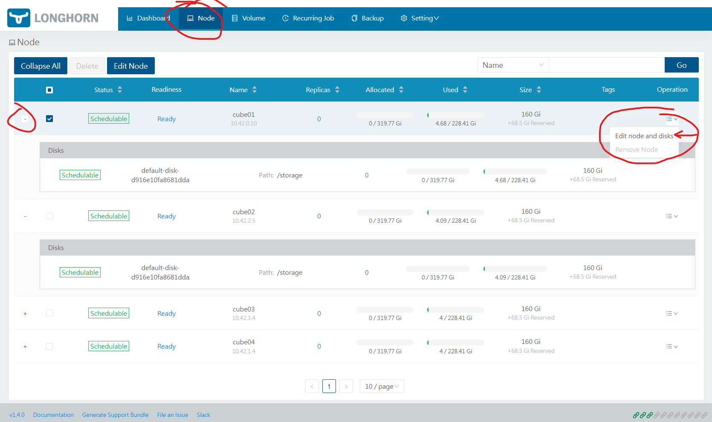
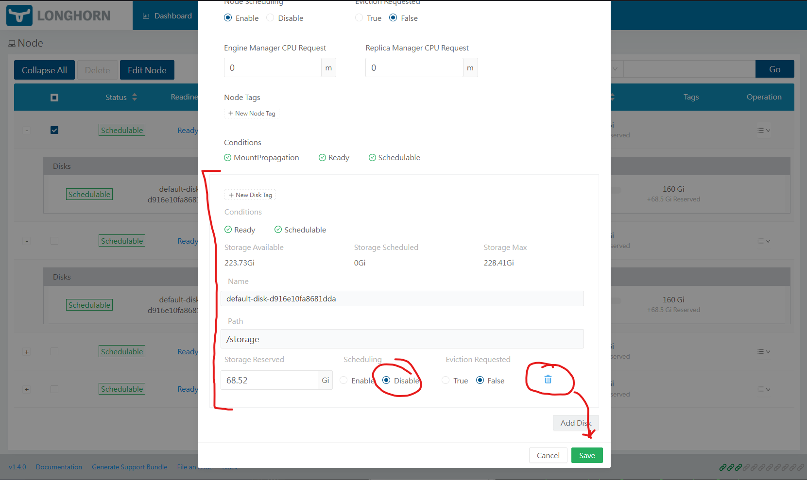
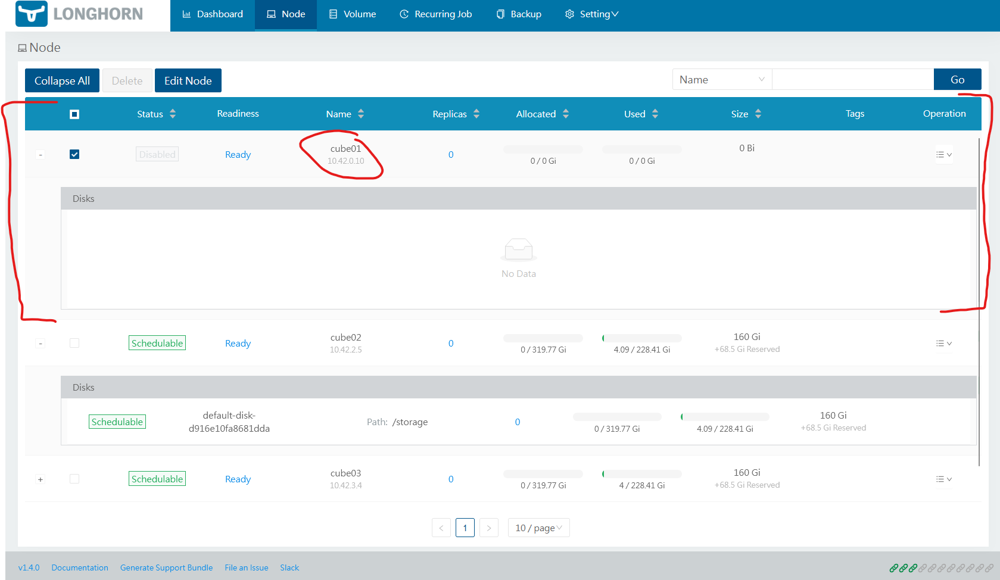
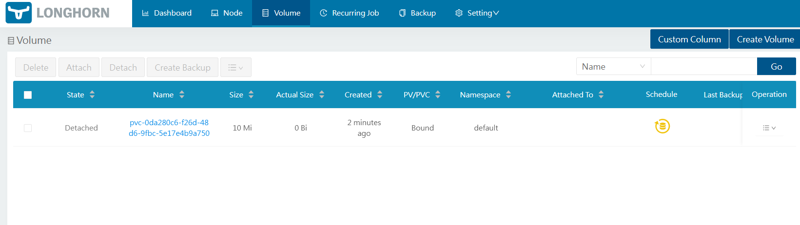

This section describes two options for setting up the storage of our Kubernetes cluster on the Turing Pi 2 platform: the NFS provider and Longhorn. Both options have their merits; your selection will depend on your project requirements.

## Option 1: The NFS provider

This is the easiest and most straightforward option, which requires the least amount of physical disks. In this setup, we will convert Node3 to double as a Samba server. Node3 is connected to two SATA ports on the Turing Pi V2. Simply connect a disk of your choice to one of these ports. It is important to note that you should not hot-plug the disk. To do this, shut down the node using the $tpi command or through the BMC web interface, plug in the disk, and then restart the node.

When the Node3 is up and ready, SSH connect to its OS.

You should be able to identify the disk using **fdisk -l** command, in our case it's Samsung SSD 870

```
root@cube03:~# fdisk -l  
  
Disk /dev/ram0: 4 MiB, 4194304 bytes, 8192 sectors  
Units: sectors of 1 * 512 = 512 bytes  
Sector size (logical/physical): 512 bytes / 4096 bytes  
I/O size (minimum/optimal): 4096 bytes / 4096 bytes  
.  
.  
.  
Disk /dev/sda: 465.76 GiB, 500107862016 bytes, 976773168 sectors  
Disk model: Samsung SSD 870   
Units: sectors of 1 * 512 = 512 bytes  
Sector size (logical/physical): 512 bytes / 512 bytes  
I/O size (minimum/optimal): 512 bytes / 512 bytes  
  

```

So for us its **/dev/sda.**

### Install NFS server

On Node3, we will be configuring the NFS server. This involves formatting the disk, mounting it, and exporting it to make it accessible to other nodes in the network.

```
# Formating the new disk  
mkfs.ext4 /dev/sda  
  
# Create /data folder  
mkdir /data  
  
# Add line to /etc/fstab to auto mount this disk to /data on boot  
echo "/dev/sda /data ext4 defaults 0 0" | tee -a /etc/fstab  
  
# Mount the disk to /data folder  
mount -a  
  
# Confirm the /data is mounted with  
df -h /data  
  
# Above should return something similar to this:  
Filesystem Size Used Avail Use% Mounted on  
/dev/sda 458G 28K 435G 1% /data  
  
# Install NFS server  
apt install -y nfs-server  
  
# Tell NFS what to export  
echo "/data \*(rw,no\_subtree\_check,no\_root\_squash)" | tee -a /etc/exports  
  
# Enable and start NFS server  
systemctl enable --now nfs-server  
  
# Tell NFS server to reload and re-export what's in /etc/exports (just in case)  
exportfs -ar  
  
# Check if the /data is exported  
root@cube03:~# showmount -e localhost  
Export list for localhost:  
/data \*  

```

### Install NFS client

On every single node, install NFS client

```
apt install -y nfs-common
```

### Install NFS StorageClass

In Kubernetes, a StorageClass is a way to define a set of parameters for a specific type of storage that is used in a cluster. This type of storage is used by Persistent Volumes (PVs) and Persistent Volume Claims (PVCs).

A Persistent Volume (PV) is a piece of storage in the cluster that has been dynamically provisioned, and it represents a specific amount of storage capacity.

A Persistent Volume Claim (PVC) is a request for storage by a user. It asks for a specific amount of storage to be dynamically provisioned based on the specified StorageClass. The PVC is then matched to a PV that meets the requirements defined in the PVC, such as storage capacity, access mode, and other attributes.

The relationship between PVs, PVCs and StorageClasses is that the PVC specifies the desired storage attributes and the StorageClass provides a way to dynamically provision the matching PV, while the PV represents the actual piece of storage that is used by the PVC.

We are going to use [**nfs-subdir-external-provisioner**](https://github.com/kubernetes-sigs/nfs-subdir-external-provisioner) and install it via Helm. **Please do the following on your master node.**

```
# Add repo to helm  
helm repo add nfs-subdir-external-provisioner <https://kubernetes-sigs.github.io/nfs-subdir-external-provisioner/>  
# Install  
helm install nfs-subdir-external-provisioner nfs-subdir-external-provisioner/nfs-subdir-external-provisioner \  
--set nfs.server=10.0.0.62 \  
--set nfs.path=/data \  
--create-namespace \  
--namespace nfs-system
```

Note, we have specified IP of our NFS server (Node3), and what is the exported path.

Check if you have StorageClass with "**kubectl get storageclas**":

```
root@cube01:~# kubectl get storageclass  
NAME PROVISIONER RECLAIMPOLICY VOLUMEBINDINGMODE ALLOWVOLUMEEXPANSION AGE  
nfs-client cluster.local/nfs-subdir-external-provisioner Delete Immediate true 10m
```

### Test

We are going to create a Persistent Volume Claim (PVC) using the recently created StorageClass and test it with a test application.

The process will involve using test files from a git repository, which you can preview in your browser. The first file will define the PVC with a size of 1 MB and the second file will create a container, mount the PVC, and create a file named "SUCCESS". This will help us verify if the entire process happens without any problems.

**On your master node:**

```
kubectl create -f https://raw.githubusercontent.com/kubernetes-sigs/nfs-subdir-external-provisioner/master/deploy/test-claim.yaml
```

**Check:**

```
root@cube01:~# kubectl get pv  
NAME CAPACITY ACCESS MODES RECLAIM POLICY STATUS CLAIM STORAGECLASS REASON AGE  
pvc-f512863d-6d94-4887-a7ff-ab05bf384f39 1Mi RWX Delete Bound default/test-claim nfs-client 11s  
  
root@cube01:~# kubectl get pvc  
NAME STATUS VOLUME CAPACITY ACCESS MODES STORAGECLASS AGE  
test-claim Bound pvc-f512863d-6d94-4887-a7ff-ab05bf384f39 1Mi RWX nfs-client 15s
```

We have requested PVC of 1MB and StorageClass using the NFS server created PV of size 1MB

**Create POD:**

```
kubectl create -f https://raw.githubusercontent.com/kubernetes-sigs/nfs-subdir-external-provisioner/master/deploy/test-pod.yaml
```

**Check:**

```
root@cube01:~# kubectl get pods  
NAME READY STATUS RESTARTS AGE  
test-pod 0/1 Completed 0 45s
```

Test pod started, and finished ok. Now we should have something in /data on our NFS server (Node3)

```
root@cube03:~# cd /data  
root@cube03:/data# ls  
default-test-claim-pvc-f512863d-6d94-4887-a7ff-ab05bf384f39 lost+found  
root@cube03:/data# cd default-test-claim-pvc-f512863d-6d94-4887-a7ff-ab05bf384f39/  
root@cube03:/data/default-test-claim-pvc-f512863d-6d94-4887-a7ff-ab05bf384f39# ls  
SUCCESS  
  

```

As you can see there is a folder "**default-test-claim-pvc-...."** and in it file called SUCCESS.

### Cleanup

To remove the tests, we can call the same files in reverse order with "delete":

```
kubectl delete -f https://raw.githubusercontent.com/kubernetes-sigs/nfs-subdir-external-provisioner/master/deploy/test-pod.yaml  
kubectl delete -f https://raw.githubusercontent.com/kubernetes-sigs/nfs-subdir-external-provisioner/master/deploy/test-claim.yaml
```

**W\*\***&#x65; can now assume the test was successful and this StorageClass can be used across our cluster.\*\*

## Option 2: The Longhorn

[Longhorn](https://longhorn.io/) is probably the most lightweight option for distributed file system, and therefore the clear choice for our cluster. Its setup is not difficult, but it does require more hardware than option 1.

Longhorn provides several benefits in a Kubernetes environment:

* **High availability:** Longhorn ensures that data is available even in the event of a node failure.
* **Easy data management**: Longhorn provides a simple interface for managing volumes and snapshots, which can simplify data management.
* **Scalable storage**: Longhorn is designed to scale dynamically, allowing storage capacity to grow as needed.
* **Performance**: Longhorn leverages local storage to provide high-performance storage for containers.
* **Data protection**: Longhorn provides data protection through snapshots and backups, ensuring data is not lost in the event of a disaster.

Longhorn is designed to use the underlying operating system's file system, rather than RAW devices. In a Kubernetes environment, Longhorn uses a designated /`<directory>` mount point on each node. The exact nature of the storage used at that mount point can vary. It can be the internal storage or an SD card, or it can be a separate SATA disk that has been mounted at that location, which is the recommended setup. Longhorn is agnostic to the specific storage technology.

### Prepare

**On each node, install the following:**

```
apt -y install nfs-common open-iscsi util-linux
```

**Prepare mount points**, this is same as in NFS part where you identify your disk, format to ext4, add to /etc/fstab and mount it. For the purpose of this guide, we are going to assume the folder is **/storage. Create this folder on all nodes, even when there is no disk mounted to it, this is to avoid issues during installation.**

### Install Longhorn

We are again going to use Helm. Please do the following on your main control node.

```
# Add longhorn to the helm  
helm repo add longhorn https://charts.longhorn.io  
  
# Install Option1  
helm install longhorn longhorn/longhorn --namespace longhorn-system --create-namespace --set defaultSettings.defaultDataPath="/storage"  
# Option 2  
helm install longhorn longhorn/longhorn --namespace longhorn-system --create-namespace --set defaultSettings.defaultDataPath="/storage" --set service.ui.loadBalancerIP="10.0.0.71" --set service.ui.type="LoadBalancer"
```

I have included two options how to install the Longhorn. **Option** **1** will install Longhorn as usual, but **Option 2** create service for Longhorn UI and make is accessible on IP 10.0.0.71. The Option 2 is using the MetalLB we set up earlier.

Deployment can take a while (10 minutes sometimes), please wait until every pod is in status "Running"

```
root@cube01:~# kubectl -n longhorn-system get pod  
NAME READY STATUS RESTARTS AGE  
longhorn-conversion-webhook-57986cf858-5frxd 1/1 Running 0 15m  
longhorn-conversion-webhook-57986cf858-5qnnl 1/1 Running 0 15m  
longhorn-recovery-backend-864d6fb7c-szflh 1/1 Running 0 15m  
longhorn-ui-6bb85455bf-gdqwx 1/1 Running 0 15m  
longhorn-recovery-backend-864d6fb7c-2gxxz 1/1 Running 0 15m  
longhorn-admission-webhook-df85b9887-lvzm6 1/1 Running 0 15m  
.  
.  
.  

```

Check if StorageClass is present

```
root@cube01:~# kubectl get storageclass  
NAME     PROVISIONER        RECLAIMPOLICY VOLUMEBINDINGMODE ALLOWVOLUMEEXPANSION AGE  
longhorn driver.longhorn.io Delete        Immediate         true                 16m
```

### Configure

Currently Longhorn is using /storage on every node, unless you are using SD card or internal storage, you might want to limit this to only Node1 to 3 which can have SSDs attached. Easyest way to do it is via web GUI. If you setup MetalLB and used **Option 2** install you can go **[http://10.0.0.71](http://10.0.0.71)** and get the Longhorn GUI. If you have choosent **Option 1**, you can export the service to localhost with command:

```
kubectl --namespace longhorn-system port-forward service/longhorn-frontend 9090:80
```

And you should be able to get the sam GUI on [http://127.0.0.1/#/dashboard](http://127.0.0.1/#/dashboard)

**Switch to Node tab, click on Operations and choose Edit node and add disks.**



Switch the disk "Scheduling" option to Disabled and click the Bin icon. Then click Save. This will remove the disk from the pool. Depending on your setup you might want to do that on Node4





In the same dialogue you add "disk" even though its a mount points.

### Test

We will create sample PVC (Persistent Volume Claim) of size 10MB, create file **pvc\_test.yaml** on your master control node.

```
---  
apiVersion: v1  
kind: PersistentVolumeClaim  
metadata:  
  name: test-pvc  
  namespace: default  
spec:  
  accessModes:  
    - ReadWriteOnce  
  storageClassName: longhorn  
  resources:  
    requests:  
      storage: 10Mi
```

And then apply it with:

```
kubectl apply -f pvc_test.yaml
```

You should be able to see the claim in GUI or with comand:

```
root@cube01:~# kubectl get pvc  
NAME     STATUS  VOLUME                                   CAPACITY ACCESS MODES STORAGECLASS AGE  
test-pvc Bound   pvc-0da280c6-f26d-48d6-9fbc-5e17e4b9a750 10Mi     RWO          longhorn     39s
```

In GUI



### Cleanup

Delete the PVC with:

```
kubectl delete -f pvc_test.yaml
```

:::note
We can now assume the test was successful and this StorageClass can be used across our cluster
:::
