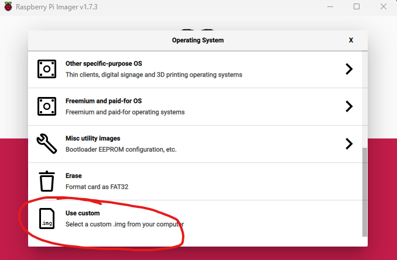
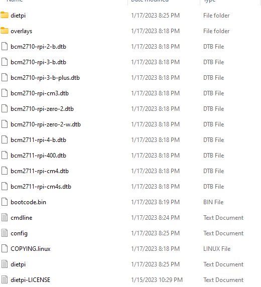

While Kubernetes doesn't require a specific operating system, the right OS can simplify post-installation tasks. For our Kubernetes setup, we'll use DietPi due to its simple setup process and available bootstrap options.

Download the DietPi ISO image for Raspberry Pi 2/3/4 **[HERE](https://dietpi.com/#downloadinfo)**.

Follow this guide to flash the ISO onto the Raspberry Pi CM4 module using your preferred OS. If your CM4 modules include an SD card, use an SD card reader.

In the Raspberry Pi Imager, instead of choosing a preset image, scroll down and choose "Use custom". Then select the downloaded DietPi image.



Continue the flashing process as detailed in our [Install OS](/docs/raspberry-pi-cm4-flashing-os) guide. However, this time, write the image directly to the CM4 storage without any modifications.

After completing the flashing process, a single partition of size 126 MB will be available. This partition is the boot disk for DietPi. If it isn't recognized immediately, try unplugging and reinserting the storage device.

The following files should be in this partition:



We're mainly interested in `dietpi.txt` and `cmdline.txt`.

## Configuring dietpi.txt

The `dietpi.txt` file enables the automated bootstrapping process of the DietPi OS. It helps to set up the network, SSH, and to install additional software. Although it can install Kubernetes automatically, we'll handle the installation manually later.

For an in-depth understanding of this file, refer **[HERE.](https://github.com/MichaIng/DietPi/blob/master/dietpi.txt)**

Edit the file and replace its content with the following code, adjusting the variables as needed:

```yaml
AUTO_SETUP_ACCEPT_LICENSE=1
AUTO_SETUP_LOCALE=C.UTF-8
AUTO_SETUP_KEYBOARD_LAYOUT=us
AUTO_SETUP_TIMEZONE=Europe/Bratislava
AUTO_SETUP_NET_ETHERNET_ENABLED=1
AUTO_SETUP_NET_WIFI_ENABLED=0
AUTO_SETUP_NET_ETH_FORCE_SPEED=0
AUTO_SETUP_NET_WIFI_COUNTRY_CODE=SK

AUTO_SETUP_NET_USESTATIC=1
AUTO_SETUP_NET_STATIC_IP=10.0.0.60
AUTO_SETUP_NET_STATIC_MASK=255.255.255.0
AUTO_SETUP_NET_STATIC_GATEWAY=10.0.0.254
AUTO_SETUP_NET_STATIC_DNS=1.1.1.1 8.8.8.8

AUTO_SETUP_DHCP_TO_STATIC=0

AUTO_SETUP_NET_HOSTNAME=cube01

AUTO_SETUP_BOOT_WAIT_FOR_NETWORK=1
AUTO_SETUP_SWAPFILE_SIZE=1
AUTO_SETUP_SWAPFILE_LOCATION=/var/swap
AUTO_SETUP_HEADLESS=1
AUTO_UNMASK_LOGIND=0
AUTO_SETUP_CUSTOM_SCRIPT_EXEC=0
AUTO_SETUP_BACKUP_RESTORE=0
AUTO_SETUP_SSH_SERVER_INDEX=-2
AUTO_SETUP_LOGGING_INDEX=-1
AUTO_SETUP_RAMLOG_MAXSIZE=50

AUTO_SETUP_WEB_SERVER_INDEX=0
AUTO_SETUP_DESKTOP_INDEX=0
AUTO_SETUP_BROWSER_INDEX=0
AUTO_SETUP_AUTOSTART_TARGET_INDEX=7
AUTO_SETUP_AUTOSTART_LOGIN_USER=root
AUTO_SETUP_GLOBAL_PASSWORD=dietpi
AUTO_SETUP_AUTOMATED=1
SURVEY_OPTED_IN=0

#OpenSSH Client
AUTO_SETUP_INSTALL_SOFTWARE_ID=0
#Samba Client
AUTO_SETUP_INSTALL_SOFTWARE_ID=1
#vim
AUTO_SETUP_INSTALL_SOFTWARE_ID=20
#RPi.GPIO
AUTO_SETUP_INSTALL_SOFTWARE_ID=69
#OpenSSH Server
AUTO_SETUP_INSTALL_SOFTWARE

_ID=105
#Python 3 pip
AUTO_SETUP_INSTALL_SOFTWARE_ID=130

CONFIG_CPU_GOVERNOR=schedutil
CONFIG_CPU_ONDEMAND_SAMPLE_RATE=25000
CONFIG_CPU_ONDEMAND_SAMPLE_DOWNFACTOR=40
CONFIG_CPU_USAGE_THROTTLE_UP=50

CONFIG_CPU_MAX_FREQ=Disabled
CONFIG_CPU_MIN_FREQ=Disabled

CONFIG_CPU_DISABLE_TURBO=0

CONFIG_PROXY_ADDRESS=MyProxyServer.com
CONFIG_PROXY_PORT=8080
CONFIG_PROXY_USERNAME=
CONFIG_PROXY_PASSWORD=

CONFIG_G_CHECK_URL_TIMEOUT=10
CONFIG_G_CHECK_URL_ATTEMPTS=5
CONFIG_CHECK_CONNECTION_IP=8.8.8.8
CONFIG_CHECK_CONNECTION_IPV6=2620:fe::fe
CONFIG_CHECK_DNS_DOMAIN=google.com

CONFIG_CHECK_DIETPI_UPDATES=1
CONFIG_CHECK_APT_UPDATES=1
CONFIG_NTP_MODE=2
CONFIG_SERIAL_CONSOLE_ENABLE=1
CONFIG_SOUNDCARD=none
CONFIG_LCDPANEL=none
CONFIG_ENABLE_IPV6=0

CONFIG_APT_RASPBIAN_MIRROR=http://raspbian.raspberrypi.org/raspbian/
CONFIG_APT_DEBIAN_MIRROR=https://deb.debian.org/debian/
CONFIG_NTP_MIRROR=debian.pool.ntp.org

#------------------------------------------------------------------------------------------------------
##### DietPi-Software settings #####
#------------------------------------------------------------------------------------------------------
SOFTWARE_DISABLE_SSH_PASSWORD_LOGINS=0

#------------------------------------------------------------------------------------------------------
##### Dev settings #####
#------------------------------------------------------------------------------------------------------
DEV_GITBRANCH=master
DEV_GITOWNER=MichaIng

#------------------------------------------------------------------------------------------------------
##### Settings, automatically added by dietpi-update #####
#------------------------------------------------------------------------------------------------------
```

Some variables require adjustment for your specific needs:

* `AUTO_SETUP_TIMEZONE` should be set to your timezone. Check the list of timezones [HERE](https://en.wikipedia.org/wiki/List_of_tz_database_time_zones).
* `AUTO_SETUP_NET_STATIC_IP`, `AUTO_SETUP_NET_STATIC_MASK`, and `AUTO_SETUP_NET_STATIC_GATEWAY` should reflect your network settings.
* `AUTO_SETUP_NET_HOSTNAME` should be a unique hostname for each node.
* `AUTO_SETUP_GLOBAL_PASSWORD` is your initial root password.

## Adjusting cmdline.txt

This file consists of a single line of text to which we'll append:

```markdown
group_enable=cpuset cgroup_enable=memory cgroup_memory=1
```

The full line might look like this:

```markdown
root=PARTUUID=a97c7839-02 rootfstype=ext4 rootwait fsck.repair=yes net.ifnames=0 logo.nologo console=serial0,115200 console=tty1 group_enable=cpuset cgroup_enable=memory cgroup_memory=1
```

Don't replace the whole line, just append the section above to ensure container software works properly.

## Booting Up

Insert an SD card into the Raspberry Pi 4, or switch to internal storage, and power up the device. It might take some time to boot up as several tasks are performed. Monitor your router for a new IP address.

Once the setup is complete, you should be able to SSH into the new IPs using the username `root` and the password you set in the `dietpi.txt` file. 

After booting up, there are a few more tweaks to make before installing K3s. SSH into the nodes, wait for the setup to complete, and then you're ready for the final touches.

## Finalizing the Setup

Log in to all 4 nodes using your preferred SSH client. Check that the OS is up-to-date with:

```markdown
apt update   
apt upgrade
```

Next, modify `/etc/hosts` on

 each node to resemble this (replace IPs with yours):

```markdown
127.0.0.1 localhost  
10.0.0.60 cube01 cube01.local  
10.0.0.61 cube02 cube02.local  
10.0.0.62 cube03 cube03.local  
10.0.0.63 cube04 cube04.local
```

This will allow us to use node names instead of IPs. Lastly, install `iptables` on all nodes:

```markdown
apt -y install iptables
```

Now, you're ready to install Kubernetes.
