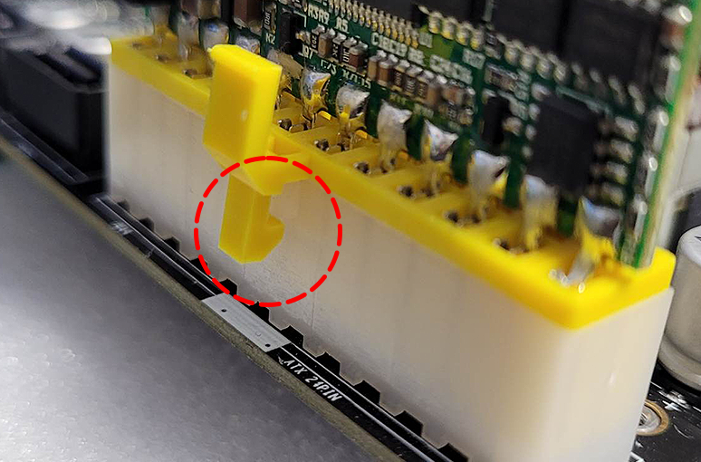

## Power

The Turing Pi 2 and Compute Modules draw power from the ATX 24 Pin socket. The [Pico PSU](https://turingpi.com/product/pico-psu/) or ATX PSU connector is designed to fit in one orientation only. Please ensure it is fully inserted and the latch on the side is engaged for a secure connection.

:::note
🔌 **Pico PSU 24-pin ATX adapter also requires 12V [external power supply](https://turingpi.com/product/power-supply/) with a 2.5-5.5mm connector**
:::

## Powering ON

Power up the 24-Pin socket by connecting a power source or turning on the ATX PSU switch. The BMC will start independently, which usually takes 10 to 20 seconds. You can watch this process on the serial console if you wish. (The first boot can take up to 2 minutes as SSH and TLS keys are being generated)
