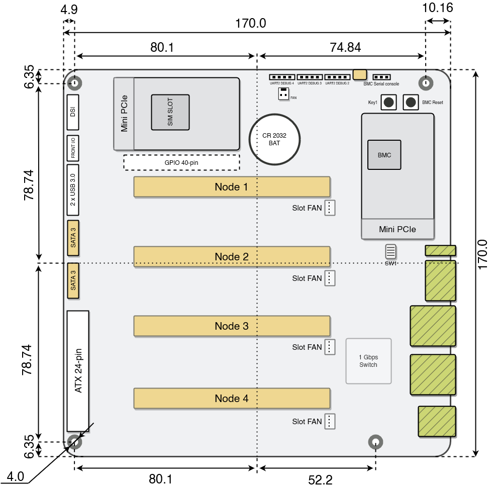
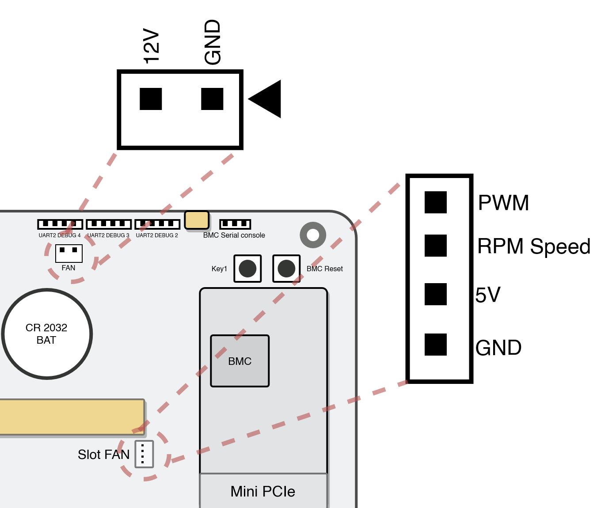

Turing Pi 2 board fits into a standard Mini ITX.

## Cooling

Although it's possible to achieve fan-less operation, we highly recommend at least one FAN in your case. All supported compute modules will work without an attached heat sink, but this is not recommended, and you will most certainly hit thermal throttling and performance issues.

If you are going to use a standard PC case or 3D printed case with fan over the compute modules, passive heat sinks should be enough.

Next to each Node1-4 slot is a Micro JST 1.25 mm 4 Pin Male Connector that can be used for individual fans for each compute module. Also on board is a 12V case fan header located near the UART ports.

