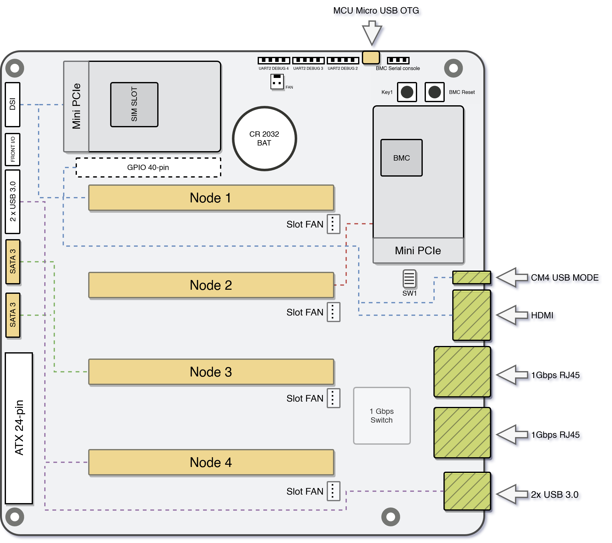
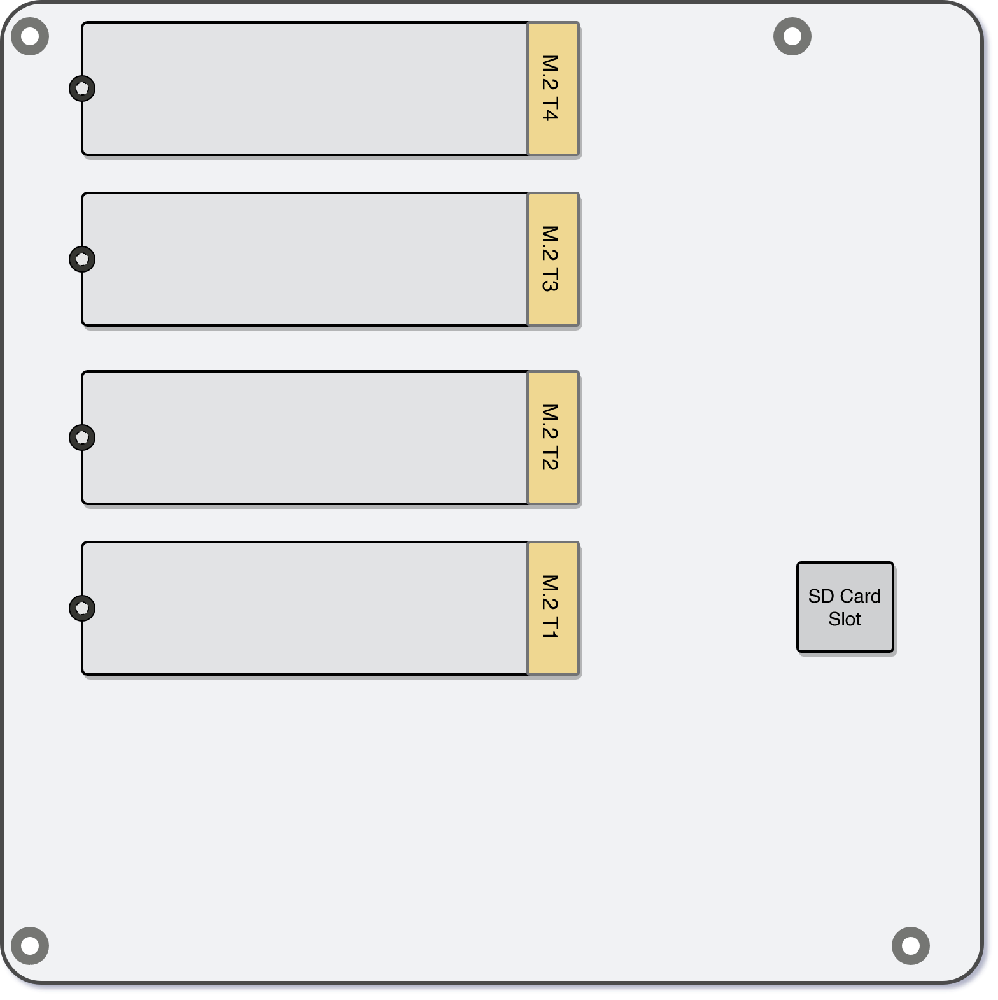
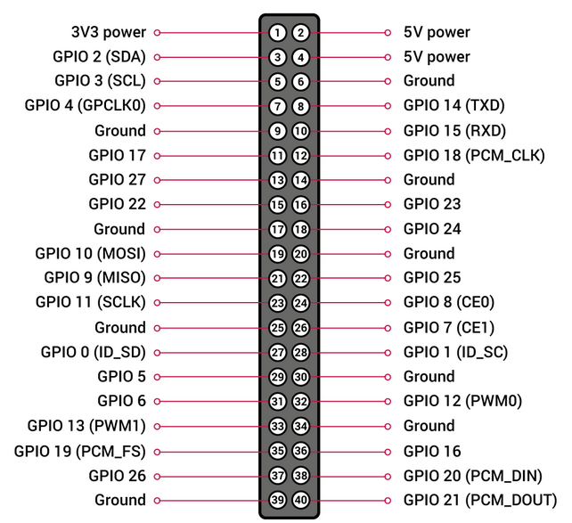
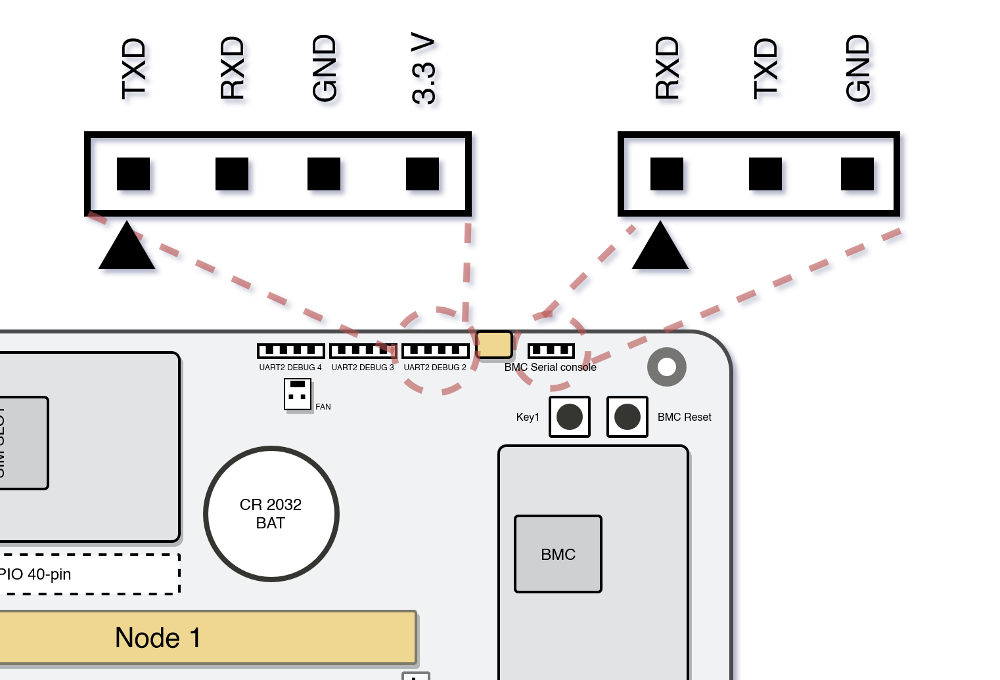
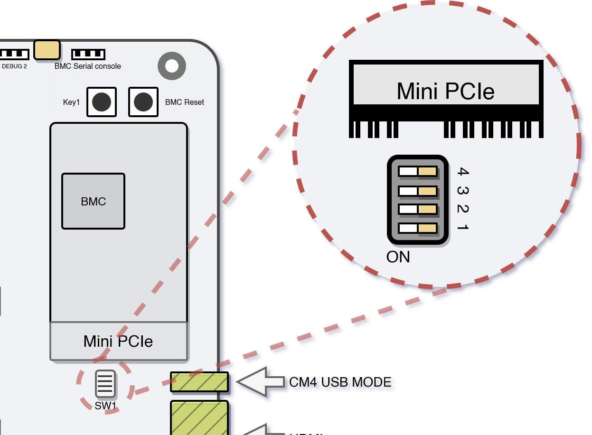
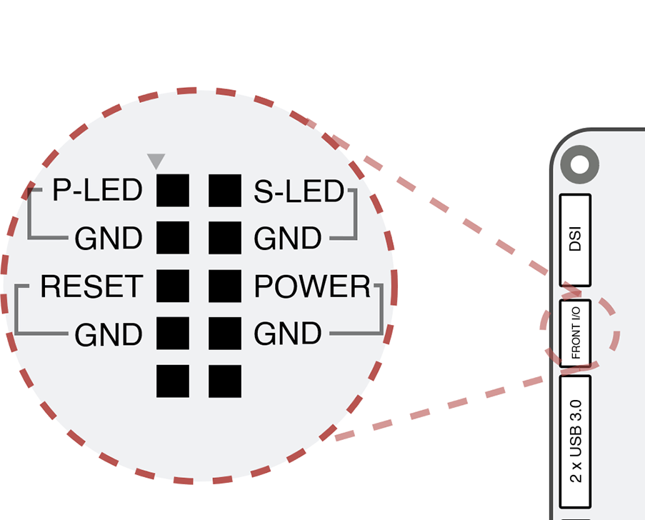
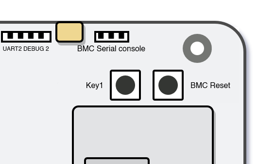

|  |  |
|---|---|
| **Form factor** | Mini ITX |
| **Dimensions** | 17 × 17 cm (6.7 × 6.7 in) |
| **Power Connectors** | Standard ATX 24 Pin socket |
| **Switch** | 1Gbps Switch (RTL8370MB-CG +) Data Rate 10 Mb/s, 100 Mb/s, 1 Gb/s Duplex Full Duplex, Half Duplex VLAN Support |
| **Storage Interfaces** | 2x SATA 3 - Standard SATA 6 connectors, up to 6Gbps per port\* 4x M.2 Slots (2260 or 2280 NVMe drives) SD Card slot - Additional storage for custom scripts/tools. Available for BMC Operating System. |
| **USB Ports** | USB 3.0 Front Panel 2 (20 pin USB header) 2x USB 3.0 CM4 USB Mode |
| **I/O Interfaces** | [Front IO](#front-io) |
| **Display Interfaces** | 1x DSI 1x HDMI |
| **Expansion Slots** | 2x Mini PCIe |
| **Ethernet Ports** | 2x 1Gbps Ethernet - In bridge mode by default |
| **Nodes slots** | 4x DDR4 - 260-pin |
| **Fan Connectors** | 4x FAN Header - Micro JST 1.25 mm 4 Pin Male Connector 1x Case FAN header - 2 Pin small Molex Fan Power Connector |
| **GPIO Interface** | GPIO 40 Pin (Standard GPIO same as on Raspberry Pi) |
| **RTC** | CR2032 (CR1220 for Turing Pi V2.4) |
| **BMC Interfaces** | BMC Micro USB - USB port for flashing BMC BMC Serial Console - serial communication port for BMC (UART @ 3.3V) |
| **Serial Ports** | [UART2](#uart) DEBU2-4 - serial communication ports attached to Node2-4. (For Node1, use UART pins in the GPIO 40pin header) 3.3V |
| **Switches and Buttons** | [SW1 ](#hdmi-circuit-switch)- HDMI circuit switch [Key1](#buttons) - Power button to turn Module1-4 on and off, [BMC Reset](#buttons) - Reset button for Baseboard Management Controller |

## Front Side

## Back Side

## Interconnections

|  |  |
|---|---|
| **Node 1** | • GPIO 40-pin • Mini PCIe with SIM card slot • HDMI • DSI • M.2 T1 (on the back) • USB 2.0 (this can be switched between all Nodes) |
| **Node 2** | • M.2 T2 (on the back) • Mini PCIe |
| **Node 3** | • M.2 T3 (on the back) • 2x SATA 3 |
| **Node 4** | • M.2 T4 (on the back) • 4x USB 3.0 |

### mPCIe, M2 (NVMe), SATA, USB ports mapping

| Vendor | Model | mPCIe | M2 (NVMe) | SATA | USB 3 | USB 2 \* |
|---|---|---|---|---|---|---|
| **Turing** | RK1 | ✔️ | ✔️(PCIe 3.0 x4) | ✔️ | ✔️ | ✔️ |
| **Raspberry Pi** | CM4 | ✔️ | ❌ | ✔️ | ✔️ | ✔️ |
| ✔️ | Orin NX Orin Nano Xavier NX TX2 NX | ✔️ | ✔️(PCIe 4.0 x4) ✔️(PCIe 3.0 x4) ✔️(PCIe 4.0 x4) ✔️(PCIe 3.0 x2) | ✔️ | ✔️ | ✔️ |
| **Nvidia Jetson** | Nano (B01) | ❌ | ✔️(PCIe 2.0 x1) | ❌ | ❌ | ✔️ |

*\*Each node can connect to the system's USB 2.0 port, but only one node can do so at any given moment.*

:::caution
Please be aware that the Raspberry Pi CM4 does not support connections via an M.2 (NVMe) port.
:::

## UART

Turing Pi 2 contains multiple UART pin outs that allow serial connection not only to BMC, but to each individual Node1-4 slot as well. All UART ports use 3.3V levels.

### Node 1

This is part of the 40 Pin GPIO, refer to the Compute Module pinout. For example, Raspberry Pi:

:::caution
Please note that there are 2 differences compared to the Raspberry Pi and the Nvidia Jetson header pinouts:

* because the debug UART is connected to the BMC, the UART header exposed through pins 8 and 10 is an additional UART in the case of the Nvidia Jetson modules and these pins are not connected in the case of the Raspberry Pi Compute Module 4
* pin 17 is connected to the GROUND instead of 3.3V - please make sure this does not conflict with your use case for the GPIO header
:::

### Node 2-4

These pins are located on the top side of the board, near HW buttons for BMC and micro USB. They are marked with "UART2 DEBUG" 2 to 4 and are only utilized by the Nvidia Jetson modules and upcoming Turing RK1 modules (Raspberry Pi Compute Module 4 does not expose the additional UART).

## BMC

BMC UART pins are also located on top of the board near the hardware buttons. Since BMC is running Linux OS, you can use this serial interface to connect to it directly.

## HDMI Circuit Switch

Since the HDMI output between Raspberry Pi and Nvidia Jetson compute modules is different, we have included a 4 pin switch to give you the option to switch between these two modes.

* Raspberry Pi: 1:ON 2:OFF 3:OFF 4:ON
* Nvidia Jetson: 1:OFF 2:ON 3:ON 4:OFF
* RK1: 1:OFF 2:OFF 3:OFF 4:OFF

## Front I/O

Front I/O pins offer similar features to standard PC motherboards with pins for:

* Power LED
* Status LED
* Power Button
* Reset Button

This allows easy integration to standard PC cases.

## Buttons

On Turing Pi 2 board are two physical buttons:

* **KEY1**
* **BMC RESET**

You can use these instead of front panel I/O pins.

### KEY1

Toggling the "Key1" button will turn all nodes on or off.

Pressing the "Key1" button when one or more modules are on will turn off all modules. But long-pressing the button will turn on the remaining nodes.

### BMC RESET

Located on the corner of the board is a push button labeled `BMC_RESET`.  Pressing this button will **hard** reset the BMC. This button is intended as a last resort in case your BMC froze or is not responding anymore. Consequently, you likely will lose any recent changes as the BMC does not have time to flush its filesystem buffers.
