There are two ways to flash the RK1 firmware - either more convenient flashing using BMC (but slower, about 90 minutes for the Ubuntu Desktop image) or by using a Linux PC or VM and the USB cable (it's similar to flashing CM4). The difference in flashing time comes from the link speeds. This article will cover both ways of flashing the firmware as well as putting the firmware on external drives.

:::note[Default login and password for the `Server` image:]
login: `ubuntu`\
password: `ubuntu`

The `Desktop` version prompts for login and password during finishing up the setup
:::

In this section:

* [Known limitations](#know-limitations)
* [Image types and download source](#image-types-and-download-source)
* [Finishing up the setup of the Desktop image](#finishing-up-the-setup-of-the-desktop-image)
* [Flashing using Turing Pi 2 BMC](#flashing-using-turing-pi-2-bmc) (more convenient)
* [Flashing using USB cable](/docs/turing-rk1-flashing-os#flashing-using-usb-cable) (faster)
* [Post-install tasks](#post-install-tasks)
* [Running off an external block device - prerequisites](#running-off-an-external-block-device---prerequisites)
* [Running off an external block device - method 1](#running-off-an-external-block-device---method-1)
* [Running off an external block device - method 2](#running-off-an-external-block-device---method-2)

 

## Know Limitations

Currently, we know of the following limitations you might encounter while using RK1 and Ubuntu on RK1

* USB ports on Jetson Carrier boards are not supported in Ubuntu images yet - run `sudo apt update` followed by `sudo apt -y upgrade` and reboot to have USB working
* DSI connector is not supported in Ubuntu builds yet - will be added later
* EDID (monitor resolution detection) does not work on the Turing Pi 2 v2.4 board correctly offering 1080p by default for all monitors - we're investigating this
* If you received your RK1 module before the official announcement (from the pool of initial 100 modules), HDMI might not work with some monitors while using a Jetson carrier board (and other Jetson-compatible carrier boards), however, HDMI will work on Turing Pi 2 board (can be fixed by adding 2 solder bridges)

 

## Image types and download source

:::note
You always find the newest firmware version on [https://firmware.turingpi.com/turing-rk1/](https://firmware.turingpi.com/turing-rk1/)
:::

There are 3 image types available for RK1:

* Ubuntu 22.04 LTS Server based on the BSP Linux 5.10
* Ubuntu 22.04 LTS Desktop based on the BSP Linux 5.10
* \[wip] Experimental Ubuntu 22.04 LTS Server based on the Mainline Kernel

The official and stable images are based on the BSP Linux 5.10. While the build is created by Joshua Riek and shared through his [GitHub repository](https://github.com/Joshua-Riek/ubuntu-rockchip), the official image source for RK1 images is [https://firmware.turingpi.com/turing-rk1/](https://firmware.turingpi.com/turing-rk1/) which may and probably will differ from the images provided by Joshua. Joshua's images will also still work, but may not contain some features or may contain them later than the official download url.

 

## Finishing up the setup of the Desktop image

Before you attempt installing the Desktop version of the image, it's good to know that once you finish flashing the Desktop image using one of the below methods, the first boot will require you to finish the setup using a keyboard, mouse, and monitor. If you do not finish the setup, SSH won't work because the hostname, the username, and the password are not set.

On Turing Pi 2 v2.4 boards you can use the `USB_OTG` port to connect a USB keyboard and mouse and the HDMI port to connect a monitor.

:::note
While the `USB_OTG` port on a Turing Pi 2 v2.4 can be connected to any node, the HDMI port is always connected to Node 1 - use Node 1 for running a Desktop image.
:::

:::note
On the Turing Pi 2 v2.5 board the `USB_OTG` function has been moved from the USB A port to a new USB C port. The USB A port is now wired only to Node 1 to support a USB keyboard and mouse. To run a Desktop, use the USB A port and the HDMI port.
:::

:::note
Most Mini PCIe USB controllers should also work with Ubuntu out of the box. We tested modules based on Renesas D720201 and D720202 chips.
:::

Connect the USB mouse, keyboard, and HDMI screen and finish the setup once the flashing is done.

 

## Flashing using Turing Pi 2 BMC

:::note
To use this feature you must [update your BMC firmware](/docs/turing-pi2-bmc-firmware-upgrade) to version 2.x
:::

Navigate to [BMC UI](/docs/turing-pi2-bmc-ui) and to the Flash Node page:

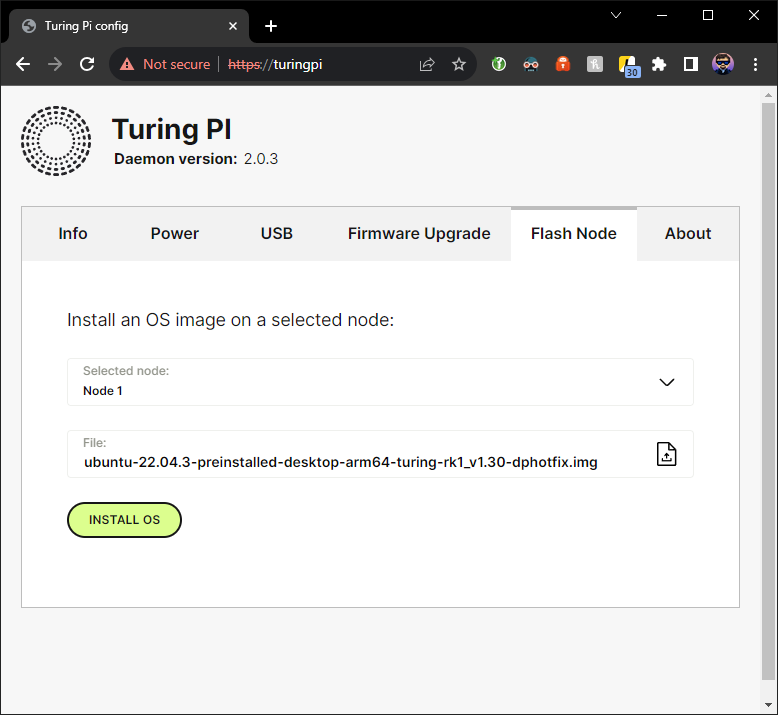

Choose the node to flash and choose the downloaded image, then proceed by clicking on "Install OS".

:::note
While flashing in Node 1 using USB cable can sometimes fail, flashing through BMC should always work
:::

Confirm that you want to flash the firmware:

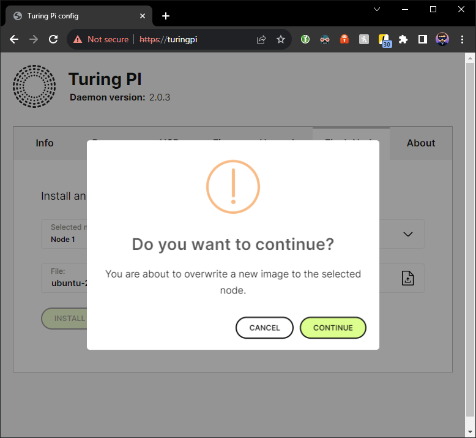

:::note
Flashing through the BMC takes about 8 minutes for each 1 GB of the image file, plus an additional minute at the end for verification. Currently, flashing the Server image will take approximately 60 minutes, and flashing of Desktop image approximately 90 minutes.
:::

:::caution
There is a known issue when the progress bar during flashing will reach 100% after approximately 2.5 minutes. This won't affect the flashing process, just the progress bar will not be updated correctly
:::

During the flashing process, the progress bar will show the current progress:

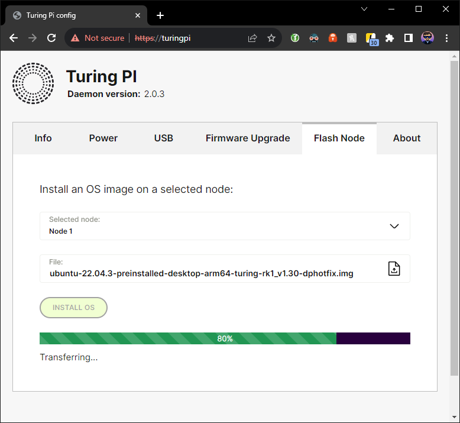

Once flashing is done, a verification will be performed to make sure that the image flashed properly (should not take more than about 10 minutes, depending on the image size):

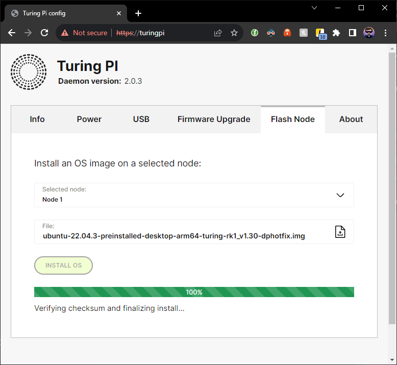

Once verification is done, a message indicating this will be shown and the module will reboot into the normal operational mode:

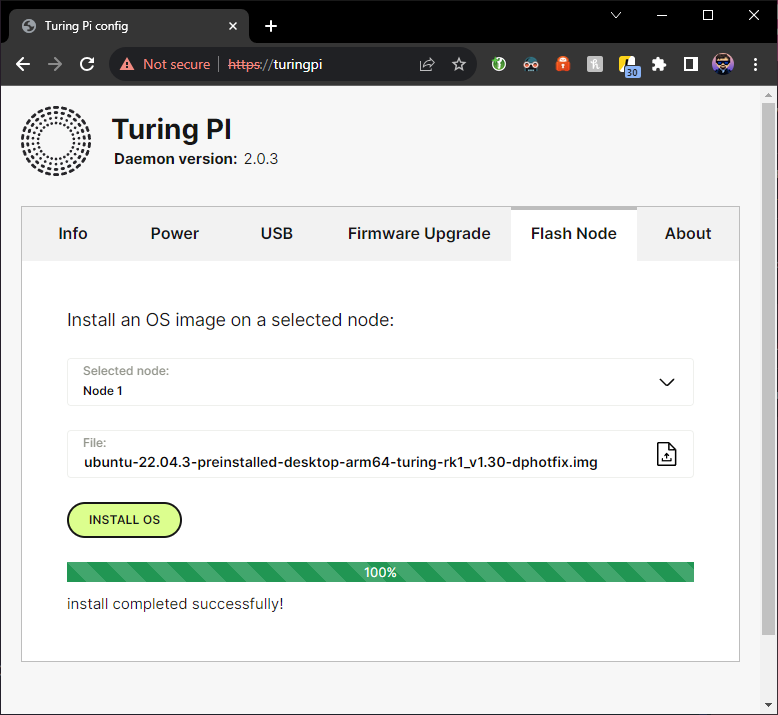

 

## Flashing using USB cable

### Preparation

To flash using a USB cable you'll need the flashing software.

Supported operating systems (please feel free propose an update when you successfully run this tool in other operating systems and provide steps to install it):

* Ubuntu 22.04:

  ```shell
  sudo apt update
  # install dependencies
  sudo apt -y install make g++ libudev-dev libusb-1.0-0-dev dh-autoreconf pkg-config libusb-1.0 git

  # clone repository
  git clone https://github.com/rockchip-linux/rkdeveloptool.git
  cd rkdeveloptool

  #hotfix a bug
  sed -i 's/snprintf(buffer, sizeof(buffer), "%s", chip);/snprintf(buffer, sizeof(buffer), "%.*s", static_cast<int>(sizeof(buffer) - 1), chip);/g' main.cpp

  # install
  aclocal
  autoreconf -i
  ./configure
  make
  sudo make install
  ```
* ...

We also tested this way of flashing with VMs using VMWare Player - you can find more about how to install and prepare VMWare Player in the related section of [Jetson module flashing](/docs/nvidia-jetson-orin-nx-vmware-player-installation-and-preparation), just install Ubuntu 22.04 LTS or another supported operating system from the list above.

Download the [OS image file](/docs/turing-rk1-flashing-os#image-types-and-download-source) and [MiniLoaderAll.bin](https://firmware.turingpi.com/misc/MiniLoaderAll.bin) file.

 

### Flashing

Connect the Turing Pi 2 board to the computer:

* Turing Pi 2 v2.4 board - using the white USB-A port on the back called `USB_OTG` with a USB A-A cable
* Turing Pi 2 v2.5 board - using the USB-C port on the back called `USB_OTG` with a USB A-C cable

:::note
To perform BMC-level operations you can either use [BMC UI](/docs/turing-pi2-bmc-ui) or [`tpi` tool](/docs/tpi-usage) (either locally or through the SSH connection to the BMC). This article will cover both ways.
:::

:::caution
Flashing using USB on the Turing Pi 2 v2.4 board might not work in Node 1 on some of the boards. If you are experiencing this issue, move the module temporarily to another node, flash, and then move back.
:::

Make sure that the node power is off, set USB mode to `Flash` for the desired node number, and power the node on. We'll use `Node 4` in this example.

BMC UI:

* Set USB mode:

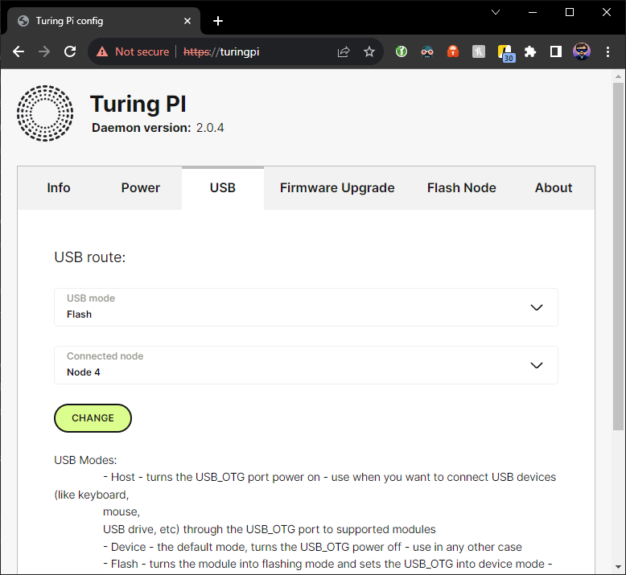

* Power on the Node:

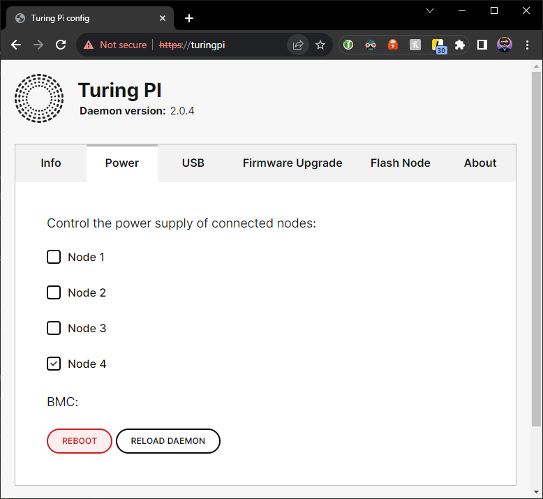

or using the `tpi` tool:

* Set USB mode:

  ```shell
  # tpi usb -n 4 flash
  ok
  ```

where the number after `-n` parameter is the node number

* Power on the node:

  ```shell
  # tpi power -n 4 on
  ok
  ```

The USB device will be exposed to the host system

:::note
If you are using VMWare Player to perform flashing, this is the moment when you may see a popup to choose what to do with the USB device - connect it to the virtual machine
:::

You can validate if the device is visible by executing on the host OS:

```shell
~$ sudo rkdeveloptool ld
DevNo=1	Vid=0x2207,Pid=0x350b,LocationID=201	Maskrom
```

If the device is visible, first upload loader:

```shell
~$ sudo rkdeveloptool db /path/to/MiniLoaderAll.bin 
Downloading bootloader succeeded.
```

:::note
If you are using VMWare Player to perform flashing, this is the second moment when you may see a popup to choose what to do with the USB device - connect it to the virtual machine (uploaded loader cause USB id to change)
:::

Then the module is ready for flashing:

```shell
~$ sudo rkdeveloptool wl 0x0 /path/to/ubuntu.img
Write LBA from file (0%)
```

:::note
Flashing this way takes about 15 minutes for the Desktop image and about 10 minutes for the Server image.
:::

Once the progress achieves 100%, the flashing is done.

Examples of the flashing process in Ubuntu 22.04:

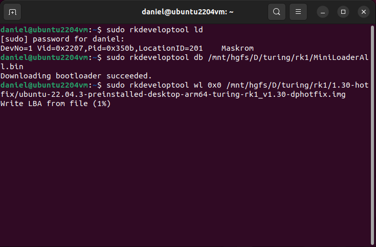

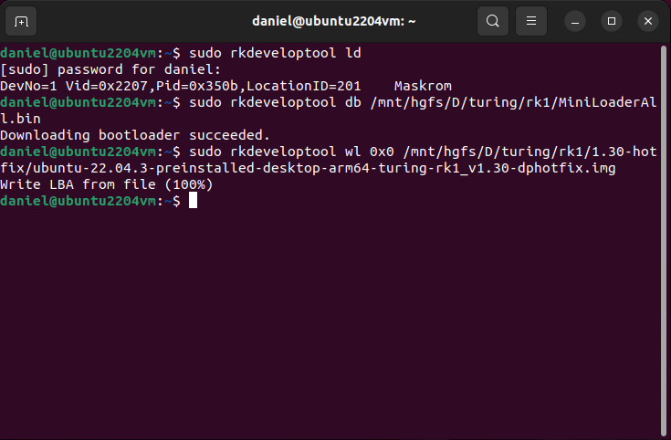

Change the USB mode back to `Device` and restart the node:

BMC UI:


`tpi` tool:

```shell
# tpi usb -n 4 device
ok
# tpi power -n 4 reset
ok
```

The module will boot and operate normally. If you flashed the Desktop image, remember to [finish the setup](#finishing-up-the-setup-of-the-desktop-image).

:::note
For the `Server` image version, the default login is `ubuntu` and the default password `ubuntu` (you'll be prompted to change password on first login). The `Desktop` version asks you to create the account during [finishing setup](#finishing-up-the-setup-of-the-desktop-image)
:::

 

## Post-install tasks

### Update the OS

This is always good to update the system after installation not only to get the latest security patches, but there may also be updates containing features and fixes that have been released between the full OS release:

```shell
sudo apt update
sudo apt -y upgrade
```

### CPU governor

Because of different performance issues, the `cpufreq` governor is set to `performacne`, which means the CPU works with the max frequency all the time. This may be the problem when you're using desktop and will look like a lag or delay, but if this is not a problem for you or you are using the server image, `ondemand` will lower the CPU temperatures and may even [raise the performance by a little bit](https://openbenchmarking.org/result/2311135-NE-UBUNTUDEF02,2311143-NE-UBUNTUOND78,2311145-NE-UBUNTUCPU51,2311148-NE-UBUNTUCPU79\&ppt=D\&oss=stockfish%2Cpovray).

To change the governor to `ondemand` run:

```shell
echo ondemand | sudo tee /sys/bus/cpu/devices/cpu*/cpufreq/scaling_governor
```

And to put it back to `performance`:

```shell
echo performance | sudo tee /sys/bus/cpu/devices/cpu*/cpufreq/scaling_governor
```

The governor will get reset on system restart. If you want to persist the change, run:

```shell
nano /usr/lib/systemd/system/cpu-governor-performance.service
```

And edit the command to contain governor of your choice, then save and exit (press `F3`, then `F2`)

 

## Running off an external block device - prerequisites

You can also run the image off an external block device:

* NVMe - supported on each node
* SATA - supported on Node 3 through the built-in SATA ports, or in Nodes 1 and 2 through PCIe to SATA controllers (ASM106x-based are proven to work)
* USB - supported on Node 4 through the built-in USB 3.0 (blue) ports, or in Nodes 1 and 2 through PCIe to SATA controllers (list of proven devices must be confirmed, but controllers based on Reneseas D720201 and D720202 chips should work)

:::caution
While you can boot off an external block device instead of included eMMC, the bootloader must still be flashed to eMMC because RK3588 SoM does not boot off devices like this and the bootloader is what handles this part of the boot process. Currently, the easiest way to put a bootloader is to flash the image onto eMMC too, but we should have "just bootloader" images for this purpose in the future
:::

The boot order:

* NVMe
* SATA
* USB
* eMMC

 

## Running off an external block device - method 1

The first method to prepare the external device is to just flash it with the image using a computer. This applies to the situation when you can connect the device to your computer first. USB devices are obvious target for this method, but if you have an easy way to connect SATA drive (through eSATA port, SATA port, SATA enclosure) or NVMe drive (NVMe USB enclosure, directly on the motherboard), you can use this method too.

On Windows, Linux and MacOS you can use Balena Etcher - select the image, select the desired disk and press `Flash`:

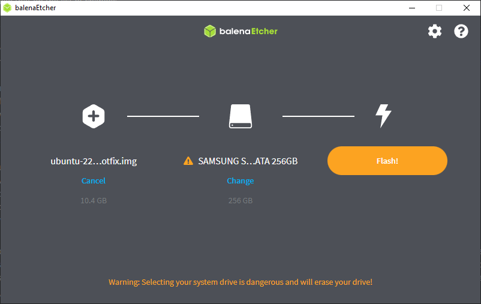

:::caution
Double check if you are choosing the right disk
:::

On Linux and MacOS you can also use `lsblk` to locate the drive and `dd` to flash the image - run `lsblk` to list the drives, connect the desired drive and run `lsblk` again to see which device appeared and remember the device name (must be disk device, not partition device), `sde` in this example:

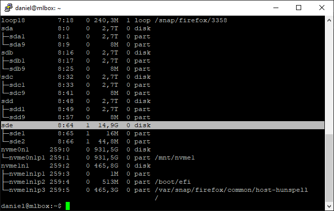

Then use `dd` to flash the image:

```shell
sudo dd if=path/to//ubuntu.img of=/dev/disk_device bs=1M
```

For example (using `sde`):

```shell
sudo dd if=ubuntu-22.04.3-preinstalled-desktop-arm64-turing-rk1_v1.30-dphotfix.img of=/dev/sde bs=1M
```

After finishing flashing remove the drive and connect it to the right connector of the Turing Pi 2 board (related to the node you want to use the drive with).

 

## Running off an external block device - method 2

If you cannot flash the block device directly, you can copy the running eMMC installation of the firmware on the external block device using the command:

```shell
sudo ubuntu-rockchip-install /dev/disk_device
```

For example, for NVMe drive:

```shell
sudo ubuntu-rockchip-install /dev/nvme0n1
```

For example SATA device:

```shell
sudo ubuntu-rockchip-install /dev/sda
```

Use `lsblk` command to examine connected drives and use the one of your choice.

This will copy the currently running Ubuntu from eMMC to the device of your choice. When the command ends - reboot, Ubuntu will start from the external block device.

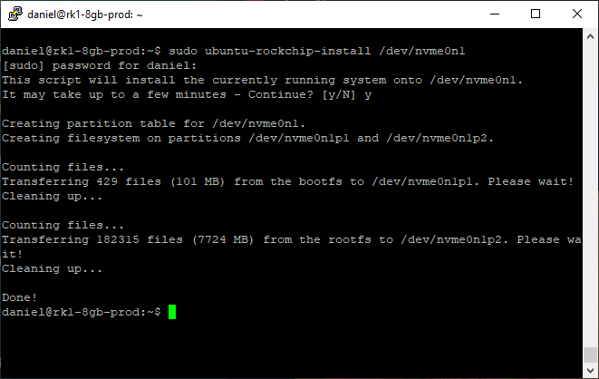
