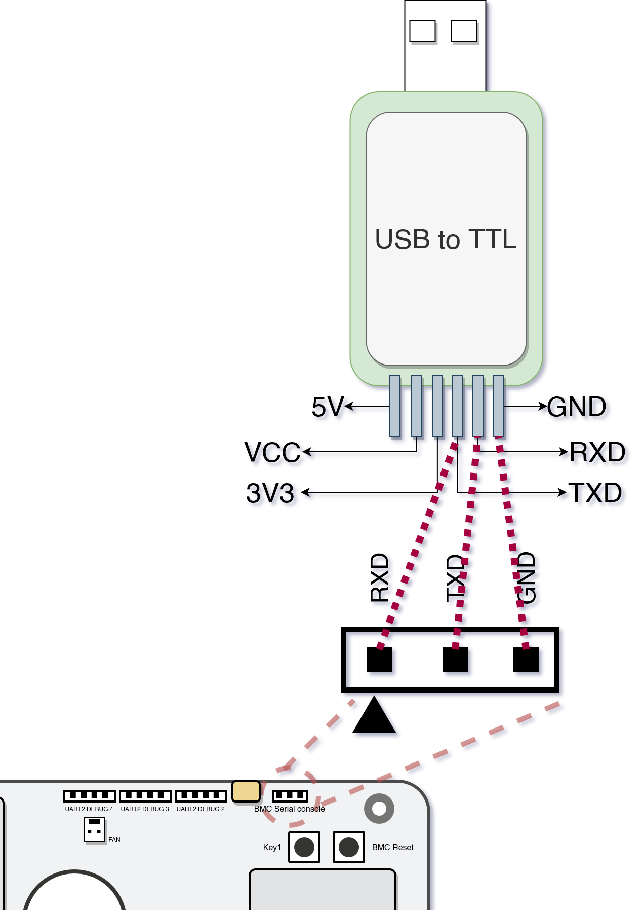
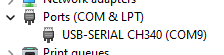
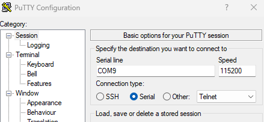

Here is a short tutorial on how to use a USB to TTL converter cable with PuTTY on Windows:

Connect the USB to TTL converter cable to your computer's USB port and to the serial port on the BMC. The exact number of pins on your USB to TTL cable can be different, but the general idea is:

* GND → GND
* TXD → RXD
* RXD → TXD

1. When plugged in, it should show as a COM port in Device Manager

2. Download and install PuTTY, a free and open-source terminal emulator, from the [official website](https://www.chiark.greenend.org.uk/~sgtatham/putty/latest.html).
3. Open PuTTY and select the Serial option under Connection Type.
4. In the Serial line field, enter the name of the serial port that the USB to TTL converter cable is connected to (e.g. "COM9")
5. In the Speed field, enter the baud rate of the serial connection: 115200

6. Click the Open button to open the connection to BMC's serial console.

7. You should now be able to view the system's boot process, kernel messages, and other debug information in the PuTTY terminal window. You might need to press the "BMC Reset" button to have it reboot and print all the messages again.

8. To access BMC's command line interface, you will need to enter the appropriate login credentials when prompted.

9. Once you are logged in, you can run Linux commands and make configuration changes as necessary.

:::note
The exact setup and configuration steps may vary depending on the device and the specific USB to TTL converter cable you are using. We recommend checking the device's documentation for more information.
:::
